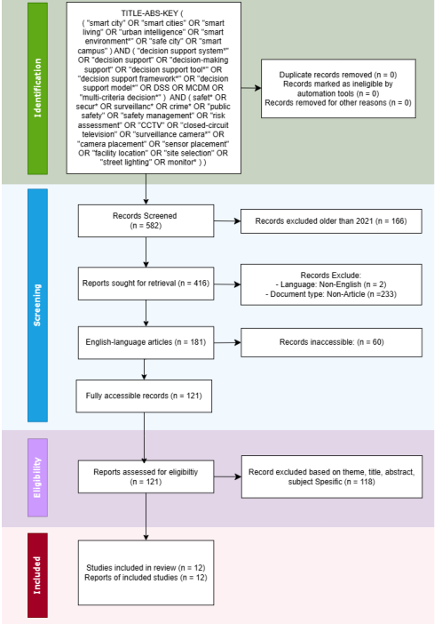
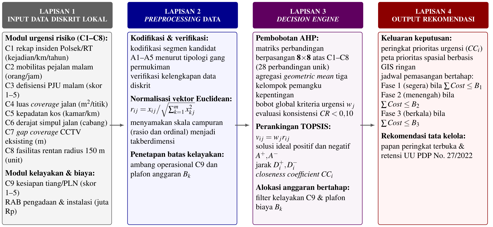

# Decision Support Systems for Urban Surveillance and Public Safety Facility Placement: A Scoping Review and Conceptual Framework for CCTV Prioritization in Jatinangor Student Settlements

**Penulis:**
1. Marvel Evan T. (140810240012@mail.unpad.ac.id)
2. Kezia Tabhita Smith (140810240020@mail.unpad.ac.id)
3. Ibnaty Farah Rabbany (140810240022@mail.unpad.ac.id)
4. Achmad Faruq M. (140810240080@mail.unpad.ac.id)
5. Gabriella Marie Keira Wibawa (140810240086@mail.unpad.ac.id)

*Program Studi Teknik Informatika, Fakultas Matematika dan Ilmu Pengetahuan Alam, Universitas Padjadjaran, Sumedang, Indonesia*

> **STATUS: diselaraskan ke sumber kebenaran tunggal `dss_revisi_markdown/dss_revisi.md`** (AHP datar 8×8; PRISMA 582→416→121→12; bobot C1 23,95%; CC A3 0,6445; sensitivitas 2/16).
> Versi ini dan `draft-paper.tex` memakai angka kanonik yang sama.

---

## RINGKASAN / ABSTRACT

**Ringkasan**—Permukiman mahasiswa di Jatinangor diwarnai oleh gang sempit, penerangan jalan yang terbatas, mobilitas malam hari yang tinggi, dan penempatan Closed-Circuit Television (CCTV) yang sporadis akibat keterbatasan anggaran belanja publik, sehingga alokasi fasilitas pengawasan memerlukan prioritisasi yang terukur. Kajian ini memetakan literatur *Decision Support System* (DSS) untuk *urban surveillance* dan *public safety facility placement* melalui pendekatan *Scoping Review* berbasis protokol PRISMA-ScR pada basis data Scopus (bidang TITLE-ABS-KEY; rentang 2021–2026; artikel jurnal primer; berbahasa Inggris), menghasilkan alur seleksi 582 rekaman teridentifikasi, 166 rekaman terbit sebelum 2021 dieksklusi pada penyaringan metadata sehingga 416 laporan dicari teks lengkapnya, 295 laporan dieksklusi pada pengambilan teks lengkap (2 non-Inggris, 233 bukan artikel jurnal primer, 60 tidak dapat diakses), 121 laporan dinilai kelayakan substantifnya, dan 12 studi primer disertakan dalam sintesis. Sintesis literatur mengidentifikasi lima pola arsitektur DSS (GIS-MCDM, optimasi *coverage*, *expert-driven*, simulasi-DSS, dan *policy-MCDA*), sebaran metode Multi-Criteria Decision Making (MCDM) dengan kombinasi rujukan AHP untuk pembobotan dan TOPSIS untuk perankingan, serta taksonomi kriteria ke dalam atribut *benefit*, *cost*, dan *context-dependent*. Berdasarkan sintesis tersebut, dirumuskan model konseptual DSS untuk Jatinangor yang mencakup alternatif segmen gang (A1–A5) berbasis tipologi spasial ilustratif, matriks delapan kriteria urgensi (C1–C8) yang dipisahkan secara tegas dari kelayakan teknis dan biaya finansial (C9 dan plafon anggaran), skema pembobotan AHP 8×8 lintas tiga kelompok pemangku kepentingan yang teruji konsisten ($CR < 0{,}10$), dan perankingan TOPSIS yang menghasilkan jadwal penempatan CCTV bertahap di bawah kendala anggaran tahunan. Keterlaksanaan prosedural model didemonstrasikan melalui simulasi numerik pilot ilustratif dan analisis sensitivitas $\pm 20\%$, menyediakan landasan konseptual yang transparan untuk mentranslasikan bukti *scoping review* ke dalam pengambilan keputusan keselamatan publik lokal.

**Kata Kunci**—Decision Support System, Multi-Criteria Decision Making, Scoping Review, PRISMA-ScR, AHP, TOPSIS, CCTV placement, Smart Living and Safety, Jatinangor.

**Abstract**—Student settlements in Jatinangor are characterized by narrow alleys, limited street lighting, high nighttime mobility, and sporadic CCTV deployment caused by budget constraints, so the allocation of surveillance facilities requires measurable prioritization. This study maps the literature on Decision Support Systems (DSS) for urban surveillance and public safety facility placement through a Scoping Review based on PRISMA-ScR in the Scopus database (TITLE-ABS-KEY; 2021–2026; article type; English), producing a selection flow of 582 records identified, 166 pre-2021 records excluded during metadata screening, 416 reports sought for retrieval, 295 reports excluded at full-text retrieval (2 non-English, 233 non-primary articles, 60 inaccessible), 121 reports assessed for full-text eligibility, and 12 primary studies included in the synthesis. The review identifies five architectural patterns of DSS (GIS-MCDM, coverage optimization, expert-driven, simulation-DSS, and policy-MCDA), a distribution of MCDM methods highlighting the prominent combination of AHP for weighting and TOPSIS for ranking, and a criteria taxonomy of benefit, cost, and context-dependent. Based on this synthesis, a conceptual DSS model is formulated for Jatinangor consisting of alley segment alternatives (A1–A5) based on spatial typologies, an eight-criteria urgency matrix (C1–C8) separated from technical and financial feasibility (C9 and budget ceiling), a full 8×8 AHP weighting scheme across three stakeholder groups ($CR < 0{,}10$), and a TOPSIS ranking that produces a phased CCTV placement schedule under budget constraints. Procedural execution is demonstrated through an illustrative numerical pilot and sensitivity analysis, providing a transparent conceptual foundation for translating scoping review evidence into local public safety decision-making.

**Keywords**—Decision Support System, Multi-Criteria Decision Making, Scoping Review, PRISMA-ScR, AHP, TOPSIS, CCTV placement, Smart Living and Safety, Jatinangor.

---

## I. PENDAHULUAN

Kawasan Kecamatan Jatinangor, Kabupaten Sumedang, merupakan kawasan pendidikan tinggi strategis seluas $26{,}20\text{ km}^2$ yang terbagi ke dalam 12 desa dengan populasi melampaui 98.000 jiwa serta kepadatan rata-rata di atas $3.740\text{ jiwa/km}^2$—bahkan melampaui $9.300\text{ jiwa/km}^2$ pada kantong permukiman mahasiswa di sekitar empat perguruan tinggi utama (Unpad, ITB, IPDN, dan IKOPIN) [[1]](#referensi). Pertumbuhan hunian padat ini tidak diimbangi kapasitas pengawasan lingkungan: gang permukiman sempit (lebar $1{,}5$–$3$ m), jangkauan Penerangan Jalan Umum (PJU) belum merata, dan mobilitas malam hari tinggi antara kampus, indekos, dan simpul layanan. Kondisi tersebut menempatkan isu keselamatan dan keamanan warga, khususnya mahasiswa, sebagai persoalan *Smart Living and Safety* yang nyata di Jatinangor.

Dari perspektif kriminologi lingkungan, intervensi pengawasan ruang publik berakar pada teori *Crime Prevention Through Environmental Design* (CPTED) [[2]](#referensi) dan *Routine Activity Theory* [[3]](#referensi). Kehadiran pengawas yang cakap (*capable guardian*) dan visibilitas lingkungan terbukti mampu menekan konvergensi antara pelaku potensial dan target yang rentan. Dalam konteks permukiman mahasiswa, timbul pertanyaan mendasar mengapa pengadaan CCTV diprioritaskan bersama atau mendampingi penerangan jalan, bukan penerangan saja. Berdasarkan prinsip CPTED, penerangan jalan dan CCTV bersifat saling melengkapi (*complementary*): penerangan memperluas pengawasan alami (*natural surveillance*), namun di kawasan indekos dengan tingkat hunian sewa yang dinamis dan perputaran orang asing yang tinggi, penerangan semata tidak memberikan efek jera forensik (*recorded deterrence*) tanpa adanya rekaman akuntabel saat insiden terjadi. Sebaliknya, CCTV berfungsi sebagai instrumen pengawas cakap buatan yang merekam bukti nyata.

Namun, penempatan Closed-Circuit Television (CCTV) di lingkungan permukiman padat menghadapi kendala nyata: keterbatasan anggaran belanja publik, ketersediaan tiang fisik, pasokan listrik, dan jaringan transmisi data. Penempatan kamera yang bersifat sporadis atau reaktif justru menghasilkan titik buta (*blind zone*), inefisiensi investasi alat, serta potensi pelanggaran privasi warga. Dalam kaitan ini, Undang-Undang Perlindungan Data Pribadi (UU PDP No. 27/2022) tidak hanya diposisikan sebagai batasan hukum, melainkan sebagai elemen desain teknis sistem: sudut pandang kamera wajib diarahkan terbatas pada koridor ruang publik (tidak menyorot pintu/jendela kamar hunian privat), dilengkapi papan informasi fisik penanda area pengawasan kamera, serta menerapkan kebijakan retensi data video maksimal 14–30 hari dengan hak akses log yang diaudit ketat. Oleh karena itu, alokasi penempatan fasilitas pengawasan memerlukan pendekatan kuantitatif yang terukur dan objektif.

*Decision Support System* (DSS) berbasis *Multi-Criteria Decision Making* (MCDM) menawarkan instrumen yang tepat untuk mengevaluasi *trade-off* antar-faktor keselamatan dan kelayakan fisik secara simultan. Dalam literatur pengambilan keputusan, *Analytic Hierarchy Process* (AHP) lazim digunakan untuk menurunkan bobot kriteria berbasis penilaian berpasangan pakar [[4]](#referensi), sedangkan *Technique for Order Preference by Similarity to Ideal Solution* (TOPSIS) digunakan untuk memeringkat alternatif berdasarkan jarak kompromi terhadap solusi ideal [[5]](#referensi).

Meskipun demikian, sebagian besar literatur penempatan fasilitas keamanan dan sensor perkotaan berfokus pada kota metropolitan dengan infrastruktur sensor kontinu dan anggaran besar. Terdapat kesenjangan penelitian (*research gap*) yang nyata mengenai bagaimana model DSS dapat dirancang secara realistis untuk permukiman padat berkendala anggaran dengan hanya memanfaatkan data diskrit lokal (data tabular, spasial statis OpenStreetMap, dan penilaian pemangku kepentingan). Makalah ini mengisi celah tersebut melalui pendekatan hibrida: melakukan *scoping review* berbasis PRISMA-ScR untuk memetakan arsitektur dan metode literatur, kemudian mentranslasikannya ke dalam rancangan model konseptual DSS penempatan CCTV di Jatinangor.

Penelitian ini dipandu oleh tiga pertanyaan penelitian:
- **RQ1 (Pemetaan Arsitektur DSS):** Bagaimana arsitektur DSS *Smart Living & Safety* dipetakan dari literatur (alur input data heterogen ke *engine* MCDM/analitik lalu output keputusan), dan pola mana yang paling *transferable* terhadap keterbatasan data Jatinangor?
- **RQ2 (Sebaran Metode & Taksonomi Kriteria MCDM):** Metode MCDM apa yang digunakan dalam DSS *Smart Living & Safety*, bagaimana skema pembobotan dan perankingannya diterapkan, serta bagaimana kriteria keputusan diklasifikasikan berdasarkan atribut *benefit* dan *cost*?
- **RQ3 (Formulasi Model Konseptual Jatinangor):** Model konseptual DSS seperti apa yang paling layak diterapkan untuk prioritisasi CCTV di permukiman mahasiswa Jatinangor, mencakup representasi segmen gang sebagai alternatif, struktur sembilan kriteria keselamatan, skema pembobotan AHP *multistakeholder* dan perankingan TOPSIS, serta elemen literatur apa yang sengaja tidak diadopsi beserta alasannya?

Kontribusi kajian ini terhadap jawaban ketiga RQ tersebut adalah:
1. **Kontribusi pertama (RQ1):** pemetaan lima pola arsitektur DSS keselamatan perkotaan beserta penanda kebutuhan datanya, sehingga teridentifikasi pola GIS-MCDM dan optimasi *coverage* sebagai arsitektur paling *transferable* untuk Jatinangor, sementara pola simulasi-DSS ditolak dengan argumen kebutuhan kalibrasi sensor yang tidak realistis di tingkat lokal.
2. **Kontribusi kedua (RQ2):** taksonomi sebaran metode MCDM (peran pembobotan subjektif/objektif, perankingan, struktural, dan evaluasi spasial) serta klasifikasi kriteria keputusan ke dalam atribut *benefit*, *cost*, dan *context-dependent* sebagai dasar konseptual model Jatinangor.
3. **Kontribusi ketiga (RQ3):** model konseptual prioritisasi CCTV berupa alternatif segmen gang A1–A5 berbasis tipologi spasial, matriks kriteria yang secara tegas memisahkan urgensi risiko (C1–C8) dari kendala kelayakan dan anggaran (C9 dan RAB), skema pembobotan AHP 8×8 lintas tiga kelompok pemangku kepentingan yang teruji konsisten ($CR < 0{,}10$), perankingan TOPSIS yang dipadukan dengan modul anggaran bertahap, serta demonstrasi komputasi numerik pilot ilustratif beserta uji sensitivitas $\pm 20\%$.

---

## II. METODOLOGI REVIU (PRISMA-ScR PROTOCOL)

Kajian ini menggunakan pendekatan *Scoping Review* dengan seleksi studi mengikuti alur *Preferred Reporting Items for Systematic Reviews and Meta-Analyses Extension for Scoping Reviews* (PRISMA-ScR) [[6]](#referensi). Protokol ditetapkan sebelum pencarian, mencakup strategi pencarian, kriteria inklusi-eksklusi, tahapan seleksi, dan ekstraksi data.

### A. Strategi Pencarian Literatur

Pencarian dilakukan pada basis data Scopus dengan sintaks *advanced search* pada bidang `TITLE-ABS-KEY`. Pembatasan pada satu basis data utama (Scopus) ditetapkan sebagai batas lingkup metodologis (*scoping boundary*) untuk menjamin bahwa seluruh studi yang teridentifikasi memiliki rekam jejak telaah sejawat (*peer-reviewed*) dan keterlacakan sitasi yang kredibel. Kata kunci disusun dari tiga blok konsep yang dihubungkan operator `AND`, sedangkan sinonim dalam setiap blok dihubungkan operator `OR`. Sintaks lengkap ditampilkan pada Tabel I untuk menjamin reproduksibilitas pencarian.

**Tabel I. SINTAKS PENCARIAN PADA BASIS DATA SCOPUS**

| Blok Konsep | Kata Kunci Pencarian |
|---|---|
| **Konteks Kawasan Cerdas** | `"smart city"` OR `"smart cities"` OR `"smart living"` OR `"urban intelligence"` OR `"smart environment*"` OR `"safe city"` OR `"smart campus"` |
| **DSS & MCDM** | `"decision support system*"` OR `"decision support"` OR `"decision-making support"` OR `"decision support tool*"` OR `"decision support framework*"` OR `"decision support model*"` OR `DSS` OR `MCDM` OR `"multi-criteria decision*"` |
| **Keselamatan & Pemantauan** | `safet*` OR `secur*` OR `surveillanc*` OR `crime*` OR `"public safety"` OR `"safety management"` OR `"risk assessment"` OR `CCTV` OR `"closed-circuit television"` OR `"surveillance camera*"` OR `"camera placement"` OR `"sensor placement"` OR `"facility location"` OR `"site selection"` OR `"street lighting"` OR `monitor*` |

Ketiga blok dihubungkan dengan operator AND sehingga setiap rekaman harus memuat minimal satu sinonim dari masing-masing blok. Protokol membatasi dokumen bertipe *Article*, berbahasa Inggris, terbit 2021–2026, dengan teks lengkap yang dapat diakses. Pencarian dieksekusi pada 28 Maret 2026 dan menghasilkan 582 rekaman awal.

### B. Kriteria Inklusi dan Eksklusi

Kriteria inklusi dan eksklusi dirumuskan sebelum penyaringan untuk meminimalkan bias seleksi. Kriteria disusun dalam enam butir (I1–I6) sebagaimana dirinci pada Tabel II.

**Tabel II. KRITERIA INKLUSI DAN EKSKLUSI STUDI**

| Kode | Kriteria Inklusi | Kriteria Eksklusi |
|---|---|---|
| **I1** | Artikel jurnal primer (*Article*), terbit 2021–2026, berbahasa Inggris. | Prosiding/bab buku, terbit sebelum 2021, atau berbahasa non-Inggris. |
| **I2** | Membahas DSS atau kerangka pengambilan keputusan dalam konteks keselamatan, keamanan, atau pemantauan urban/*smart city*. | Domain di luar keselamatan/keamanan publik perkotaan (mis. medis klinis, limbah, atau pertanian murni). |
| **I3** | Menggunakan metode MCDM/MCDA eksplisit, atau model analitik keputusan terstruktur (optimasi cakupan berbobot/simulasi risiko) dengan alur input–engine–output yang jelas. | Hanya membahas deteksi objek/*computer vision* murni, perangkat keras jaringan IoT, atau *machine learning* tanpa mekanisme alokasi/keputusan. |
| **I4** | Konteks spasial perkotaan, kampus, atau permukiman yang *transferable*. | Konteks mikro/non-urban (pertambangan, keamanan siber murni, atau internal perusahaan). |
| **I5** | Penelitian primer (*original research*) dengan studi kasus/simulasi empiris. | Artikel *review*, survei literatur sekunder, atau editorial. |
| **I6** | Naskah teks lengkap (*full-text*) dapat diakses dan bukan duplikat kasus. | Teks lengkap tidak dapat diakses (*paywall*) atau duplikasi studi kasus yang sama. |

Terkait kriteria I2, terdapat catatan khusus mengenai studi penempatan sensor grid kelistrikan oleh Yuhang et al. [[18]](#referensi). Studi ini diikutsertakan bukan untuk variabel fisik transmisi energinya, melainkan secara metodologis murni karena menyajikan formulasi matematis *backup coverage model* (BCSLP) dan pembobotan objektif EWM pada graf jaringan yang secara topologis dan matematika identik (*isomorphic*) dengan permasalahan penempatan kamera pengawas di persimpangan jalan perkotaan.

### C. Proses Seleksi Studi

Seleksi studi dilakukan mengikuti empat tahapan standar PRISMA-ScR sebagaimana divisualisasikan pada Gambar 1:
1. **Identifikasi:** Pencarian sistematis pada basis data Scopus menghasilkan 582 rekaman awal tanpa rekaman duplikat otomatis. **Penyaringan metadata** menerapkan batas tahun terbit 2021–2026 dan mengeksklusi 166 rekaman yang terbit sebelum 2021, sehingga tersisa 416 laporan yang dicari teks lengkapnya. Termasuk di dalam 166 rekaman yang gugur adalah satu studi penempatan fasilitas berbasis AHP-GIS-Fuzzy TOPSIS akhir 2020 yang secara substantif relevan namun secara disiplin digugurkan sesuai batas waktu protokol.
2. **Pengambilan Teks Lengkap (*Reports Sought for Retrieval*):** Dari 416 laporan, 295 dieksklusi karena berbahasa non-Inggris ($n=2$), bukan artikel jurnal primer ($n=233$), atau teks lengkap tidak dapat diunduh akibat batasan langganan institusi ($n=60$). Dengan demikian, diperoleh 121 artikel teks lengkap untuk penilaian kelayakan.
3. **Penilaian Kelayakan Substantif (Eligibility):** Sebanyak 121 laporan teks lengkap ditelaah secara mendalam terhadap kriteria inklusi–eksklusi. Tahap ini mengeksklusi 109 laporan dengan rincian: tidak memuat model keputusan atau hanya *computer vision*/optimasi murni tanpa MCDM ($n=63$), berada di luar domain keselamatan perkotaan ($n=28$), berfokus pada komparasi makro antar-kota tanpa alokasi lokal ($n=10$), artikel ulasan sekunder ($n=5$), serta konteks spesifik non-transferable ($n=3$).
4. **Studi Disertakan (Included):** Diperoleh tepat 12 studi primer yang memenuhi seluruh kriteria protokol untuk disertakan dalam sintesis ($121 - 109 = 12$).

Seluruh tahapan penyaringan naskah dilakukan secara independen oleh lima penelaah anggota tim penulis. Perbedaan interpretasi diselesaikan melalui diskusi konsensus yang dipimpin oleh koordinator protokol (A1). Seluruh keputusan inklusi dan eksklusi diverifikasi penuh secara manual.

*Gambar 1. Diagram alir seleksi studi berdasarkan protokol PRISMA-ScR dari 582 rekaman teridentifikasi hingga 12 studi primer disertakan (tanggal pencarian: 28 Maret 2026).*

### D. Ekstraksi dan Analisis Literatur

Studi yang disertakan di-*charting* ke dalam tabel ekstraksi dengan kolom: penulis, domain permasalahan, komponen DSS, metode MCDM, kriteria utama, dan relevansi terhadap studi kasus Jatinangor. Hasil ekstraksi menjadi dasar sintesis tematik untuk menjawab RQ1, RQ2, dan merumuskan model RQ3.

---

## III. HASIL DAN PEMBAHASAN

### A. Analisis RQ1: Pemetaan Kerangka dan Arsitektur DSS

**RQ1:** *Bagaimana arsitektur DSS Smart Living & Safety dipetakan dari literatur (alur input data heterogen ke engine MCDM/analitik lalu output keputusan), dan pola mana yang paling transferable terhadap keterbatasan data Jatinangor?*

Hasil ekstraksi data (*data charting*) terhadap 12 studi primer yang disertakan [[7]–[18]](#referensi) dirangkum pada Tabel III. Secara sebaran temporal dan geografis, seluruh studi terbit dalam rentang 2022–2026 (terkonsentrasi pada 2024–2026) dengan cakupan wilayah meliputi Tiongkok [[7], [17], [18]], Uni Emirat Arab [[10]], Korea Selatan [[11]], Lebanon/kota cerdas [[12]], Kazakhstan [[13]], Arab Saudi/Bahrain [[14]], Indonesia [[15], [16]], Jerman [[9]], dan Spanyol/Uni Eropa [[8]]. Keragaman domain mencakup keselamatan pesepeda, kampus cerdas, hunian apartemen, transportasi bahan berbahaya, pemantauan UAV, hingga ketahanan banjir komunitas.

**Tabel III. EKSTRAKSI LITERATUR (DATA CHARTING 12 STUDI INTI)**

| No. | Penulis & Sitasi | Domain Permasalahan | Komponen DSS (Input → Engine → Output) | Metode MCDM | Kriteria Utama | Relevansi Jatinangor & Pemetaan Kriteria |
|---|---|---|---|---|---|---|
| 1 | Wang et al. (2025) [[7]](#referensi) | Penempatan kamera jalan, Wuwei RRT | Input simpul jalan + model *coverage*; *engine* MWVC + *greedy*; output titik kamera optimal | Optimasi *coverage* MWVC (Non-MCDM) | *Coverage* jalan (benefit); jumlah tiang dan kamera (cost) | Jangkar argumen anggaran (tiang 62→33, kamera 196→98, coverage 100%); C4, C6, C7, C9 |
| 2 | Gonzalez-Villa et al. (2024) [[8]](#referensi) | *Counter-terrorism* dan infrastruktur kritis (S4AllCities) | Input pergerakan pejalan/kendaraan + model ancaman; *engine* prediktif-probabilistik; output evakuasi dan rute intervensi | DSS simulasi terintegrasi (Non-MCDM) | Probabilitas ancaman, *egress time*, estimasi korban | Pembanding arsitektur; pola simulasi ditolak untuk model operasional lokal karena butuh sensor dinamis |
| 3 | Feizizadeh & Omarzadeh (2025) [[9]](#referensi) | Pemetaan risiko pesepeda, Berlin | Input *crowd-sensor* + guna lahan; *engine* statistik spasial + MCDA-GIS; output peta risiko | Spatial-MCDA berbasis GIS | Volume lalu lintas, kondisi jalur, lingkungan, guna lahan, sosiodemografi | Template peta prioritas spasial gang; C1, C2, C5, C8 |
| 4 | Ahmed et al. (2022) [[10]](#referensi) | *Smart campus*, UAE | Input survei 4 kelompok pengguna; *engine* AHP antar-*stakeholder* + *utility function*; output tool keputusan investasi | AHP *multistakeholder* + *utility function* | *Smart security and safety*, navigasi kampus, *adaptive learning* | Skema AHP tiga kelompok pemangku kepentingan; bukti *safety* domain terpenting; C8, C9 |
| 5 | Choi et al. (2025) [[11]](#referensi) | Teknologi hunian padat, Korea Selatan | Input 16 teknologi + panel 22 ahli; *engine* MCDM + *expected utility* 3 skenario; output prioritas teknologi | MCDM terintegrasi + *expected utility* | *Importance* dan *utility* per domain; *smart safety* teratas | Legitimasi fokus *safety* di permukiman padat; C5, C8 |
| 6 | Kanj et al. (2024) [[12]](#referensi) | Rute barang berbahaya, *smart city* | Input data *cloud* + cost/duration/risk; *engine* Fuzzy AHP + Fuzzy TOPSIS; output rute teraman | Fuzzy AHP (bobot) + Fuzzy TOPSIS (ranking) | Cost, duration, risk | Justifikasi inti rujukan kombinasi AHP-TOPSIS; C1, C9 |
| 7 | Kabashkin et al. (2025) [[13]](#referensi) | Monitoring lalu lintas UAV, Astana | Input video 30 titik kritis; *engine* simulasi + kerangka MCDM; output evaluasi 6 skenario | MCDM evaluasi skenario berbasis simulasi | Flow, kecepatan, delay, kriteria skenario | Sampling titik kritis menjadi logika segmen gang; UAV diganti observasi manual; C2 |
| 8 | Baddour et al. (2026) [[14]](#referensi) | Perencanaan *diplomatic quarter* | Input dataset urban publik; *engine* BWM + CoCoSo dengan komparasi AHP/TOPSIS/VIKOR; output ranking skenario | BWM (bobot) + CoCoSo (ranking); komparasi empiris | Security, accessibility, infrastructure, sustainability, resilience | Komparasi metode; alasan memilih AHP-TOPSIS (selisih kecil, lebih sederhana diaudit); C1, C3, C8, C9 |
| 9 | Almassawa et al. (2024) [[15]](#referensi) | Kebijakan *smart mobility*, South Tangerang | Input indikator availability/security/comfort; *engine* PROMETHEE; output strategi kebijakan | PROMETHEE | Availability, security, comfort | Variasi metode; konteks wilayah urban Indonesia; C1, C2 |
| 10 | Shiddiqy et al. (2025) [[16]](#referensi) | Arsitektur pertahanan IKN, Indonesia | Input dokumen kebijakan sekunder; *engine* SWOT + AHP; output prioritas komponen pertahanan | SWOT + AHP | C4ISR, AI-surveillance, keamanan infrastruktur, kolaborasi | Bukti AHP dari data sekunder; bobot surveilans pengawasan sangat tinggi; C4, C7 |
| 11 | Zheng et al. (2025) [[17]](#referensi) | Risiko banjir komunitas, Guangzhou | Input faktor alam-sosial + IoT + ArcGIS; *engine* DEMATEL-ISM + Bayesian Network; output risiko & evaluasi intervensi | DEMATEL-ISM + Bayesian Network | Faktor alam dan sosial; kapasitas drainase | Logika intervensi terukur; rantai input data lingkungan; C3, C9 |
| 12 | Yuhang et al. (2025) [[18]](#referensi) | Penempatan sensor grid, Guangzhou | Input proximity + kepadatan penduduk (EWM); *engine* BCSLP + *genetic algorithm*; output strategi *balanced* | EWM (bobot objektif) + optimasi *coverage* | Primary coverage, backup coverage, risiko, biaya | EWM sebagai validasi silang bobot data; logika coverage berulang; C4, C5, C7, C9 |

Berdasarkan Tabel III, arsitektur DSS pada literatur dikelompokkan menjadi lima pola utama: (1) GIS-MCDM dan evaluasi spasial [[9], [13], [17]], (2) optimasi *coverage* [[7], [18]], (3) *expert-driven* [[10], [11], [14]], (4) simulasi-DSS operasional [[8]], dan (5) *policy-MCDA* [[15], [16]]. Distribusi kelima pola diilustrasikan pada Gambar 2.

*Gambar 2. Taksonomi lima pola arsitektur DSS pada korpus literatur dan status adopsinya pada model Jatinangor (empat pola diadopsi, satu pola simulasi ditolak).*

Gambar 2 memperlihatkan bahwa empat dari lima pola diadopsi untuk model Jatinangor, sedangkan pola simulasi-DSS operasional [[8]] ditolak karena menuntut kalibrasi sensor dinamis berbiaya tinggi. Pola GIS-MCDM, optimasi *coverage*, dan *expert-driven* dapat berjalan di atas data tabular dan spasial statis sehingga paling *transferable* untuk permukiman berkendala anggaran.

**Jawaban RQ1:** Arsitektur DSS keselamatan perkotaan terpetakan ke lima pola arsitektur. Pola paling *transferable* untuk keterbatasan data Jatinangor adalah kombinasi GIS-MCDM, optimasi *coverage*, dan *expert-driven*. **Celah yang teridentifikasi:** mayoritas studi mengevaluasi arsitektur pada lingkungan perkotaan berdata lengkap (sensor kontinu/citra berbiaya), sedangkan penempatan fasilitas pengawasan pada permukiman padat berkendala anggaran dengan data diskrit belum pernah dirancang sebagai satu model utuh.

---

### B. Analisis RQ2: Sebaran Metode MCDM dan Taksonomi Kriteria

**RQ2:** *Metode MCDM apa yang digunakan dalam DSS Smart Living & Safety, bagaimana skema pembobotan dan perankingannya diterapkan, serta bagaimana kriteria keputusan diklasifikasikan berdasarkan atribut benefit dan cost?*

Metode MCDM yang muncul pada 12 studi inti dikelompokkan berdasarkan perannya dalam siklus pengambilan keputusan pada Tabel IV. Sepuluh studi menggunakan kerangka berbasis MCDM/MCDA, dengan AHP/Fuzzy AHP sebagai metode pembobotan primer terbanyak [[10], [12], [16]] dan Spatial-MCDA pada 3 studi [[9], [11], [13]]. Kombinasi AHP untuk pembobotan dan TOPSIS untuk perankingan merupakan pasangan rujukan yang secara transparan teruji bekerja bersama pada korpus [[12]] serta diperkuat oleh bukti komparasi empiris [[14]].

**Tabel IV. SEBARAN PERAN, FREKUENSI PEMAKAIAN PRIMER, DAN KARAKTERISTIK METODE MCDM**

| Peran dalam DSS | Metode yang Ditemukan | Frek. Primer | Kelebihan Utama | Keterbatasan | Perlakuan di Model Jatinangor |
|---|---|---|---|---|---|
| **Pembobotan subjektif (pakar)** | AHP / Fuzzy AHP [[10], [12], [16]] | 3 studi | Menangani penilaian multipakar; rasio konsistensi (CR) teraudit | Subjektif; jumlah pasang kuadratik | **Diadopsi** untuk bobot kriteria urgensi C1–C8 |
| | BWM [[14]] | 1 studi | Jumlah perbandingan berpasangan lebih hemat | Membutuhkan penentuan kriteria terbaik/terburuk awal | Tidak diadopsi (selisih empiris kecil terhadap AHP [[14]]) |
| **Pembobotan objektif (data)** | Entropy Weight Method (EWM) [[18]] | 1 studi | Objektif murni dari dispersi data numerik | Bergantung penuh pada kelengkapan data lapangan | **Diadopsi** sebagai instrumen validasi silang |
| **Perankingan alternatif** | TOPSIS / Fuzzy TOPSIS [[12]] | 1 studi | Komputasi ringkas; konsep kompromi jarak solusi ideal intuitif | Memerlukan bobot eksternal dan normalisasi skala | **Diadopsi** untuk perankingan segmen A1–A5 |
| | CoCoSo [[14]] | 1 studi | Menggabungkan model kompromi aditif dan multiplikatif | Formulasi lebih kompleks bagi pemangku kepentingan lokal | Tidak diadopsi |
| | PROMETHEE [[15]] | 1 studi | Mengakomodasi variasi fungsi preferensi per kriteria | Penentuan parameter ambang preferensi cukup rumit | Tidak diadopsi |
| **Pemodelan struktural / kausal** | DEMATEL-ISM + Bayesian Network [[17]] | 1 studi | Memetakan kausalitas antar-faktor dan probabilitas intervensi | Fokus pada relasi faktor, bukan perankingan alternatif lokasi | Tidak diadopsi |
| **Evaluasi spasial / skenario** | Spatial-MCDA GIS [[9]]; Multi-skenario [[11], [13]] | 3 studi | Integrasi langsung dengan visualisasi spasial peta risiko | Sensitif terhadap resolusi data spasial | **Diadopsi** untuk visualisasi peta prioritas segmen |
| **Analitik non-MCDM (pembanding)** | Optimasi MWVC [[7]]; Simulasi-DSS [[8]] | 2 studi | Efisiensi cakupan graf jalan [[7]]; respons evakuasi *real-time* [[8]] | Simulasi [[8]] menuntut sensor berbiaya tinggi | Logika cakupan [[7]] diserap ke C4/C6/C7; simulasi [[8]] ditolak |

Selanjutnya, kriteria keputusan diklasifikasikan ke dalam tiga kelompok: *benefit*, *cost*, dan *context-dependent* (Tabel V).

**Tabel V. TAKSONOMI KRITERIA KEPUTUSAN**

| Kelompok | Orientasi Preferensi | Contoh Kriteria dari Literatur Sumber | Perlakuan di Model Jatinangor |
|---|---|---|---|
| **Benefit** | Semakin tinggi nilainya semakin diprioritaskan | Volume mobilitas [[9]]; cakupan pengawasan [[7], [18]]; keamanan dan aksesibilitas [[14]]; kepadatan [[18]] | Seluruh kriteria urgensi C1–C8 diarahkan sebagai *benefit* terhadap urgensi (skor tinggi = makin mendesak) |
| **Cost** | Semakin rendah nilainya semakin dikehendaki | Jumlah perangkat [[7]]; risiko kecelakaan [[13]]; biaya implementasi [[14]]; latency jaringan [[18]] | Biaya instalasi dan RAB dipisahkan sebagai batas anggaran (*budget ceiling constraint*) |
| **Context-dependent** | Arah preferensi bergantung pada formulasi tujuan model | Parameter arus lalu lintas & delay [[13]]; faktor hidrologis lingkungan [[17]] | Tidak dipaksa biner; disesuaikan dengan konteks keputusan spesifik |

Taksonomi ini memastikan bahwa sifat kriteria didefinisikan terhadap tujuan keputusan model, bukan nama variabel. Kriteria C9 (kelayakan teknis) dan estimasi biaya (RAB) dipisahkan dari skor urgensi agar tidak mengaburkan penilaian risiko murni.

**Jawaban RQ2:** Metode MCDM terbagi ke dalam empat peran fungsional; pola kombinasi AHP (pembobotan) dan TOPSIS (perankingan) merupakan konfigurasi paling teruji dan transparan untuk diadopsi. Kriteria terbagi ke dalam *benefit*, *cost*, dan *context-dependent*. **Celah yang teridentifikasi:** (a) perbandingan antara bobot subjektif pakar dan bobot objektif data lapangan jarang dieksplorasi bersama, (b) metode SAW dan WP minim bukti pada domain penempatan fasilitas modern, dan (c) pencampuran kriteria biaya ke dalam skor urgensi kerap mengacaukan analisis manfaat-biaya.

---

### C. Sintesis RQ1 dan RQ2

Temuan analisis RQ1 dan RQ2 dirangkum ke dalam sepuluh dimensi keputusan pada Tabel VI sebagai jembatan langsung menuju perancangan model pada Seksi IV.

**Tabel VI. SINTESIS TEMUAN LITERATUR DAN IMPLIKASINYA BAGI MODEL JATINANGOR**

| Aspek | Temuan Literatur (12 Studi Inti) | Implikasi bagi Model Jatinangor |
|---|---|---|
| **Arsitektur** | Lima pola; dominasi sistem *hybrid*; variasi kebutuhan data tajam | Diadopsi kombinasi modular: GIS-MCDM + optimasi *coverage* + *expert-driven* |
| **Kebutuhan Input** | Data spasial, observasi lapangan, survei pakar, data tabular, sensor | Cukup memanfaatkan data diskrit lokal: survei, OpenStreetMap, rekap insiden, dan RAB |
| **Decision Engine** | MCDM, optimasi graf, fuzzy logic, Bayesian, simulasi operasional | MCDM transparan dipilih agar dapat diaudit langsung oleh pemangku kepentingan lokal |
| **Skema Pembobotan** | Didominasi penilaian pakar (AHP, BWM) dan metode objektif (EWM) | AHP 8×8 lintas tiga kelompok pemangku kepentingan |
| **Skema Perankingan** | TOPSIS, CoCoSo, PROMETHEE | TOPSIS diadopsi karena formulasi matematis ringkas dan pasangan rujukan teruji [[12]] |
| **Atribut Benefit** | Cakupan wilayah, volume aktivitas, kerawanan, kepadatan hunian | Menjadi orientasi preferensi seluruh kriteria urgensi C1–C8 |
| **Atribut Cost** | Anggaran pengadaan, jumlah perangkat, kendala teknis | Kendala anggaran (RAB) dan filter batas kelayakan teknis C9 |
| **Context-dependent** | Bergantung formulasi matematis masing-masing model | Kriteria diformulasikan searah urgensi tanpa dipaksa biner |
| **Format Output** | Peta risiko, skor komparatif, matriks peringkat alternatif | Peta prioritas segmen gang + skema alokasi pemasangan bertahap (Fase 1, 2, 3) |
| **Transferability** | Sangat ditentukan oleh ketersediaan infrastruktur data | Diuji pada tiga dimensi: kebutuhan data, kompleksitas komputasi, dan kepraktisan output |

---

## IV. PERANCANGAN MODEL KONSEPTUAL DSS JATINANGOR (JAWABAN RQ3)

**RQ3:** *Model konseptual DSS seperti apa yang paling layak diterapkan untuk prioritisasi CCTV di permukiman mahasiswa Jatinangor, mencakup representasi segmen gang sebagai alternatif, struktur sembilan kriteria keselamatan, skema pembobotan AHP multistakeholder dan perankingan TOPSIS, serta elemen literatur apa yang sengaja tidak diadopsi beserta alasannya?*

### A. Profil Lokasi dan Perumusan Alternatif (A1–A5)

Kecamatan Jatinangor memiliki luas $26{,}20\text{ km}^2$ dengan lebih dari 98.000 penduduk tetap dan puluhan ribu mahasiswa komuter maupun penghuni indekos yang terkonsentrasi di koridor Desa Sayang, Cikeruh, Hegarmanah, Cipacing, dan Cileles [[1]](#referensi). Kepadatan penduduk di desa-desa lingkar kampus mencapai rata-rata $3.740\text{ jiwa/km}^2$ hingga melampaui $9.300\text{ jiwa/km}^2$ [[1]](#referensi), memicu tumbuhnya lorong permukiman padat indekos yang minim penerangan jalan dan pengawasan kamera.

Unit keputusan yang paling tepat adalah segmen jalan atau gang yang menjadi kandidat penempatan satu titik kamera pengawas. Lima alternatif segmen dirumuskan sebagai **tipologi spasial ilustratif** yang merefleksikan variasi karakteristik lingkungan permukiman mahasiswa Jatinangor (Tabel VII).

**Tabel VII. ALTERNATIF SEGMEN LOKASI PRIORITAS (A1–A5)**

| Kode | Nama Segmen | Karakteristik Lingkungan | Tipologi Spasial Ilustratif |
|---|---|---|---|
| **A1** | Gang Kos Sayang | Gang residensial sempit padat indekos | Konsentrasi indekos tinggi; akses lorong buntu; minim PJU; rawan pencurian |
| **A2** | Ruas Jalan Cikeruh | Koridor jalan aktif dekat gerbang kampus | Jalur mobilitas pejalan kaki dan motor mahasiswa malam hari |
| **A3** | Persimpangan Hegarmanah | Simpul jalan multi-cabang (pertemuan 5 akses) | Titik temu sirkulasi utama; konsentrasi gerai ATM, minimarket, dan halte |
| **A4** | Gang Cipacing | Gang residensial panjang berkontur liku | Defisiensi penerangan parah (gelap malam hari); gap ke kamera aktif jauh |
| **A5** | Ruas Jalan Cileles | Ruas jalan sekunder lingkar timur kampus | Jalur perlintasan alternatif; penerangan seadanya; kepadatan hunian moderat |

Perumusan tipologi pada Tabel VII berakar pada abstraksi kondisi spasial tipikal Jatinangor, sedangkan rujukan [[7], [9]] digunakan murni sebagai dasar metodologis pemodelan segmen graf jalan. Model ini dirancang memiliki skalabilitas penuh untuk diperluas ke puluhan hingga ratusan segmen gang di seluruh Jatinangor tanpa mengubah struktur kriteria keputusan.

### B. Matriks Kriteria Keselamatan C1–C9

Untuk menyelesaikan kerancuan antara aspek urgensi risiko dan aspek kelayakan fisik, model membagi kriteria ke dalam dua modul fungsi:
1. **Kriteria Urgensi Risiko (C1–C8):** Seluruhnya berorientasi manfaat terhadap urgensi (*benefit-oriented toward urgency*); nilai yang lebih tinggi menandakan kebutuhan pengawasan yang semakin mendesak, dan diproses langsung di dalam mesin perankingan TOPSIS.
2. **Kriteria Kelayakan Teknis (C9) dan Biaya Finansial (RAB):** C9 (kesiapan fisik tiang, pasokan listrik, dan sinyal internet) bersama estimasi biaya pengadaan/instalasi dipisahkan dari perankingan urgensi. C9 berfungsi sebagai filter batas kelayakan teknis ($C9 \ge \theta_{\text{min}}$, dengan $\theta_{\text{min}} = 3$ mengindikasikan ketersediaan akses daya dan tiang minimum), sedangkan RAB berfungsi sebagai kendala anggaran belanja tahunan (*budget ceiling constraint*) untuk membagi urutan prioritas ke dalam fase-fase pemasangan bertahap.

Terkait arah kriteria efisiensi cakupan (C4), luas area jalan yang terjangkau pandang kamera ($\text{m}^2$/titik) dirumuskan searah urgensi (*benefit*): pada lingkungan dengan keterbatasan anggaran alat, penempatan kamera pada lokasi yang mampu mengawasi bidang ruang publik lebih luas memberikan utilitas efisiensi pengawasan per unit investasi yang lebih besar. Potensi korelasi antar-kriteria (misalnya C4 cakupan dengan C6 simpul dan C7 gap; atau C2 mobilitas dengan C5 kepadatan kos dan C8 fasilitas rentan) tidak dimodelkan secara eksplisit; pembobotan AHP 8×8 menilai setiap pasangan kriteria secara langsung, dan korelasi residu dicatat sebagai keterbatasan serta peluang ANP/DEMATEL pada riset lanjutan.

Tabel VIII merangkum struktur kriteria keselamatan, definisi operasional, skala, sumber data, dan rujukan studi pendukung.

**Tabel VIII. MATRIKS STRUKTUR, SKALA PENGUKURAN, SUMBER DATA, DAN FREKUENSI DUKUNGAN KRITERIA KESELAMATAN (C1–C9)**

| Kode | Kriteria | Definisi Operasional (Arah Preferensi) | Satuan | Skala | Sumber Data (Utama / Fallback) | Frek. | Rujukan Literatur Inti |
|---|---|---|---|---|---|:---:|---|
| **C1** | Riwayat kerawanan segmen | Frekuensi insiden kriminalitas/kecelakaan per km per tahun (Benefit thd Urgensi) | kejadian/km/th | Rasio | Rekap Polsek / wawancara Ketua RT | 4 | [[9], [12], [14], [15]] |
| **C2** | Volume mobilitas malam | Rata-rata orang & motor melintas pukul 18.00–24.00 (Benefit thd Urgensi) | orang/jam | Rasio | *Counting* manual malam / CCTV eksisting | 3 | [[9], [13], [15]] |
| **C3** | Defisiensi penerangan | Tingkat kekurangan cahaya PJU malam hari (Benefit thd Urgensi: makin gelap makin butuh) | skor 1–5 | Ordinal | Survei lux/visibilitas / data Dishub | 2 | [[14], [17]] |
| **C4** | Efisiensi *coverage* | Estimasi luas area pandang terawasi per titik kamera (Benefit thd Urgensi) | $\text{m}^2$/titik | Rasio | Geometri OpenStreetMap + uji lapangan | 3 | [[7], [16], [18]] |
| **C5** | Kepadatan penghuni | Estimasi jumlah kamar indekos aktif per km segmen (Benefit thd Urgensi) | kamar/km | Rasio | Pendataan indekos / profil desa [[1]](#referensi) | 3 | [[9], [11], [18]] |
| **C6** | Derajat simpul jalan | Jumlah cabang persimpangan yang bertemu pada segmen (Benefit thd Urgensi) | cabang | Rasio | Ekstraksi simpul graf OpenStreetMap | 1 | [[7]] |
| **C7** | *Coverage gap* CCTV | Jarak terdekat dari titik tengah ke CCTV aktif terdekat (Benefit thd Urgensi) | meter | Rasio | Pemetaan koordinat GPS kamera eksisting | 3 | [[7], [16], [18]] |
| **C8** | Kedekatan fasilitas rentan | Jumlah POI rawan (indekos, ATM, warung, halte) radius 150 m (Benefit thd Urgensi) | unit POI | Rasio | Observasi lapangan + OpenStreetMap POI | 4 | [[9], [10], [11], [14]] |
| **C9** | Kelayakan implementasi | Kesiapan fisik tiang, pasokan listrik PLN, dan sinyal internet (Kelayakan Teknis) | skor 1–5 | Ordinal | Survei teknis lapangan + RAB | 6 | [[7], [10], [12], [14], [17], [18]] |

Validasi literatur membuktikan bahwa delapan dari sembilan kriteria didukung minimal dua studi primer: C9 didukung 6 studi; C1 dan C8 didukung 4 studi; C2, C4, C5, dan C7 didukung 3 studi; serta C3 didukung 2 studi. Hanya C6 (derajat simpul jalan) yang bersumber tunggal dari model *vertex cover* [[7]] dan dicatat apa adanya secara transparan.

Perlu digarisbawahi bahwa frekuensi kemunculan dalam literatur tidak mencerminkan tingkat kepentingan di lapangan Jatinangor. Kriteria defisiensi penerangan (C3) hanya muncul pada dua studi literatur [[14], [17]], namun di permukiman Jatinangor merupakan faktor pemicu kerawanan yang paling mendesak. Oleh sebab itu, bobot prioritas tidak diturunkan dari frekuensi literatur, melainkan ditentukan melalui pembobotan konsensus pakar via AHP 8×8.

### C. Skema Pembobotan AHP dan Perankingan TOPSIS

#### 1. Pembobotan AHP Multistakeholder 8×8

Skema pembobotan mengadopsi model konsensus lintas pemangku kepentingan [[10]]:
- **Responden Tiga Kelompok:** (a) Pemerintah Daerah (Kecamatan Jatinangor, Satpol PP, Dishub Sumedang), (b) Pengelola Kampus (Direktorat Keamanan / Sarpras PTN Jatinangor), dan (c) Komunitas Warga (Ketua RT/RW dan paguyuban pemilik indekos).
- **Matriks Perbandingan 8×8:** Delapan kriteria urgensi (C1–C8) dibandingkan berpasangan pada skala Saaty 1–9, menghasilkan 28 perbandingan unik. Setiap kelompok responden mengisi matriks penuh, diuji konsistensinya, lalu diagregasi. Beban 28 perbandingan dikelola melalui pengisian segitiga atas dan sifat resiprokal.
- **Agregasi Rata-Rata Geometrik:** Penilaian antarkelompok diagregasi menggunakan rata-rata geometrik (*geometric mean*):
  $$a_{jk} = \left( \prod_{p=1}^P a_{jk}^{(p)} \right)^{1/P}$$
  dengan $P$ adalah jumlah responden pemangku kepentingan.
- **Bobot Global dan Evaluasi Konsistensi:** Bobot global kriteria urgensi $w_j$ diturunkan dari eigenvektor utama matriks agregat 8×8 ($\sum_{j=1}^8 w_j = 1$). Konsistensi dievaluasi melalui Indeks Konsistensi (CI) dan Rasio Konsistensi (CR):
  $$\text{CI} = \frac{\lambda_{\max} - n}{n - 1}, \quad \text{CR} = \frac{\text{CI}}{\text{RI}}$$
  dengan $n = 8$ dan Random Index $\text{RI} = 1{,}41$ [[4]](#referensi). Matriks dinyatakan konsisten bila $\text{CR} < 0{,}10$.

#### 2. Perankingan TOPSIS dan Alokasi Bertahap

Matriks keputusan urgensi $X = [x_{ij}]_{m \times n}$ ($m=5$ alternatif, $n=8$ kriteria) diproses melalui tahapan:
1. **Normalisasi Vektor Euclidean:**
   $$r_{ij} = \frac{x_{ij}}{\sqrt{\sum_{k=1}^m x_{kj}^2}}, \quad i=1,\dots,m; \ j=1,\dots,n$$
2. **Pembobotan Matriks:**
   $$v_{ij} = w_j \cdot r_{ij}$$
3. **Penentuan Solusi Ideal Positif ($A^+$) dan Negatif ($A^-$):** Karena seluruh kriteria C1–C8 adalah *benefit* terhadap urgensi:
   $$A^+ = \{\max_i(v_{ij}) \mid j=1,\dots,n\}, \quad A^- = \{\min_i(v_{ij}) \mid j=1,\dots,n\}$$
4. **Jarak Euclidean:**
   $$D_i^+ = \sqrt{\sum_{j=1}^n (v_{ij} - v_j^+)^2}, \quad D_i^- = \sqrt{\sum_{j=1}^n (v_{ij} - v_j^-)^2}$$
5. **Nilai Kedekatan Relatif (*Closeness Score*, $CC_i$):**
   $$CC_i = \frac{D_i^-}{D_i^+ + D_i^-}, \quad 0 \le CC_i \le 1$$
   Alternatif dengan $CC_i$ tertinggi memiliki tingkat urgensi keselamatan terbesar. Notasi $CC_i$ digunakan secara eksplisit untuk mencegah kerancuan dengan penomoran kriteria $C_j$.
6. **Mekanisme Alokasi Bertahap di Bawah Batas Anggaran:** Urutan $CC_i$ dipadukan dengan filter batas kelayakan teknis dan estimasi biaya per titik $\text{Cost}_i$. Untuk implementasi, ambang kelayakan operasional ditetapkan sebagai $C9_i \ge 3$ pada skala 1–5. Angka ambang ini bukan aturan numerik eksplisit dalam `dss_revisi.md`, melainkan kebijakan implementasi terdokumentasi atas peran C9 sebagai kendala kelayakan. Pengadaan dibagi ke dalam fase tahunan di bawah batas anggaran belanja $B_k$:
   $$\sum_{i \in \text{Fase } k} \text{Cost}_i \le B_k \quad \text{dengan } C9_i \ge 3$$
   Estimasi biaya unit kamera diasumsikan berkisar Rp 5–8 juta per titik, mencakup perangkat kamera IP luar ruang (2–4 MP, *night vision*), kotak pelindung, tiang mini/braket yang ditumpangkan pada tiang PLN/PJU eksisting, penarikan kabel daya, dan adaptor proteksi petir. Biaya meningkat hingga Rp 8 juta apabila diperlukan pendirian tiang galvanis mandiri 6 meter (seperti pada segmen A4). Plafon anggaran tahunan disimulasikan sebesar Rp 15.000.000,-, merefleksikan pagu alokasi belanja keamanan lingkungan pada pos Dana Desa / swadaya rukun warga.
7. **Uji Sensitivitas $\pm 20\%$ (One-At-A-Time / OAT):** Dilakukan perturbasi bobot sebesar $+20\%$ dan $-20\%$ pada setiap kriteria dengan renormalisasi proporsional pada 7 kriteria lainnya untuk menguji ketahanan peringkat.

Tabel IX menyajikan matriks keputusan ilustratif dan vektor bobot global hasil AHP 8×8.

**Tabel IX. MATRIKS KEPUTUSAN DAN VEKTOR BOBOT ILUSTRATIF (A1–A5 DAN C1–C8 SIMULASI NUMERIK PROSEDURAL)**

| Alternatif Segmen | C1 | C2 | C3 | C4 | C5 | C6 | C7 | C8 | C9 | Biaya (Jt) |
|---|:---:|:---:|:---:|:---:|:---:|:---:|:---:|:---:|:---:|:---:|
| **A1 (Gang Kos Sayang)** | 4,2 | 120 | 4 | 380 | 85 | 2 | 450 | 8 | 4 | Rp 6,5 |
| **A2 (Ruas Jalan Cikeruh)** | 2,1 | 350 | 2 | 650 | 40 | 3 | 180 | 12 | 5 | Rp 5,0 |
| **A3 (Persimpangan Hegarmanah)** | 3,5 | 280 | 3 | 520 | 55 | 5 | 320 | 15 | 4 | Rp 7,5 |
| **A4 (Gang Cipacing)** | 3,8 | 80 | 5 | 290 | 60 | 2 | 600 | 4 | 3 | Rp 8,0 |
| **A5 (Ruas Jalan Cileles)** | 1,5 | 160 | 3 | 420 | 30 | 2 | 250 | 5 | 4 | Rp 5,5 |
| **Bobot Global AHP ($w_j$)** | **23,95%** | **14,29%** | **14,29%** | **7,70%** | **12,45%** | **5,15%** | **9,74%** | **12,45%** | Kendala Anggaran |

#### 3. Demonstrasi Prosedural Melalui Pilot Dummy Numerik

Prosedur komputasi diuji menggunakan dataset simulasi ilustratif pada Tabel IX. Pembobotan AHP 8×8 menghasilkan $\lambda_{\max} = 8{,}1031$, $\text{CI} = 0{,}0147$, dan $\text{CR} = 0{,}0104 < 0{,}10$, sehingga matriks konsisten pada data ilustratif. Bobot global kriteria menempatkan riwayat kerawanan C1 ($23{,}95\%$), defisiensi penerangan C3 ($14{,}29\%$), dan mobilitas malam C2 ($14{,}29\%$) sebagai tiga kriteria urgensi teratas, diikuti C5 ($12{,}45\%$), C8 ($12{,}45\%$), C7 ($9{,}74\%$), C4 ($7{,}70\%$), dan C6 ($5{,}15\%$).

Pada tahap TOPSIS, perankingan menghasilkan nilai kedekatan relatif:
$$\text{A3 } (CC_{\text{A3}} = 0{,}6445) > \text{A1 } (CC_{\text{A1}} = 0{,}5774) > \text{A4 } (CC_{\text{A4}} = 0{,}4995) > \text{A2 } (CC_{\text{A2}} = 0{,}4638) > \text{A5 } (CC_{\text{A5}} = 0{,}1820)$$

Dengan batas anggaran Rp 15.000.000,- per tahun anggaran:
- **Fase 1 (Segera / Tahun 1):** Alternatif A3 (Rp 7,5 Jt) dan A1 (Rp 6,5 Jt) didanai penuh dengan total belanja Rp 14,0 juta ($\le$ Rp 15 Jt).
- **Fase 2 (Menengah / Tahun 2):** Alternatif A4 (Rp 8,0 Jt) dan A2 (Rp 5,0 Jt) dialokasikan pada tahun anggaran berikutnya dengan total belanja Rp 13,0 juta.
- **Fase 3 (Berkala / Tahun 3):** Alternatif A5 (Rp 5,5 Jt) dialokasikan pada fase akhir.

Tabel X merangkum uji sensitivitas OAT $\pm 20\%$ pada seluruh delapan kriteria urgensi.

**Tabel X. HASIL ANALISIS SENSITIVITAS BOBOT SATU PER SATU (OAT) PADA DELAPAN KRITERIA URGENSI**

| Kriteria | Perturbasi | $CC_{\text{A1}}$ | $CC_{\text{A2}}$ | $CC_{\text{A3}}$ | $CC_{\text{A4}}$ | $CC_{\text{A5}}$ | Susunan Peringkat Lengkap |
|:---:|:---:|:---:|:---:|:---:|:---:|:---:|---|
| C1 | +20% | 0,6157 | 0,4392 | 0,6570 | 0,5330 | 0,1660 | A3 > A1 > A4 > A2 > A5 |
| C1 | -20% | 0,5412 | 0,4849 | 0,6336 | 0,4699 | 0,1963 | A3 > A1 > A2 > A4 > A5 * |
| C2 | +20% | 0,5443 | 0,5010 | 0,6527 | 0,4695 | 0,1950 | A3 > A1 > A2 > A4 > A5 * |
| C2 | -20% | 0,6090 | 0,4270 | 0,6374 | 0,5276 | 0,1697 | A3 > A1 > A4 > A2 > A5 |
| C3 | +20% | 0,5805 | 0,4491 | 0,6280 | 0,5151 | 0,1914 | A3 > A1 > A4 > A2 > A5 |
| C3 | -20% | 0,5749 | 0,4760 | 0,6585 | 0,4867 | 0,1741 | A3 > A1 > A4 > A2 > A5 |
| C4 | +20% | 0,5745 | 0,4682 | 0,6445 | 0,4960 | 0,1847 | A3 > A1 > A4 > A2 > A5 |
| C4 | -20% | 0,5797 | 0,4602 | 0,6446 | 0,5024 | 0,1799 | A3 > A1 > A4 > A2 > A5 |
| C5 | +20% | 0,5898 | 0,4548 | 0,6354 | 0,5009 | 0,1769 | A3 > A1 > A4 > A2 > A5 |
| C5 | -20% | 0,5670 | 0,4710 | 0,6522 | 0,4984 | 0,1862 | A3 > A1 > A4 > A2 > A5 |
| C6 | +20% | 0,5735 | 0,4631 | 0,6466 | 0,4970 | 0,1812 | A3 > A1 > A4 > A2 > A5 |
| C6 | -20% | 0,5806 | 0,4643 | 0,6429 | 0,5016 | 0,1827 | A3 > A1 > A4 > A2 > A5 |
| C7 | +20% | 0,5790 | 0,4532 | 0,6327 | 0,5107 | 0,1815 | A3 > A1 > A4 > A2 > A5 |
| C7 | -20% | 0,5761 | 0,4725 | 0,6546 | 0,4903 | 0,1824 | A3 > A1 > A4 > A2 > A5 |
| C8 | +20% | 0,5667 | 0,4761 | 0,6605 | 0,4795 | 0,1774 | A3 > A1 > A4 > A2 > A5 |
| C8 | -20% | 0,5863 | 0,4535 | 0,6306 | 0,5170 | 0,1859 | A3 > A1 > A4 > A2 > A5 |

*Tanda * = terjadi pembalikan peringkat (rank reversal) pada A4/A2.*

Tabel X menunjukkan bahwa Alternatif A3 dan A1 secara kokoh mempertahankan posisi Peringkat 1 dan 2 pada seluruh 16 skenario pengujian, menunjukkan bahwa rekomendasi prioritas utama Fase 1 stabil terhadap fluktuasi preferensi pakar. Sementara itu, antara Alternatif A4 dan A2 terdapat selisih skor kedekatan dasar yang relatif rapat ($0{,}4995$ vs $0{,}4638$), sehingga terjadi pergeseran peringkat 3 dan 4 pada skenario penurunan bobot C1 ($-20\%$) dan kenaikan bobot C2 ($+20\%$). Temuan ini memperkuat alasan metodologis mengapa A4 dan A2 dikelompokkan bersama ke dalam Fase 2, di mana pembuat keputusan dapat memanfaatkan rasio efisiensi biaya urgensi ($CC_i / \text{Cost}_i$) sebagai kriteria pendukung bila terjadi realokasi dana tak terduga.

---

### D. Arsitektur Konseptual dan Justifikasi Adopsi

Arsitektur konseptual empat lapisan DSS prioritisasi CCTV Jatinangor ditampilkan pada Gambar 3.

*Gambar 3. Arsitektur konseptual empat lapisan DSS prioritas CCTV Jatinangor: lapisan input data diskrit, preprocessing, decision engine AHP-TOPSIS, dan output alokasi bertahap.*

Arsitektur ini mengadopsi pola GIS-MCDM dari [[9], [13]], logika optimasi *coverage* dari [[7], [18]], serta skema *expert-driven* dari [[10], [14]]. Justifikasi adopsi dan penolakan elemen literatur dicatat secara eksplisit:
- **Ditolak: Simulasi-DSS operasional ala [[8]]** karena menuntut data sensor dinamis berbiaya tinggi dan kalibrasi yang tidak tersedia di tingkat lokal.
- **Ditolak: Kombinasi BWM-CoCoSo ala [[14]]** karena selisih kinerja terhadap AHP-TOPSIS relatif kecil, sementara pakar lokal lebih akrab dengan AHP dan proses auditnya lebih transparan.
- **Ditunda: Metrik *response time* dan *egress* ala [[8]]** karena keterbatasan data empiris; dicatat sebagai agenda riset lanjutan.
- **Disiplin Protokol:** Template AHP-GIS-Fuzzy-TOPSIS yang relevan namun terbit akhir 2020 digugurkan demi mematuhi batas waktu protokol (2021–2026).

---

### E. Kelayakan Adopsi Model

Kelayakan model diuji pada tiga dimensi kepraktisan:
1. **Kebutuhan Data:** Seluruh input berupa data diskrit non-*streaming* (rekap insiden, *counting* manual, survei lux/visibilitas, OSM, dan RAB) sehingga tidak bergantung pada sensor kontinu atau citra satelit berbayar.
2. **Kompleksitas Komputasi:** Formulasi AHP 8×8 dan TOPSIS bersifat transparan, dapat dihitung menggunakan lembar kerja (*spreadsheet*) standar atau skrip Python ringan, serta dilengkapi uji konsistensi rasio ($CR < 0{,}10$) dan analisis sensitivitas yang mudah diaudit.
3. **Kepraktisan Keluaran (*Actionable Output*):** Model tidak hanya berhenti pada skor komparatif abstrak, melainkan menghasilkan peta zonasi prioritas dan pembagian jadwal pemasangan bertahap (Fase 1, 2, dan 3) yang langsung dapat diadopsi oleh perangkat desa atau kecamatan dalam menyusun anggaran belanja tahunan.

---

## V. KESIMPULAN DAN ROADMAP IMPLEMENTASI

Kajian ini memetakan 12 studi primer melalui protokol PRISMA-ScR dan mengidentifikasi lima pola arsitektur DSS keselamatan perkotaan, sebaran metode MCDM dengan kombinasi rujukan AHP untuk pembobotan dan TOPSIS untuk perankingan, serta taksonomi kriteria *benefit*, *cost*, dan *context-dependent*. Dari sintesis tersebut dirancang model konseptual DSS prioritisasi CCTV untuk permukiman mahasiswa Jatinangor yang mencakup: (1) lima alternatif segmen representatif A1–A5 berbasis tipologi spasial gang permukiman, (2) pemisahan tegas antara kriteria urgensi risiko (C1–C8) dari kendala kelayakan teknis dan biaya (C9 dan RAB), (3) pembobotan AHP 8×8 lintas tiga kelompok pemangku kepentingan yang teruji konsisten ($CR < 0{,}10$), (4) perankingan TOPSIS yang dipadukan dengan modul anggaran bertahap di bawah plafon belanja tahunan, serta (5) demonstrasi komputasi numerik pilot ilustratif yang membuktikan keterlaksanaan prosedural model beserta ketahanan peringkatnya melalui analisis sensitivitas $\pm 20\%$.

*Roadmap* pengembangan sistem menuju implementasi perangkat lunak operasional meliputi empat tahapan:
1. **Pengumpulan Data Empiris Lapangan:** Melakukan survei geometri gang A1–A5, penghitungan (*counting*) mobilitas pejalan kaki dan pengendara malam hari, survei lux/visibilitas PJU malam, pemetaan koordinat GPS kamera aktif eksisting, dan penyusunan RAB fisik tiang/jaringan bersama teknisi lokal.
2. **Penyusunan Prototipe Dasbor DSS:** Mengimplementasikan mesin algoritma AHP 8×8 dan TOPSIS ke dalam antarmuka dasbor spasial berbasis web GIS ringan untuk memvisualisasikan zonasi prioritas dan peta alokasi kamera bertahap.
3. **Kalibrasi Bobot Pemangku Kepentingan:** Mengedarkan instrumen kuesioner AHP 8×8 kepada perwakilan Pemda Sumedang, pengelola keamanan kampus PTN, dan paguyuban RT/indekos untuk memperoleh vektor bobot konsensus empiris.
4. **Pengembangan Lanjutan:** Mengintegrasikan kanal pelaporan insiden warga berbasis aplikasi bergerak (*mobile*), mekanisme pembaruan data berkala, serta evaluasi dampak penurunan kriminalitas pasca-instalasi kamera.

Keterbatasan kajian ini mencakup:
1. Pencarian literatur dibatasi pada satu basis data utama (Scopus) untuk artikel jurnal berbahasa Inggris, di mana terdapat 60 laporan yang tidak dapat diakses teks lengkapnya akibat batasan langganan institusi (*paywall*).
2. Penurunan beberapa kriteria keselamatan dan arsitektur penempatan sensor dilakukan melalui abstraksi analogi struktural dari domain terkait (seperti transportasi bahan berbahaya [[12]], mitigasi banjir [[17]], dan sensor jaringan listrik [[18]]).
3. Kriteria C6 (derajat simpul jalan) bersumber tunggal dari model *vertex cover* [[7]].
4. Matriks keputusan dan bobot pada makalah ini berstatus simulasi pilot ilustratif untuk mendemonstrasikan keterlaksanaan prosedural sebelum pengisian data survei lapangan secara komprehensif.
5. Model MCDM mengasumsikan independensi antarkriteria; pembobotan AHP 8×8 tidak memodelkan korelasi antarkriteria, sehingga pengembangan relasi jaringan (ANP/DEMATEL) dibuka pada riset mendatang.

---

## REFERENSI

- [1] Badan Pusat Statistik Kabupaten Sumedang, *Kecamatan Jatinangor Dalam Angka 2024*. Sumedang, Indonesia: BPS Kabupaten Sumedang, 2024.
- [2] T. D. Crowe, *Crime Prevention Through Environmental Design: Applications of Architectural Design and Space Management Concepts*, 2nd ed. Boston, MA, USA: Butterworth-Heinemann, 2000.
- [3] L. E. Cohen and M. Felson, "Social change and crime rate trends: A routine activity approach," *American Sociological Review*, vol. 44, no. 4, pp. 588–608, 1979.
- [4] T. L. Saaty, *The Analytic Hierarchy Process: Planning, Priority Setting, Resource Allocation*. New York, NY, USA: McGraw-Hill, 1980.
- [5] C.-L. Hwang and K. Yoon, *Multiple Attribute Decision Making: Methods and Applications*. Berlin, Germany: Springer-Verlag, 1981.
- [6] A. C. Tricco *et al.*, "PRISMA extension for scoping reviews (PRISMA-ScR): Checklist and explanation," *Annals of Internal Medicine*, vol. 169, no. 7, pp. 467–473, Oct. 2018, doi: 10.7326/M18-0850.
- [7] L. Wang, Y. Zhang, T. Feng, and X. Qi, "Monitoring layout and optimisation method based on minimum weighted vertices of roads," *Applied Sciences*, vol. 15, no. 21, Art. no. 11622, 2025, doi: 10.3390/app152111622.
- [8] J. González-Villa *et al.*, "Decision-support system for safety and security assessment and management in smart cities," *Multimedia Tools and Applications*, vol. 83, no. 22, pp. 61971–61994, 2024, doi: 10.1007/s11042-023-16020-6.
- [9] B. Feizizadeh and D. Omarzadeh, "A GIS based spatiotemporal modelling approach for cycling risk mapping using crowd-sourced sensor data," *Annals of GIS*, vol. 31, no. 2, pp. 333–351, 2025, doi: 10.1080/19475683.2025.2453550.
- [10] V. Ahmed, S. Saboor, N. Ahmad, and M. Ghaly, "A multi-attribute utility decision support tool for a smart campus—UAE as a case study," *Frontiers in Built Environment*, vol. 8, Art. no. 1044646, 2022, doi: 10.3389/fbuil.2022.1044646.
- [11] J. Choi, J. Ok, and I. Yu, "Smart city technologies for apartment complexes in South Korea: Expert prioritization and expected utility evaluation," *Journal of Asian Architecture and Building Engineering*, early access, Dec. 2025, doi: 10.1080/13467581.2025.2605740.
- [12] H. Kanj, Y. Kotb, M. Alakkoumi, and S. Kanj, "Dynamic decision making process for dangerous good transportation using a combination of TOPSIS and AHP methods with fuzzy sets," *IEEE Access*, vol. 12, pp. 40450–40479, 2024, doi: 10.1109/ACCESS.2024.3372852.
- [13] I. Kabashkin, A. Kulmurzina, B. Nadimov, G. Tlepiyeva, Z. Sansyzbayeva, and T. Sultanov, "Synchronized multi-point UAV-based traffic monitoring for urban infrastructure decision support," *Drones*, vol. 9, no. 5, Art. no. 370, 2025, doi: 10.3390/drones9050370.
- [14] O. Baddour, A. Bhogayata, and T. Vora, "Intelligent decision support for diplomatic quarter planning through multi-criteria analysis and urban intelligence," *Journal of Intelligent Decision Making and Information Science*, vol. 3, no. 3S, pp. 1612–1629, 2026, doi: 10.59543/jidmis.v3.958.
- [15] S. F. Almassawa, E. Rustiadi, A. Fauzi, and R. Sutriadi, "Policy on the implementation of smart mobility in South Tangerang City, Indonesia based on public transportation using the PROMETHEE method," *Planning Malaysia*, vol. 22, no. 5, pp. 293–306, 2024, doi: 10.21837/pm.v22i34.1590.
- [16] M. A. A. Shiddiqy, R. Novarizal, M. S. N. B. Abu Hassan, D. Kurniawansyah, and Alficandra, "An integrated smart defense architecture for the Nusantara capital city of Indonesia," *International Journal of Safety and Security Engineering*, vol. 15, no. 12, pp. 2561–2572, 2025, doi: 10.18280/ijsse.151213.
- [17] X. Zheng, K. Wang, and M. Liu, "A Bayesian Network and DEMATEL-ISM approach for smart community flood risk assessment: A case study of Tangxia, China," *Journal of Cases on Information Technology*, vol. 27, no. 1, pp. 1–22, 2025, doi: 10.4018/JCIT.386165.
- [18] E. Yuhang *et al.*, "Sensor placement optimization for power grid condition monitoring based on a backup coverage model: A case study of Guangzhou," *Applied Sciences*, vol. 15, no. 23, Art. no. 12570, 2025, doi: 10.3390/app152312570.
