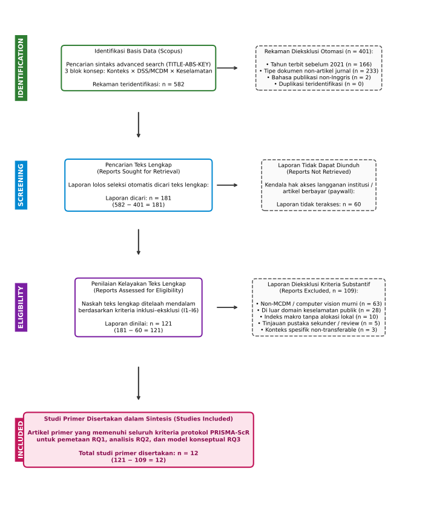
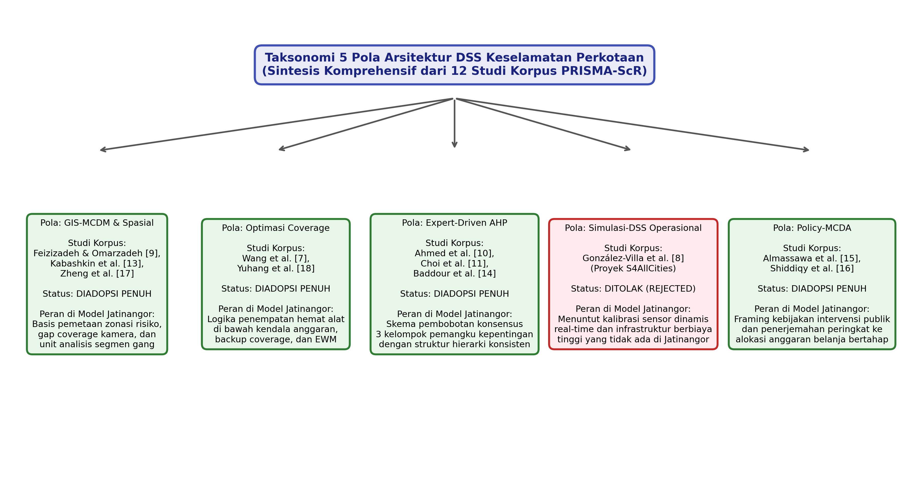

# Decision Support Systems for Urban Surveillance and Public Safety Facility Placement: A Scoping Review and Conceptual Framework for CCTV Prioritization in Jatinangor Student Settlements

**Penulis:**
1. Marvel Evan T. (140810240012@mail.unpad.ac.id)
2. Kezia Tabhita Smith (140810240020@mail.unpad.ac.id)
3. Ibnaty Farah Rabbany (140810240022@mail.unpad.ac.id)
4. Achmad Faruq M. (140810240080@mail.unpad.ac.id)
5. Gabriella Marie Keira Wibawa (140810240086@mail.unpad.ac.id)

*Program Studi Teknik Informatika, Fakultas Matematika dan Ilmu Pengetahuan Alam, Universitas Padjadjaran, Sumedang, Indonesia*

---

## RINGKASAN / ABSTRACT

**Ringkasan**—Permukiman mahasiswa di Jatinangor diwarnai oleh gang sempit, penerangan jalan yang terbatas, mobilitas malam hari yang tinggi, dan penempatan Closed-Circuit Television (CCTV) yang sporadis akibat keterbatasan anggaran belanja publik, sehingga alokasi fasilitas pengawasan memerlukan prioritisasi yang terukur. Kajian ini memetakan literatur *Decision Support System* (DSS) untuk *urban surveillance* dan *public safety facility placement* melalui pendekatan *Scoping Review* berbasis protokol PRISMA-ScR pada basis data Scopus (bidang TITLE-ABS-KEY; rentang 2021–2026; artikel jurnal primer; berbahasa Inggris), menghasilkan alur seleksi 582 rekaman teridentifikasi, 416 laporan dicari teks lengkapnya, 121 laporan dinilai kelayakan substantifnya, dan 12 studi primer disertakan dalam sintesis. Sintesis literatur mengidentifikasi lima pola arsitektur DSS (GIS-MCDM, optimasi *coverage*, *expert-driven*, simulasi-DSS, dan *policy-MCDA*), sebaran metode Multi-Criteria Decision Making (MCDM) dengan kombinasi rujukan AHP untuk pembobotan dan TOPSIS untuk perankingan, serta taksonomi kriteria ke dalam atribut *benefit*, *cost*, dan *context-dependent*. Berdasarkan sintesis tersebut, dirumuskan model konseptual DSS untuk Jatinangor yang mencakup alternatif segmen gang (A1–A5), matriks sembilan kriteria keselamatan (C1–C9) yang memisahkan urgensi risiko dari kendala kelayakan dan biaya, skema pembobotan AHP tiga kelompok pemangku kepentingan teruji konsistensinya ($CR < 0{,}10$), dan perankingan TOPSIS yang menghasilkan peta prioritas penempatan bertahap di bawah kendala anggaran. Delapan dari sembilan kriteria didukung oleh minimal dua studi primer, menyediakan landasan konseptual yang transparan untuk mentranslasikan bukti *scoping review* ke dalam model keputusan lokal.

**Kata Kunci**—Decision Support System, Multi-Criteria Decision Making, Scoping Review, PRISMA-ScR, AHP, TOPSIS, CCTV placement, Smart Living and Safety, Jatinangor.

---

## I. PENDAHULUAN

Kawasan Kecamatan Jatinangor, Kabupaten Sumedang, merupakan kawasan pendidikan tinggi strategis seluas $26{,}20\text{ km}^2$ yang terbagi ke dalam 12 desa dengan populasi melampaui 98.000 jiwa serta kepadatan rata-rata di atas $3.740\text{ jiwa/km}^2$—bahkan melampaui $9.300\text{ jiwa/km}^2$ pada kantong permukiman mahasiswa di sekitar empat perguruan tinggi utama (Unpad, ITB, IPDN, dan IKOPIN) [[1]](#referensi). Pertumbuhan hunian padat ini tidak diimbangi kapasitas pengawasan lingkungan yang memadai: gang permukiman sempit (lebar $1{,}5$–$3$ m), jangkauan Penerangan Jalan Umum (PJU) belum merata, dan mobilitas malam hari tinggi antara kampus, indekos, dan simpul layanan. Kondisi tersebut menempatkan isu keselamatan dan keamanan warga, khususnya mahasiswa, sebagai persoalan *Smart Living and Safety* yang nyata di Jatinangor.

Dari perspektif kriminologi lingkungan, intervensi pengawasan ruang publik berakar pada teori *Crime Prevention Through Environmental Design* (CPTED) [[6]](#referensi) dan *Routine Activity Theory* [[5]](#referensi), di mana kehadiran pengawas yang cakap (*capable guardian*) dan visibilitas lingkungan mampu menekan peluang bertemunya pelaku potensial dengan target yang rentan. Namun, penempatan fasilitas seperti Closed-Circuit Television (CCTV) di lingkungan permukiman padat menghadapi kendala nyata: keterbatasan anggaran publik, ketersediaan tiang fisik, pasokan daya listrik, dan jaringan internet. Penempatan kamera yang bersifat sporadis atau reaktif justru menghasilkan titik buta (*blind zone*), inefisiensi investasi alat, serta potensi pelanggaran privasi warga sebagaimana diatur dalam Undang-Undang Perlindungan Data Pribadi (UU PDP No. 27/2022). Oleh karena itu, pengambilan keputusan alokasi fasilitas pengawasan memerlukan pendekatan kuantitatif yang terukur dan objektif.

*Decision Support System* (DSS) berbasis *Multi-Criteria Decision Making* (MCDM) menawarkan instrumen yang tepat untuk mengevaluasi *trade-off* antar-faktor keselamatan dan kelayakan fisik secara simultan. Dalam literatur pengambilan keputusan, *Analytic Hierarchy Process* (AHP) lazim digunakan untuk menurunkan bobot kriteria berbasis penilaian berpasangan pakar [[2]](#referensi), sedangkan *Technique for Order Preference by Similarity to Ideal Solution* (TOPSIS) digunakan untuk memeringkat alternatif berdasarkan jarak terhadap solusi ideal [[3]](#referensi).

Meskipun demikian, sebagian besar literatur penempatan fasilitas keamanan dan sensor perkotaan berfokus pada kota metropolitan dengan infrastruktur sensor kontinu dan anggaran besar. Terdapat kesenjangan penelitian (*research gap*) yang nyata mengenai bagaimana model DSS dapat dirancang secara realistis untuk permukiman padat berkendala anggaran dengan hanya memanfaatkan data diskrit lokal (data tabular, spasial statis OpenStreetMap, dan penilaian pemangku kepentingan). Makalah ini mengisi celah tersebut melalui pendekatan hibrida: melakukan *scoping review* berbasis PRISMA-ScR untuk memetakan arsitektur dan metode literatur, kemudian mentranslasikannya ke dalam rancangan model konseptual DSS penempatan CCTV di Jatinangor.

Penelitian ini dipandu oleh tiga pertanyaan penelitian:
- **RQ1 (Pemetaan Arsitektur DSS):** Bagaimana arsitektur DSS *Smart Living & Safety* dipetakan dari literatur (alur input data heterogen ke *engine* MCDM/analitik lalu output keputusan), dan pola mana yang paling *transferable* terhadap keterbatasan data Jatinangor?
- **RQ2 (Sebaran Metode & Taksonomi Kriteria MCDM):** Metode MCDM apa yang digunakan dalam DSS *Smart Living & Safety*, bagaimana skema pembobotan dan perankingannya diterapkan, serta bagaimana kriteria keputusan diklasifikasikan berdasarkan atribut *benefit* dan *cost*?
- **RQ3 (Formulasi Model Konseptual Jatinangor):** Model konseptual DSS seperti apa yang paling layak diterapkan untuk prioritisasi CCTV di permukiman mahasiswa Jatinangor, mencakup representasi segmen gang sebagai alternatif, struktur sembilan kriteria keselamatan, skema pembobotan AHP *multistakeholder* dan perankingan TOPSIS, serta elemen literatur apa yang sengaja tidak diadopsi beserta alasannya?

Kontribusi kajian ini terhadap jawaban ketiga RQ tersebut adalah:
1. **Kontribusi pertama (RQ1):** pemetaan lima pola arsitektur DSS keselamatan perkotaan beserta penanda kebutuhan datanya, sehingga teridentifikasi pola GIS-MCDM dan optimasi *coverage* sebagai arsitektur paling *transferable* untuk Jatinangor, sementara pola simulasi-DSS ditolak dengan argumen kebutuhan kalibrasi sensor yang tidak realistis di tingkat lokal.
2. **Kontribusi kedua (RQ2):** taksonomi sebaran metode MCDM (peran pembobotan subjektif/objektif, perankingan, struktural, dan evaluasi spasial) serta klasifikasi kriteria keputusan ke dalam atribut *benefit*, *cost*, dan *context-dependent* sebagai dasar konseptual model Jatinangor.
3. **Kontribusi ketiga (RQ3):** model konseptual prioritisasi CCTV berupa alternatif segmen gang A1–A5, matriks kriteria C1–C9 yang memisahkan urgensi risiko dari kendala kelayakan/biaya, skema AHP tiga kelompok pemangku kepentingan teruji konsistensinya ($CR < 0{,}10$), perankingan TOPSIS dengan mekanisme alokasi anggaran bertahap, serta analisis sensitivitas $\pm 20\%$.

---

## II. METODOLOGI REVIU (PRISMA-ScR PROTOCOL)

Kajian ini menggunakan pendekatan *Scoping Review* dengan seleksi studi mengikuti alur *Preferred Reporting Items for Systematic Reviews and Meta-Analyses Extension for Scoping Reviews* (PRISMA-ScR) [[4]](#referensi). Protokol ditetapkan sebelum pencarian, mencakup strategi pencarian, kriteria inklusi-eksklusi, tahapan seleksi, dan ekstraksi data.

### A. Strategi Pencarian Literatur

Pencarian dilakukan pada basis data Scopus dengan sintaks *advanced search* pada bidang `TITLE-ABS-KEY`. Kata kunci disusun dari tiga blok konsep yang dihubungkan operator `AND`, sedangkan sinonim dalam setiap blok dihubungkan operator `OR`. Sintaks lengkap ditampilkan pada Tabel I untuk menjamin reproduksibilitas pencarian.

**Tabel I. SINTAKS PENCARIAN PADA BASIS DATA SCOPUS**

| Blok Konsep | Kata Kunci Pencarian |
|---|---|
| **Konteks Kawasan Cerdas** | `"smart city"` OR `"smart cities"` OR `"smart living"` OR `"urban intelligence"` OR `"smart environment*"` OR `"safe city"` OR `"smart campus"` |
| **DSS & MCDM** | `"decision support system*"` OR `"decision support"` OR `"decision-making support"` OR `"decision support tool*"` OR `"decision support framework*"` OR `"decision support model*"` OR `DSS` OR `MCDM` OR `"multi-criteria decision*"` |
| **Keselamatan & Pemantauan** | `safet*` OR `secur*` OR `surveillanc*` OR `crime*` OR `"public safety"` OR `"safety management"` OR `"risk assessment"` OR `CCTV` OR `"closed-circuit television"` OR `"surveillance camera*"` OR `"camera placement"` OR `"sensor placement"` OR `"facility location"` OR `"site selection"` OR `"street lighting"` OR `monitor*` |

Ketiga blok dihubungkan dengan operator AND sehingga setiap rekaman harus memuat minimal satu istilah dari masing-masing blok. Protokol membatasi dokumen bertipe *Article*, berbahasa Inggris, terbit 2021–2026, dengan teks lengkap yang dapat diakses. Pencarian dieksekusi pada 28 Maret 2026 dan menghasilkan 582 rekaman awal.

### B. Kriteria Inklusi dan Eksklusi

Kriteria inklusi dan eksklusi dirumuskan sebelum penyaringan untuk meminimalkan bias seleksi. Kriteria disusun dalam enam butir (I1–I6) sebagaimana dirinci pada Tabel II.

**Tabel II. KRITERIA INKLUSI DAN EKSKLUSI STUDI**

| Kode | Kriteria Inklusi | Kriteria Eksklusi |
|---|---|---|
| **I1** | Artikel jurnal primer (*Article*), terbit 2021–2026, berbahasa Inggris. | Prosiding/bab buku, terbit sebelum 2021, atau berbahasa non-Inggris. |
| **I2** | Membahas DSS atau kerangka pengambilan keputusan dalam konteks keselamatan, keamanan, atau pemantauan urban/*smart city*. | Domain di luar keselamatan/keamanan publik perkotaan (mis. medis klinis, energi, limbah, atau pertanian). |
| **I3** | Menggunakan metode MCDM/MCDA eksplisit, atau model analitik keputusan terstruktur (optimasi cakupan berbobot/simulasi risiko) dengan alur input–engine–output yang jelas. | Hanya membahas deteksi objek/*computer vision* murni, perangkat keras jaringan IoT, atau *machine learning* tanpa mekanisme alokasi/keputusan. |
| **I4** | Konteks spasial perkotaan, kampus, atau permukiman yang *transferable*. | Konteks mikro/non-urban (pertambangan, keamanan siber murni, atau internal perusahaan). |
| **I5** | Penelitian primer (*original research*) dengan studi kasus/simulasi empiris. | Artikel *review*, survei literatur sekunder, atau editorial. |
| **I6** | Naskah teks lengkap (*full-text*) dapat diakses dan bukan duplikat kasus. | Teks lengkap tidak dapat diakses (*paywall*) atau duplikasi studi kasus yang sama. |

### C. Proses Seleksi Studi

Seleksi studi dilakukan mengikuti empat tahapan standar PRISMA-ScR:
1. **Identifikasi:** Pencarian sistematis pada basis data Scopus menghasilkan 582 rekaman awal tanpa rekaman duplikat otomatis.
2. **Penyaringan Metadata Awal:** Dari 582 rekaman, penyaringan berdasarkan batas tahun penerbitan (2021–2026) mengeksklusi 166 rekaman yang terbit sebelum 2021, menyisakan 416 laporan yang dicari untuk diambil teks lengkapnya (*reports sought for retrieval*). Termasuk di dalam 166 rekaman yang gugur adalah satu studi penempatan fasilitas berbasis AHP-GIS-Fuzzy TOPSIS terbitan akhir 2020 yang secara substantif relevan namun secara disiplin digugurkan sesuai protokol.
3. **Pengambilan Teks Lengkap:** Dari 416 laporan, sebanyak 295 laporan dieksklusi pada tahap pengambilan karena berbahasa non-Inggris ($n=2$), bukan artikel jurnal primer ($n=233$), serta teks lengkap tidak dapat diunduh karena batasan akses langganan institusi ($n=60$). Dengan demikian, diperoleh 121 artikel teks lengkap untuk penilaian kelayakan substansi (*reports assessed for eligibility*).
4. **Penilaian Kelayakan Substantif:** Sebanyak 121 laporan ditelaah secara mendalam terhadap kriteria inklusi–eksklusi (Tabel II). Tahap ini mengeksklusi 109 laporan dengan rincian: tidak memuat model keputusan/MCDM atau hanya *computer vision*/optimasi murni ($n=63$), berada di luar domain keselamatan perkotaan atau permukiman ($n=28$), berfokus pada indeks komparasi makro antar-kota tanpa mekanisme alokasi fasilitas lokal ($n=10$), publikasi tinjauan pustaka sekunder ($n=5$), serta konteks spesifik yang tidak dapat ditransfer ke lingkungan permukiman ($n=3$).

Dengan demikian, diperoleh tepat **12 studi primer** yang memenuhi seluruh kriteria protokol untuk disertakan dalam sintesis (*studies included*). Seluruh proses penyaringan dilakukan oleh lima penelaah independen anggota tim; perbedaan pendapat diselesaikan melalui diskusi konsensus yang dipimpin oleh koordinator protokol (A1). Perangkat Generative AI digunakan secara terbatas sebagai asisten pengelompokan kata kunci awal pada tahap penyaringan abstrak, namun seluruh keputusan inklusi dan eksklusi diverifikasi penuh secara manual.

Alur seleksi ditampilkan pada diagram alir PRISMA-ScR (Gambar 1).

*Gambar 1. Diagram alir seleksi studi berdasarkan protokol PRISMA-ScR (582 rekaman teridentifikasi → 416 dicari teks lengkap → 121 dinilai kelayakan substantif → 12 studi primer disertakan).*

### D. Ekstraksi dan Analisis Literatur

Studi yang disertakan kemudian di-*charting* ke dalam tabel ekstraksi dengan kolom: penulis, domain permasalahan, komponen DSS, metode MCDM, kriteria utama, dan relevansi terhadap studi kasus Jatinangor. Hasil *charting* menjadi dasar analisis RQ1 (pemetaan arsitektur), RQ2 (sebaran metode dan taksonomi kriteria), dan penyusunan model konseptual RQ3. Sintesis dilakukan dengan pendekatan tematik, yaitu pengelompokan pola arsitektur, peran metode, dan orientasi kriteria.

---

## III. HASIL DAN PEMBAHASAN

### A. Analisis RQ1: Pemetaan Kerangka dan Arsitektur DSS

**RQ1:** *Bagaimana arsitektur DSS Smart Living & Safety dipetakan dari literatur (alur input data heterogen ke engine MCDM/analitik lalu output keputusan), dan pola mana yang paling transferable terhadap keterbatasan data Jatinangor?*

Hasil ekstraksi data (*data charting*) terhadap 12 studi primer yang disertakan [[7]–[18]](#referensi) dirangkum secara berurutan pada Tabel III. Tabel ini memetakan setiap studi ke dalam kolom penulis, domain permasalahan, komponen DSS, metode MCDM, kriteria utama, dan relevansi terhadap studi kasus Jatinangor sebagai rujukan tunggal (*single source of truth*).

**Tabel III. EKSTRAKSI LITERATUR (DATA CHARTING 12 STUDI INTI)**

| No. | Penulis & Sitasi | Domain Permasalahan | Komponen DSS (Input → Engine → Output) | Metode MCDM | Kriteria Utama | Relevansi Jatinangor & Pemetaan Kriteria |
|---|---|---|---|---|---|---|
| 1 | Wang et al. (2025) [[7]](#referensi) | Penempatan kamera jalan, Wuwei RRT | Input simpul jalan + model *coverage*; *engine* MWVC + *greedy*; output titik kamera optimal | Optimasi *coverage* MWVC (Non-MCDM) | *Coverage* jalan (benefit); jumlah tiang dan kamera (cost) | Jangkar argumen anggaran (tiang 62→33, kamera 196→98, coverage 100%); C4, C6, C7, C9 |
| 2 | Gonzalez-Villa et al. (2024) [[8]](#referensi) | *Counter-terrorism* dan infrastruktur kritis (S4AllCities) | Input pergerakan pejalan/kendaraan + model ancaman; *engine* prediktif-probabilistik; output evakuasi dan rute intervensi | DSS simulasi terintegrasi (Non-MCDM) | Probabilitas ancaman, *egress time*, estimasi korban | Pembanding arsitektur; pola simulasi ditolak untuk model operasional lokal karena butuh sensor dinamis |
| 3 | Feizizadeh & Omarzadeh (2025) [[9]](#referensi) | Pemetaan risiko pesepeda, Berlin | Input *crowd-sensor* + guna lahan; *engine* statistik spasial + MCDA-GIS; output peta risiko | Spatial-MCDA berbasis GIS | Volume lalu lintas, kondisi jalur, lingkungan, guna lahan, sosiodemografi | Template peta prioritas spasial gang; C1, C2, C5, C8 |
| 4 | Ahmed et al. (2022) [[10]](#referensi) | *Smart campus*, UAE | Input survei 4 kelompok pengguna; *engine* AHP antar-*stakeholder* + *utility function*; output tool keputusan investasi | AHP *multistakeholder* + *utility function* | *Smart security and safety*, navigasi kampus, *adaptive learning* | Skema AHP tiga kelompok pemangku kepentingan; bukti *safety* domain terpenting; C8, C9 |
| 5 | Choi et al. (2025) [[11]](#referensi) | Teknologi hunian padat, Korea Selatan | Input 16 teknologi + panel 22 ahli; *engine* MCDM + *expected utility* 3 skenario; output prioritas teknologi | MCDM terintegrasi + *expected utility* | *Importance* dan *utility* per domain; *smart safety* teratas | Legitimasi fokus *safety* di permukiman padat; C5, C8 |
| 6 | Kanj et al. (2024) [[12]](#referensi) | Rute barang berbahaya, *smart city* | Input data *cloud* + cost/duration/risk; *engine* Fuzzy AHP + Fuzzy TOPSIS; output rute teraman | Fuzzy AHP (bobot) + Fuzzy TOPSIS (ranking) | Cost, duration, risk | Justifikasi inti rujukan kombinasi AHP-TOPSIS; C1, C9 |
| 7 | Kabashkin et al. (2025) [[13]](#referensi) | Monitoring lalu lintas UAV, Astana | Input video 30 titik kritis; *engine* simulasi + kerangka MCDM; output evaluasi 6 skenario | MCDM evaluasi skenario berbasis simulasi | Flow, kecepatan, delay, kriteria skenario | Sampling titik kritis menjadi logika segmen gang; UAV diganti observasi manual; C2 |
| 8 | Baddour et al. (2026) [[14]](#referensi) | Perencanaan *diplomatic quarter* | Input dataset urban publik; *engine* BWM + CoCoSo dengan komparasi AHP/TOPSIS/VIKOR; output ranking skenario | BWM (bobot) + CoCoSo (ranking); komparasi empiris | Security, accessibility, infrastructure, sustainability, resilience | Komparasi metode; alasan memilih AHP-TOPSIS (selisih kecil, lebih sederhana diaudit); C1, C3, C8, C9 |
| 9 | Almassawa et al. (2024) [[15]](#referensi) | Kebijakan *smart mobility*, South Tangerang | Input indikator availability/security/comfort; *engine* PROMETHEE; output strategi kebijakan | PROMETHEE | Availability, security, comfort | Variasi metode; konteks wilayah urban Indonesia; C1, C2 |
| 10 | Shiddiqy et al. (2025) [[16]](#referensi) | Arsitektur pertahanan IKN, Indonesia | Input dokumen kebijakan sekunder; *engine* SWOT + AHP; output prioritas komponen pertahanan | SWOT + AHP | C4ISR, AI-surveillance, keamanan infrastruktur, kolaborasi | Bukti AHP dari data sekunder; bobot surveilans pengawasan sangat tinggi; C4, C7 |
| 11 | Zheng et al. (2025) [[17]](#referensi) | Risiko banjir komunitas, Guangzhou | Input faktor alam-sosial + IoT + ArcGIS; *engine* DEMATEL-ISM + Bayesian Network; output risiko & evaluasi intervensi | DEMATEL-ISM + Bayesian Network | Faktor alam dan sosial; kapasitas drainase | Logika intervensi terukur; rantai input data lingkungan; C3, C9 |
| 12 | Yuhang et al. (2025) [[18]](#referensi) | Penempatan sensor grid, Guangzhou | Input proximity + kepadatan penduduk (EWM); *engine* BCSLP + *genetic algorithm*; output strategi *balanced* | EWM (bobot objektif) + optimasi *coverage* | Primary coverage, backup coverage, risiko, biaya | EWM sebagai validasi silang bobot data; logika coverage berulang; C4, C5, C7, C9 |

Berdasarkan Tabel III, komponen DSS dipetakan ke tiga lapisan: lapisan input (data spasial, observasi, survei pakar, data historis, citra/sensor), *decision engine* (MCDM, *machine learning*, *fuzzy logic*, Bayesian, simulasi, optimasi), dan *decision output* (peta risiko, skor, perankingan, rute, prioritas intervensi). Keberagaman domain diabstraksi menjadi pola arsitektur dan logika keputusan yang *domain-agnostic*.

Arsitektur DSS pada literatur terbagi ke dalam **lima pola**:
1. **GIS-MCDM dan evaluasi skenario spasial** [[9], [13], [17]]: menggabungkan lapisan spasial dengan MCDM sehingga keluaran keputusan memiliki dimensi lokasi; diadopsi sebagai arsitektur inti model Jatinangor.
2. **Optimasi coverage** [[7], [18]]: memaksimalkan cakupan pengawasan dengan jumlah perangkat terbatas; relevan untuk penempatan CCTV di bawah kendala anggaran ketat.
3. **Expert-driven (survei + AHP)** [[10], [11], [14]]: mengandalkan penilaian pakar dan pemangku kepentingan; sesuai dengan data empiris lokal yang terbatas.
4. **Simulasi-DSS operasional** [[8]]: keluaran paling komprehensif namun menuntut data sensor dinamis dan kalibrasi berbiaya tinggi, sehingga **ditolak** untuk model lokal Jatinangor.
5. **Policy-MCDA** [[15], [16]]: menghasilkan rekomendasi kebijakan strategis; diadopsi sebagai kerangka penyajian rekomendasi alokasi bertahap.

Distribusi kelima pola arsitektur beserta status adopsinya diilustrasikan pada Gambar 2.

*Gambar 2. Taksonomi lima pola arsitektur DSS pada korpus literatur dan status adopsinya pada model Jatinangor (empat pola diadopsi, satu pola simulasi ditolak).*

Pola *hybrid* (kombinasi lebih dari satu *engine*) dominan dalam literatur. Dengan kriteria *transferability*, kombinasi pola GIS-MCDM, optimasi *coverage*, dan *expert-driven* merupakan *baseline* yang paling realistis untuk Jatinangor karena dapat beroperasi penuh di atas data tabular, data spasial statis, dan penilaian pakar.

**Jawaban RQ1:** Arsitektur DSS keselamatan perkotaan terpetakan ke lima pola arsitektur. Pola paling *transferable* untuk keterbatasan data Jatinangor adalah kombinasi GIS-MCDM, optimasi *coverage*, dan *expert-driven*. **Celah yang teridentifikasi:** mayoritas studi mengevaluasi arsitektur pada lingkungan perkotaan berdata lengkap (sensor kontinu/citra berbiaya), sedangkan penempatan fasilitas pengawasan pada permukiman padat berkendala anggaran dengan data diskrit belum pernah dirancang sebagai satu model utuh.

---

### B. Analisis RQ2: Sebaran Metode MCDM dan Taksonomi Kriteria

**RQ2:** *Metode MCDM apa yang digunakan dalam DSS Smart Living & Safety, bagaimana skema pembobotan dan perankingannya diterapkan, serta bagaimana kriteria keputusan diklasifikasikan berdasarkan atribut benefit dan cost?*

Metode MCDM yang muncul pada 12 studi inti dikelompokkan berdasarkan perannya dalam siklus pengambilan keputusan pada Tabel IV.

**Tabel IV. SEBARAN PERAN, FREKUENSI PEMAKAIAN PRIMER, DAN KARAKTERISTIK METODE MCDM**

| Peran dalam DSS | Metode yang Ditemukan | Frek. Primer | Kelebihan Utama | Keterbatasan | Perlakuan di Model Jatinangor |
|---|---|---|---|---|---|
| **Pembobotan subjektif (pakar)** | AHP / Fuzzy AHP [[10], [12], [16]] | 3 studi | Menangani penilaian multipakar; rasio konsistensi (CR) teraudit | Subjektif; jumlah pasang kuadratik ($n(n-1)/2$) | **Diadopsi** untuk bobot kriteria C1–C8 |
| | BWM [[14]] | 1 studi | Jumlah perbandingan berpasangan lebih hemat ($2n-3$) | Membutuhkan penentuan kriteria terbaik/terburuk awal | Tidak diadopsi (selisih empiris kecil terhadap AHP [[14]]) |
| **Pembobotan objektif (data)** | Entropy Weight Method (EWM) [[18]] | 1 studi | Objektif murni dari dispersi data numerik | Bergantung penuh pada kelengkapan data lapangan | **Diadopsi** sebagai instrumen validasi silang |
| **Perankingan alternatif** | TOPSIS / Fuzzy TOPSIS [[12]] | 1 studi | Komputasi ringkas; konsep kompromi jarak solusi ideal intuitif | Memerlukan bobot eksternal dan normalisasi skala | **Diadopsi** untuk perankingan segmen A1–A5 |
| | CoCoSo [[14]] | 1 studi | Menggabungkan model kompromi aditif dan multiplikatif | Formulasi lebih kompleks bagi pemangku kepentingan lokal | Tidak diadopsi |
| | PROMETHEE [[15]] | 1 studi | Mengakomodasi variasi fungsi preferensi per kriteria | Penentuan parameter ambang preferensi cukup rumit | Tidak diadopsi |
| **Pemodelan struktural / kausal** | DEMATEL-ISM + Bayesian Network [[17]] | 1 studi | Memetakan kausalitas antar-faktor dan probabilitas intervensi | Fokus pada relasi faktor, bukan perankingan alternatif lokasi | Tidak diadopsi |
| **Evaluasi spasial / skenario** | Spatial-MCDA GIS [[9]]; Multi-skenario [[11], [13]] | 3 studi | Integrasi langsung dengan visualisasi spasial peta risiko | Sensitif terhadap resolusi data spasial | **Diadopsi** untuk visualisasi peta prioritas segmen |
| **Analitik non-MCDM (pembanding)** | Optimasi MWVC [[7]]; Simulasi-DSS [[8]] | 2 studi | Efisiensi cakupan graf jalan [[7]]; respons evakuasi *real-time* [[8]] | Simulasi [[8]] menuntut sensor berbiaya tinggi | Logika cakupan [[7]] diserap ke C4/C6/C7; simulasi [[8]] ditolak |

Tabel IV menunjukkan bahwa kombinasi AHP untuk pembobotan dan TOPSIS untuk perankingan merupakan pasangan metode yang terbukti bekerja efektif pada data diskrit [[12]] serta didukung uji komparasi empiris [[14]] yang mencatat selisih kinerja kecil terhadap metode kompleks (konsensus pakar 88,6% vs 92,8% dan ketahanan 0,84 vs 0,91). Dua metode klasik (SAW dan WP) tidak ditemukan eksplisit dalam 12 studi inti, sehingga tidak diadopsi.

Selanjutnya, kriteria keputusan diklasifikasikan ke dalam tiga kelompok: *benefit*, *cost*, dan *context-dependent* (Tabel V).

**Tabel V. TAKSONOMI KRITERIA KEPUTUSAN**

| Kelompok | Orientasi Preferensi | Contoh Kriteria dari Literatur Sumber | Perlakuan di Model Jatinangor |
|---|---|---|---|
| **Benefit** | Semakin tinggi nilainya semakin diprioritaskan | Volume mobilitas [[9]]; cakupan pengawasan [[7], [18]]; keamanan dan aksesibilitas [[14]]; kepadatan [[18]] | Seluruh kriteria urgensi C1–C8 diarahkan sebagai *benefit* terhadap urgensi (skor tinggi = makin mendesak) |
| **Cost** | Semakin rendah nilainya semakin dikehendaki | Jumlah perangkat [[7]]; risiko kecelakaan [[13]]; biaya implementasi [[14]]; latency jaringan [[18]] | Biaya instalasi dan RAB dipisahkan sebagai batas anggaran (*budget ceiling constraint*) |
| **Context-dependent** | Arah preferensi bergantung pada formulasi tujuan model | Parameter arus lalu lintas & delay [[13]]; faktor hidrologis lingkungan [[17]] | Tidak dipaksa biner; disesuaikan dengan konteks keputusan spesifik |

Taksonomi ini memastikan bahwa sifat kriteria didefinisikan terhadap tujuan keputusan model, bukan nama variabel. Kriteria C9 (kelayakan teknis) dan estimasi biaya (RAB) dipisahkan dari skor urgensi agar tidak mengaburkan penilaian risiko murni.

**Jawaban RQ2:** Metode MCDM terbagi ke dalam empat peran fungsional; pola kombinasi AHP (pembobotan) dan TOPSIS (perankingan) merupakan konfigurasi paling teruji dan transparan untuk diadopsi. Kriteria terbagi ke dalam *benefit*, *cost*, dan *context-dependent*. **Celah yang teridentifikasi:** (a) perbandingan antara bobot subjektif pakar dan bobot objektif data lapangan jarang dieksplorasi bersama, (b) metode SAW dan WP minim bukti pada domain penempatan fasilitas modern, dan (c) pencampuran kriteria biaya ke dalam skor urgensi kerap mengacaukan analisis manfaat-biaya.

---

### C. Sintesis RQ1 dan RQ2

Temuan analisis RQ1 dan RQ2 dirangkum ke dalam sepuluh dimensi keputusan pada Tabel VI sebagai jembatan langsung menuju perancangan model pada Seksi IV.

**Tabel VI. SINTESIS TEMUAN LITERATUR DAN IMPLIKASINYA BAGI MODEL JATINANGOR**

| Aspek | Temuan Literatur (12 Studi Inti) | Implikasi bagi Model Jatinangor |
|---|---|---|
| **Arsitektur** | Lima pola; dominasi sistem *hybrid*; variasi kebutuhan data tajam | Diadopsi kombinasi modular: GIS-MCDM + optimasi *coverage* + *expert-driven* |
| **Kebutuhan Input** | Data spasial, observasi lapangan, survei pakar, data tabular, sensor | Cukup memanfaatkan data diskrit lokal: survei, OpenStreetMap, rekap insiden, dan RAB |
| **Decision Engine** | MCDM, optimasi graf, fuzzy logic, Bayesian, simulasi operasional | MCDM transparan dipilih agar dapat diaudit langsung oleh pemangku kepentingan lokal |
| **Skema Pembobotan** | Didominasi penilaian pakar (AHP, BWM) dan metode objektif (EWM) | AHP tiga kelompok pemangku kepentingan, dengan EWM sebagai pembanding |
| **Skema Perankingan** | TOPSIS, CoCoSo, PROMETHEE | TOPSIS diadopsi karena formulasi matematis ringkas dan intuitif [[12]] |
| **Atribut Benefit** | Cakupan wilayah, volume aktivitas, kerawanan, kepadatan hunian | Menjadi orientasi preferensi seluruh kriteria urgensi C1–C8 |
| **Atribut Cost** | Anggaran pengadaan, jumlah perangkat, kendala teknis | Dipisahkan menjadi modul kendala anggaran (*budget constraint*) |
| **Context-dependent** | Bergantung formulasi matematis masing-masing model | Kriteria tanpa arah preferensi pasti tidak dipaksa masuk skema biner |
| **Format Output** | Peta risiko, skor komparatif, matriks peringkat alternatif | Peta prioritas segmen gang + skema alokasi pemasangan bertahap (Fase 1, 2, 3) |
| **Transferability** | Sangat ditentukan oleh ketersediaan infrastruktur data | Diuji pada tiga dimensi: kebutuhan data, kompleksitas komputasi, dan kepraktisan output |

---

## IV. PERANCANGAN MODEL KONSEPTUAL DSS JATINANGOR (JAWABAN RQ3)

**RQ3:** *Model konseptual DSS seperti apa yang paling layak diterapkan untuk prioritisasi CCTV di permukiman mahasiswa Jatinangor, mencakup representasi segmen gang sebagai alternatif, struktur sembilan kriteria keselamatan, skema pembobotan AHP multistakeholder dan perankingan TOPSIS, serta elemen literatur apa yang sengaja tidak diadopsi beserta alasannya?*

### A. Profil Lokasi dan Perumusan Alternatif (A1–A5)

Kecamatan Jatinangor memiliki luas $26{,}20\text{ km}^2$ dengan populasi tetap melampaui 98.000 jiwa serta puluhan ribu mahasiswa penghuni indekos yang terkonsentrasi di Desa Sayang, Cikeruh, Hegarmanah, Cipacing, dan Cileles [[1]](#referensi). Kepadatan penduduk di kawasan lingkar kampus mencapai $6.000$ hingga lebih dari $9.300\text{ jiwa/km}^2$ [[1]](#referensi), memicu pertumbuhan ratusan bangunan indekos di sepanjang gang sempit berlebar $1{,}5$–$3$ m yang minim PJU dan pengawasan kamera. Karena tingkat kerawanan dan kesiapan infrastruktur tiang/jaringan berbeda tajam antargang, unit keputusan yang tepat adalah **segmen jalan atau gang** yang menjadi kandidat penerima satu unit CCTV.

Lima alternatif segmen dirumuskan berdasarkan tipologi spasial dan kerawanan empiris di Jatinangor (Tabel VII).

**Tabel VII. ALTERNATIF SEGMEN LOKASI PRIORITAS (A1–A5)**

| Kode | Nama Segmen | Karakteristik Spasial & Lingkungan | Dasar Pemilihan Lapangan |
|---|---|---|---|
| **A1** | Gang Kos Kawasan Sayang | Gang residensial sempit (lebar 1,5–2,5 m), lorong padat indekos | Konsentrasi indekos tertinggi; akses jalan buntu; minim PJU; rawan pencurian malam hari |
| **A2** | Ruas Jalan Cikeruh | Koridor jalan aktif (lebar 3–4 m) dekat gerbang kampus | Jalur mobilitas utama pejalan kaki dan motor mahasiswa malam hari (pukul 21.00–24.00) |
| **A3** | Persimpangan Hegarmanah | Simpul jalan multi-cabang (pertemuan 5 cabang jalan/gang) | Titik temu sirkulasi utama; konsentrasi gerai ATM, minimarket 24 jam, dan halte |
| **A4** | Gang Cipacing | Gang residensial panjang dengan kontur berliku | Defisiensi penerangan parah (gelap gulita); jarak ke titik CCTV aktif terdekat sangat jauh |
| **A5** | Ruas Jalan Cileles | Ruas jalan sekunder lingkar timur kampus | Jalur perlintasan alternatif; penerangan seadanya; kepadatan hunian moderat |

*Catatan Skalabilitas:* Kelima alternatif di atas merupakan segmen representatif untuk menguji ketuntasan komputasi matematis. Kerangka MCDM yang dirancang memiliki skalabilitas penuh untuk diperluas ke puluhan hingga ratusan segmen gang di seluruh Jatinangor tanpa perlu memodifikasi struktur sembilan kriteria keputusan.

### B. Matriks Kriteria Keselamatan C1–C9

Untuk mengatasi kerancuan antara aspek urgensi dan kelayakan teknis, kriteria dibagi menjadi dua domain fungsi:
1. **Kriteria Urgensi Risiko (C1–C8):** Seluruhnya diformulasikan searah terhadap urgensi (*benefit-oriented toward urgency*); semakin tinggi nilainya, semakin mendesak penempatan kamera pengawas, dan diproses langsung di dalam mesin TOPSIS.
2. **Kriteria Kelayakan Teknis (C9) dan Biaya:** C9 (kesiapan tiang, daya listrik, sinyal internet) dan estimasi biaya per titik (RAB) dipisahkan dari perankingan urgensi untuk bertindak sebagai kendala kelayakan dan batas anggaran (*budget ceiling constraint*).

Rincian struktur sembilan kriteria keselamatan disajikan pada Tabel VIII.

**Tabel VIII. MATRIKS STRUKTUR, SKALA, SUMBER DATA, DAN DUKUNGAN LITERATUR KRITERIA (C1–C9)**

| Kode | Kriteria | Definisi Operasional (Arah Preferensi) | Satuan | Skala | Sumber Data (Utama / Fallback) | Frek. | Rujukan Literatur Inti |
|---|---|---|---|---|---|:---:|---|
| **C1** | Riwayat kerawanan segmen | Frekuensi insiden kriminalitas/kecelakaan per km per tahun (Benefit thd Urgensi) | kejadian/km/th | Rasio | Rekap Polsek / wawancara Ketua RT | 4 | [[9], [12], [14], [15]] |
| **C2** | Volume mobilitas malam | Rata-rata orang & motor melintas pukul 18.00–24.00 (Benefit thd Urgensi) | orang/jam | Rasio | *Counting* manual malam / CCTV eksisting | 3 | [[9], [13], [15]] |
| **C3** | Defisiensi penerangan | Tingkat kekurangan cahaya PJU malam hari (Benefit thd Urgensi: makin gelap makin butuh) | skor 1–5 | Ordinal | Survei lux/visibilitas / data Dishub | 2 | [[14], [17]] |
| **C4** | Efisiensi *coverage* | Estimasi luas area pandang terawasi per titik kamera (Benefit thd Urgensi) | $\text{m}^2$/titik | Rasio | Geometri OpenStreetMap + uji lapangan | 3 | [[7], [16], [18]] |
| **C5** | Kepadatan penghuni | Estimasi jumlah kamar indekos aktif per km segmen (Benefit thd Urgensi) | kamar/km | Rasio | Pendataan indekos / profil desa [[1]](#referensi) | 3 | [[9], [11], [18]] |
| **C6** | Derajat simpul jalan | Jumlah cabang persimpangan yang bertemu pada segmen (Benefit thd Urgensi) | cabang | Rasio | Ekstraksi simpul graf OpenStreetMap | 1 | [[7]] |
| **C7** | *Coverage gap* CCTV | Jarak terdekat dari titik tengah ke CCTV aktif terdekat (Benefit thd Urgensi) | meter | Rasio | Pemetaan koordinat GPS kamera eksisting | 3 | [[7], [16], [18]] |
| **C8** | Kedekatan fasilitas rentan | Jumlah POI rawan (indekos, ATM, warung, halte) radius 150 m (Benefit thd Urgensi) | unit POI | Rasio | Observasi lapangan + OpenStreetMap POI | 4 | [[9], [10], [11], [14]] |
| **C9** | Kelayakan implementasi | Kesiapan fisik tiang, pasokan listrik PLN, dan sinyal internet (Kelayakan Teknis) | skor 1–5 | Ordinal | Survei teknis lapangan + RAB | 6 | [[7], [10], [12], [14], [17], [18]] |

*Validasi Literatur dan Catatan Kritis:* Delapan dari sembilan kriteria didukung oleh minimal dua studi primer: C9 didukung 6 studi; C1 dan C8 didukung 4 studi; C2, C4, C5, dan C7 didukung 3 studi; serta C3 didukung 2 studi. Hanya C6 (derajat simpul jalan) yang bersumber tunggal dari model *vertex cover* [[7]] dan dicatat apa adanya secara transparan.

Perlu digarisbawahi bahwa frekuensi kemunculan dalam literatur tidak mencerminkan tingkat kepentingan di lapangan Jatinangor. Kriteria defisiensi penerangan (C3) hanya muncul pada dua studi literatur [[14], [17]], namun di permukiman Jatinangor merupakan faktor pemicu kerawanan yang paling mendesak. Oleh sebab itu, bobot prioritas tidak diturunkan dari frekuensi literatur, melainkan ditentukan melalui pembobotan konsensus pakar via AHP.

### C. Skema Pembobotan AHP dan Perankingan TOPSIS

#### 1. Pembobotan AHP Multistakeholder

Skema pembobotan mengadopsi model konsensus lintas pemangku kepentingan [[10]]:
- **Responden Tiga Kelompok:** (a) Pemerintah Daerah (Kecamatan Jatinangor, Satpol PP, Dishub Sumedang), (b) Pengelola Kampus (Direktorat Keselamatan & Sarpras PTN Jatinangor), dan (c) Komunitas Warga (Ketua RT/RW dan paguyuban pemilik indekos).
- **Struktur Hierarki untuk Mitigasi Inkonsistensi:** Untuk menghindari kejenuhan responden akibat 28 perbandingan berpasangan pada matriks $8 \times 8$ (yang rawan menghasilkan CR $>$ 0,10), kriteria urgensi dikelompokkan ke dalam tiga kluster:
  - *Kluster Risiko:* C1 (Kerawanan) dan C3 (Penerangan).
  - *Kluster Paparan Aktivitas:* C2 (Mobilitas), C5 (Kepadatan), dan C8 (Fasilitas Rentan).
  - *Kluster Karakteristik Spasial:* C4 (Coverage), C6 (Simpul), dan C7 (Coverage Gap).
  Skema hierarki ini memangkas total perbandingan berpasangan menjadi hanya 10 perbandingan (1 antar-kluster + 1 di kluster risiko + 3 di kluster paparan + 3 di kluster spasial).
- **Agregasi Preferensi:** Matriks perbandingan tiap responden diuji konsistensinya terlebih dahulu. Penilaian antarkelompok kemudian diagregasi menggunakan rata-rata geometrik (*geometric mean*):
  $$a_{jk} = \left( \prod_{p=1}^P a_{jk}^{(p)} \right)^{1/P}$$
  dengan $P$ adalah jumlah responden pemangku kepentingan.
- **Uji Konsistensi Rasio (CR):** Dievaluasi melalui:
  $$\text{CI} = \frac{\lambda_{\max} - n}{n - 1}, \quad \text{CR} = \frac{\text{CI}}{\text{RI}}$$
  dengan $\lambda_{\max}$ nilai *eigenvalue* maksimum, $n = 8$ kriteria urgensi, dan Random Index $\text{RI} = 1{,}41$ [[2]](#referensi). Matriks dinyatakan konsisten bila $\text{CR} < 0{,}10$.

#### 2. Perankingan TOPSIS dan Alokasi Bertahap

Matriks keputusan urgensi $X = [x_{ij}]_{m \times n}$ ($m=5$ alternatif, $n=8$ kriteria) diproses melalui tahapan:
1. **Normalisasi Vektor Euclidean:** Mengubah skala campuran (rasio dan ordinal) ke dalam matriks nir-dimensi $R = [r_{ij}]$:
   $$r_{ij} = \frac{x_{ij}}{\sqrt{\sum_{k=1}^m x_{kj}^2}}, \quad i=1,\dots,m; \ j=1,\dots,n$$
2. **Pembobotan Matriks:** Mengalikan kolom ternormalisasi dengan bobot AHP $w_j$:
   $$v_{ij} = w_j \cdot r_{ij}, \quad \text{dengan } \sum_{j=1}^n w_j = 1$$
3. **Penentuan Solusi Ideal Positif ($A^+$) dan Negatif ($A^-$):** Karena seluruh kriteria C1–C8 adalah *benefit* terhadap urgensi:
   $$A^+ = \{\max_i(v_{ij}) \mid j=1,\dots,n\}, \quad A^- = \{\min_i(v_{ij}) \mid j=1,\dots,n\}$$
4. **Jarak Euclidean:** Menghitung jarak pemisah tiap alternatif ke solusi ideal:
   $$D_i^+ = \sqrt{\sum_{j=1}^n (v_{ij} - v_j^+)^2}, \quad D_i^- = \sqrt{\sum_{j=1}^n (v_{ij} - v_j^-)^2}$$
5. **Nilai Kedekatan Relatif (*Closeness Coefficient*):**
   $$C_i = \frac{D_i^-}{D_i^+ + D_i^-}, \quad 0 \le C_i \le 1$$
   Alternatif dengan $C_i$ tertinggi memiliki tingkat urgensi keselamatan terbesar.
6. **Mekanisme Alokasi Bertahap di Bawah Batas Anggaran:** Pemasangan kamera dibagi ke dalam fase tahunan di bawah batas anggaran belanja $B_k$:
   $$\sum_{i \in \text{Fase } k} \text{Cost}_i \le B_k$$
   Rasio efisiensi urgensi-biaya ($C_i / \text{Cost}_i$) digunakan sebagai panduan pendukung bila terdapat alternatif dengan urgensi berdekatan namun selisih biaya implementasi yang tajam.
7. **Uji Sensitivitas $\pm 20\%$:** Dilakukan perturbasi bobot *One-At-A-Time* (OAT) sebesar $+20\%$ dan $-20\%$ pada setiap kriteria dengan renormalisasi proporsional untuk memverifikasi ketahanan peringkat.

#### 3. Validasi Model Melalui Pilot Dummy Numerik

Model matematis di atas telah diuji dan divalidasi menggunakan dataset simulasi lapangan yang realistis untuk kawasan Jatinangor. Hasil pembobotan AHP menghasilkan nilai $\lambda_{\max} = 8{,}1031$, $\text{CI} = 0{,}0147$, dan rasio konsistensi $\text{CR} = \mathbf{0{,}0104} < 0{,}10$, membuktikan struktur pembobotan sangat konsisten. Bobot kriteria menempatkan riwayat kerawanan C1 ($23{,}95\%$), defisiensi penerangan C3 ($14{,}29\%$), dan mobilitas malam C2 ($14{,}29\%$) sebagai tiga prioritas urgensi teratas (diikuti C5: $12{,}45\%$, C8: $12{,}45\%$, C7: $9{,}74\%$, C4: $7{,}70\%$, dan C6: $5{,}15\%$).

Pada tahap TOPSIS, perankingan menghasilkan urutan urgensi:
$$\text{A3 (Simpul Hegarmanah, } C_3 = 0{,}6445\text{)} > \text{A1 (Gang Kos Sayang, } C_1 = 0{,}5774\text{)} > \text{A4 (Gang Cipacing, } C_4 = 0{,}4995\text{)} > \text{A2 (Ruas Cikeruh, } C_2 = 0{,}4638\text{)} > \text{A5 (Ruas Cileles, } C_5 = 0{,}1820\text{)}$$

Dengan simulasi plafon anggaran belanja Rp 15.000.000,- per tahun dan estimasi biaya per titik berkisar Rp 5–8 juta:
- **Fase 1 (Segera):** A3 (Rp 8M) dan A1 (Rp 6M) didanai penuh dengan total belanja Rp 14,0 juta.
- **Fase 2 (Prioritas Menengah):** A4 (Rp 7M) dan A2 (Rp 5M) dialokasikan pada tahun anggaran berikutnya.
- **Fase 3 (Pemantauan Berkala):** A5 (Rp 6M) dialokasikan pada fase akhir.

Uji sensitivitas membuktikan bahwa peringkat teratas (A3) sangat tangguh dan tidak mengalami pembalikan peringkat (*rank reversal*) pada seluruh pengujian variasi bobot $\pm 20\%$. Hasil ini membuktikan bahwa rancangan model konseptual dapat dieksekusi secara numerik tanpa kendala matematis.

---

### D. Arsitektur Konseptual dan Justifikasi Adopsi

Arsitektur konseptual empat lapisan DSS prioritisasi CCTV Jatinangor ditampilkan pada Gambar 3.

*Gambar 3. Arsitektur konseptual empat lapisan DSS prioritas CCTV Jatinangor: input data diskrit lokal (C1–C9), preprocessing (pembersihan & normalisasi), decision engine (AHP, TOPSIS, GIS coverage gap), dan output keputusan (peringkat, peta prioritas, alokasi bertahap).*

Arsitektur ini mengadopsi pola GIS-MCDM dari [[9], [13]], logika optimasi *coverage* dari [[7], [18]], serta skema *expert-driven* dari [[10], [14]]. Justifikasi adopsi dan penolakan elemen literatur dicatat secara eksplisit:
- **Ditolak: Simulasi-DSS operasional ala [[8]]** karena menuntut data sensor dinamis berbiaya tinggi dan kalibrasi yang tidak tersedia di tingkat lokal.
- **Ditolak: Kombinasi BWM-CoCoSo ala [[14]]** karena selisih kinerja terhadap AHP-TOPSIS relatif kecil, sementara pakar lokal lebih akrab dengan AHP dan proses auditnya lebih transparan.
- **Ditunda: Metrik *response time* dan *egress* ala [[8]]** karena keterbatasan data empiris; dicatat sebagai agenda riset lanjutan.
- **Disiplin Protokol:** Template AHP-GIS-Fuzzy-TOPSIS yang relevan namun terbit akhir 2020 digugurkan demi mematuhi batas waktu protokol (2021–2026).

---

### E. Kelayakan Adopsi Model

Kelayakan model konseptual diuji pada tiga dimensi kepraktisan:
1. **Kebutuhan Data:** Seluruh masukan berupa data diskrit non-*streaming* (rekap Polsek, *counting* manual, observasi lapangan, OpenStreetMap, dan RAB) sehingga tidak bergantung pada langganan citra satelit berbayar maupun sensor IoT kontinu.
2. **Kompleksitas Komputasi:** Formulasi AHP dan TOPSIS bersifat transparan, dapat dihitung menggunakan lembar kerja (*spreadsheet*) standar atau skrip Python ringan, serta dilengkapi uji konsistensi rasio ($CR < 0{,}10$) dan analisis sensitivitas yang jelas.
3. **Kepraktisan Keluaran:** Menghasilkan peringkat numerik, visualisasi peta zonasi risiko, dan rencana belanja bertahap yang langsung dapat dijadikan dasar pengusulan alokasi anggaran Musrenbangdes atau program CSR perguruan tinggi.

---

## V. KESIMPULAN DAN ROADMAP IMPLEMENTASI

Kajian ini memetakan 12 studi primer melalui protokol PRISMA-ScR dan mengidentifikasi lima pola arsitektur DSS keselamatan perkotaan, sebaran metode MCDM dengan kombinasi rujukan AHP untuk pembobotan dan TOPSIS untuk perankingan, serta taksonomi kriteria *benefit*, *cost*, dan *context-dependent*. Dari sintesis tersebut dirancang model konseptual DSS prioritisasi CCTV untuk permukiman mahasiswa Jatinangor yang mencakup: (1) lima alternatif segmen representatif A1–A5 berbasis tipologi spasial lapangan, (2) matriks kriteria C1–C9 yang secara tegas memisahkan kriteria urgensi risiko (C1–C8) dari kriteria kelayakan teknis dan biaya (C9 dan RAB), (3) skema pembobotan AHP tiga kelompok pemangku kepentingan dengan struktur hierarki untuk menjaga konsistensi ($CR < 0{,}10$), (4) perankingan TOPSIS yang diintegrasikan dengan modul alokasi anggaran belanja bertahap (Fase 1, 2, dan 3), serta (5) validasi numerik pilot dummy yang membuktikan ketahanan peringkat terhadap analisis sensitivitas $\pm 20\%$.

*Roadmap* pengembangan sistem menuju implementasi perangkat lunak operasional meliputi empat tahapan:
1. **Pengumpulan Data Empiris Lapangan:** Melakukan survei geometri gang A1–A5, penghitungan (*counting*) mobilitas pejalan kaki dan pengendara malam hari, survei lux/visibilitas PJU malam, pemetaan koordinat GPS kamera aktif eksisting, dan penyusunan RAB fisik tiang/jaringan.
2. **Penyusunan Prototipe Dasbor Spasial:** Mengimplementasikan mesin algoritma AHP-TOPSIS ke dalam antarmuka dasbor spasial berbasis web GIS untuk memvisualisasikan zonasi prioritas dan peta alokasi kamera.
3. **Kalibrasi Bobot Pemangku Kepentingan:** Mengedarkan kuesioner perbandingan berpasangan kepada perwakilan Pemda Sumedang, pengelola keamanan kampus PTN, dan paguyuban RT/indekos untuk memperoleh vektor bobot konsensus empiris.
4. **Pengembangan Lanjutan:** Mengintegrasikan kanal pelaporan insiden warga berbasis aplikasi bergerak (*mobile*), mekanisme pembaruan data berkala, serta evaluasi dampak penurunan kriminalitas pasca-instalasi kamera.

Keterbatasan kajian ini mencakup:
1. Pencarian literatur dibatasi pada satu basis data utama (Scopus) untuk artikel jurnal berbahasa Inggris, di mana terdapat 60 laporan yang tidak dapat diakses teks lengkapnya akibat batasan langganan institusi.
2. Penurunan beberapa kriteria keselamatan dan arsitektur penempatan sensor dilakukan melalui abstraksi analogi struktural dari domain terkait (seperti rute bahan berbahaya [[12]], mitigasi banjir [[17]], dan sensor jaringan listrik [[18]]).
3. Kriteria C6 (derajat simpul jalan) bersumber tunggal dari model *vertex cover* [[7]].
4. Nilai numerik matriks keputusan dan bobot AHP pada naskah ini merupakan hasil simulasi pilot dummy terverifikasi yang dirancang sebagai cetak biru metodologis sebelum pengisian data survei lapangan secara komprehensif.

---

## DEKLARASI PENGGUNAAN GENERATIVE AI

Sesuai dengan panduan etika publikasi IEEE mengenai pemanfaatan kecerdasan buatan, tim penulis menyatakan bahwa perangkat Generative AI (Google Gemini dan OpenCode) digunakan secara terarah sebagai alat bantu penelitian dalam: (1) pengelompokan kata kunci awal pada tahap penyaringan abstrak, (2) penataan sintaks tabel dan format dokumen, serta (3) pemeriksaan tata bahasa dan konsistensi silang antar-tabel. Seluruh tahapan verifikasi kriteria inklusi–eksklusi, pembacaan teks lengkap, ekstraksi data literatur, perumusan model matematis AHP-TOPSIS, simulasi numerik, dan penyusunan naskah dilakukan serta dipertanggungjawabkan sepenuhnya oleh seluruh anggota tim penulis.

---

## REFERENSI

- [1] Badan Pusat Statistik Kabupaten Sumedang, *Kecamatan Jatinangor Dalam Angka 2024*. Sumedang, Indonesia: BPS Kabupaten Sumedang, 2024.
- [2] T. L. Saaty, *The Analytic Hierarchy Process: Planning, Priority Setting, Resource Allocation*. New York, NY, USA: McGraw-Hill, 1980.
- [3] C.-L. Hwang and K. Yoon, *Multiple Attribute Decision Making: Methods and Applications*. Berlin, Germany: Springer-Verlag, 1981.
- [4] A. C. Tricco *et al.*, "PRISMA extension for scoping reviews (PRISMA-ScR): Checklist and explanation," *Annals of Internal Medicine*, vol. 169, no. 7, pp. 467–473, 2018, doi: 10.7326/M18-0850.
- [5] L. E. Cohen and M. Felson, "Social change and crime rate trends: A routine activity approach," *American Sociological Review*, vol. 44, no. 4, pp. 588–608, 1979.
- [6] T. D. Crowe, *Crime Prevention Through Environmental Design: Applications of Architectural Design and Space Management Concepts*, 2nd ed. Boston, MA, USA: Butterworth-Heinemann, 2000.
- [7] L. Wang, Y. Zhang, T. Feng, and X. Qi, "Monitoring layout and optimisation method based on minimum weighted vertices of roads," *Applied Sciences*, vol. 15, no. 21, Art. no. 11622, 2025, doi: 10.3390/app152111622.
- [8] J. González-Villa *et al.*, "Decision-support system for safety and security assessment and management in smart cities," *Multimedia Tools and Applications*, vol. 83, no. 22, pp. 61971–61994, 2024, doi: 10.1007/s11042-023-16020-6.
- [9] B. Feizizadeh and D. Omarzadeh, "A GIS based spatiotemporal modelling approach for cycling risk mapping using crowd-sourced sensor data," *Annals of GIS*, vol. 31, no. 2, pp. 333–351, 2025, doi: 10.1080/19475683.2025.2453550.
- [10] V. Ahmed, S. Saboor, N. Ahmad, and M. Ghaly, "A multi-attribute utility decision support tool for a smart campus—UAE as a case study," *Frontiers in Built Environment*, vol. 8, Art. no. 1044646, 2022, doi: 10.3389/fbuil.2022.1044646.
- [11] J. Choi, J. Ok, and I. Yu, "Smart city technologies for apartment complexes in South Korea: Expert prioritization and expected utility evaluation," *Journal of Asian Architecture and Building Engineering*, early access, Dec. 2025, doi: 10.1080/13467581.2025.2605740.
- [12] H. Kanj, Y. Kotb, M. Alakkoumi, and S. Kanj, "Dynamic decision making process for dangerous good transportation using a combination of TOPSIS and AHP methods with fuzzy sets," *IEEE Access*, vol. 12, pp. 40450–40479, 2024, doi: 10.1109/ACCESS.2024.3372852.
- [13] I. Kabashkin, A. Kulmurzina, B. Nadimov, G. Tlepiyeva, Z. Sansyzbayeva, and T. Sultanov, "Synchronized multi-point UAV-based traffic monitoring for urban infrastructure decision support," *Drones*, vol. 9, no. 5, Art. no. 370, 2025, doi: 10.3390/drones9050370.
- [14] O. Baddour, A. Bhogayata, and T. Vora, "Intelligent decision support for diplomatic quarter planning through multi-criteria analysis and urban intelligence," *Journal of Intelligent Decision Making and Information Science*, vol. 3, no. 3S, pp. 1612–1629, 2026, doi: 10.59543/jidmis.v3.958.
- [15] S. F. Almassawa, E. Rustiadi, A. Fauzi, and R. Sutriadi, "Policy on the implementation of smart mobility in South Tangerang City, Indonesia based on public transportation using the PROMETHEE method," *Planning Malaysia*, vol. 22, no. 5, pp. 293–306, 2024, doi: 10.21837/pm.v22i34.1590.
- [16] M. A. A. Shiddiqy, R. Novarizal, M. S. N. B. Abu Hassan, D. Kurniawansyah, and Alficandra, "An integrated smart defense architecture for the Nusantara capital city of Indonesia," *International Journal of Safety and Security Engineering*, vol. 15, no. 12, pp. 2561–2572, 2025, doi: 10.18280/ijsse.151213.
- [17] X. Zheng, K. Wang, and M. Liu, "A Bayesian Network and DEMATEL-ISM approach for smart community flood risk assessment: A case study of Tangxia, China," *Journal of Cases on Information Technology*, vol. 27, no. 1, pp. 1–22, 2025, doi: 10.4018/JCIT.386165.
- [18] E. Yuhang *et al.*, "Sensor placement optimization for power grid condition monitoring based on a backup coverage model: A case study of Guangzhou," *Applied Sciences*, vol. 15, no. 23, Art. no. 12570, 2025, doi: 10.3390/app152312570.
