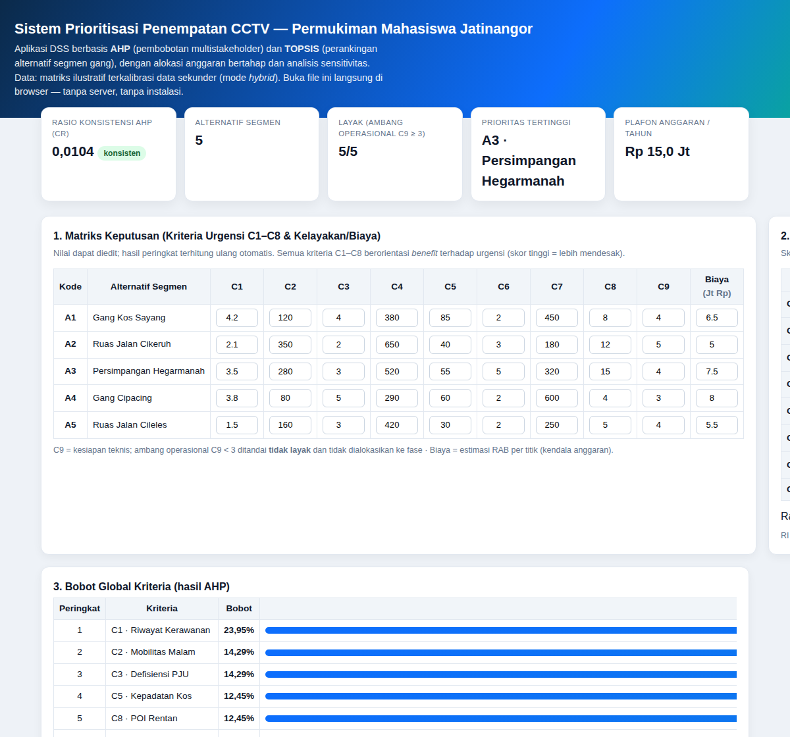
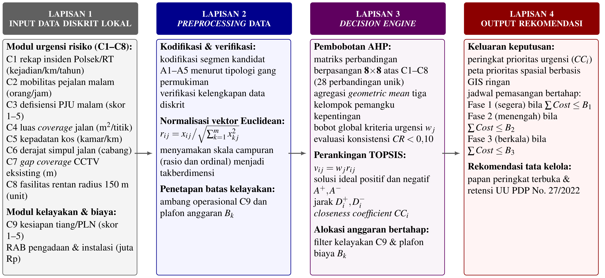
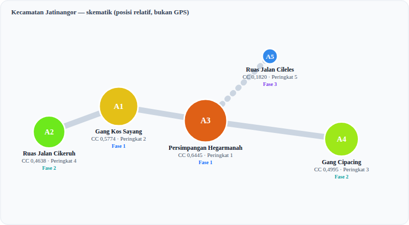

# Implementasi dan Pengujian Numerik Sistem Pendukung Keputusan AHP–TOPSIS untuk Prioritisasi Penempatan CCTV di Permukiman Mahasiswa Jatinangor

**Penulis:** Marvel Evan T.; Kezia Tabhita Smith; Ibnaty Farah Rabbany; Achmad Faruq M.; Gabriella Marie Keira Wibawa
**Afiliasi:** Program Studi Teknik Informatika, Fakultas MIPA, Universitas Padjadjaran, Sumedang, Indonesia

---

**Abstrak**—Penempatan kamera pengawas (CCTV) di permukiman mahasiswa Jatinangor masih sporadis akibat keterbatasan anggaran, sehingga dibutuhkan mekanisme prioritisasi yang terukur. Kajian sebelumnya menghasilkan model konseptual DSS berbasis Analytic Hierarchy Process (AHP) dan Technique for Order Preference by Similarity to Ideal Solution (TOPSIS), namun belum diwujudkan sebagai perangkat lunak. Makalah ini melaporkan implementasi model tersebut menjadi aplikasi web satu-berkas yang dapat dijalankan luring, serta pengujian numeriknya. Model memakai lima alternatif segmen gang (A1–A5), delapan kriteria urgensi risiko (C1–C8) yang dipisahkan dari kriteria kelayakan teknis dan biaya (C9 dan RAB), pembobotan AHP lintas tiga kelompok pemangku kepentingan, dan perankingan TOPSIS dengan alokasi anggaran bertahap di bawah plafon Rp 15 juta per tahun. Dataset disusun secara hybrid: angka riil level desa/kecamatan dari sumber sekunder publik (populasi desa, statistik kriminalitas, jumlah kamar kos, bukti defisiensi penerangan) dipakai sebagai kalibrasi, sedangkan sel per-segmen merupakan estimasi terdokumentasi. Hasil pengujian: matriks AHP konsisten dengan rasio konsistensi CR = 0,0104 (< 0,10); bobot terbesar pada riwayat kerawanan C1 (23,95%), diikuti defisiensi penerangan C3 (14,29%) dan mobilitas malam C2 (14,29%); peringkat TOPSIS A3 (0,6445) > A1 (0,5774) > A4 (0,4995) > A2 (0,4638) > A5 (0,1820); alokasi menghasilkan dua titik pada Fase 1 (Rp 14,0 juta), dua pada Fase 2 (Rp 13,0 juta), dan satu pada Fase 3. Analisis sensitivitas ±20% (16 run) memperlihatkan peringkat puncak A3 dan A1 stabil pada seluruh skenario, dengan pembalikan peringkat hanya antara A4 dan A2 pada 2 dari 16 skenario. Aplikasi mereproduksi angka model secara persis dan menyediakan verifikasi perhitungan yang dapat diaudit.

**Kata kunci**—Decision Support System, AHP, TOPSIS, penempatan CCTV, implementasi perangkat lunak, Jatinangor

**Abstract**—CCTV placement in Jatinangor student settlements remains sporadic due to budget constraints, creating a need for measurable prioritization. Previous work produced a conceptual DSS model based on the Analytic Hierarchy Process (AHP) and TOPSIS but did not implement it as software. This paper reports the implementation of that model as a single-file, offline web application, along with its numerical evaluation. The model employs five alley-segment alternatives (A1–A5), eight risk-urgency criteria (C1–C8) separated from technical feasibility and cost (C9 and budget estimation), AHP weighting across three stakeholder groups, and TOPSIS ranking with phased budget allocation under a budget ceiling of IDR 15 million per year. The dataset is hybrid: real village/district-level figures from public secondary sources (village population, crime statistics, number of boarding-house rooms, evidence of street-lighting deficiency) are used for calibration, while per-segment cells are documented estimates. Results show a consistent AHP matrix (consistency ratio CR = 0.0104 < 0.10); the dominant weight is crime history C1 (23.95%), followed by lighting deficiency C3 (14.29%) and nighttime mobility C2 (14.29%); the TOPSIS ranking is A3 (0.6445) > A1 (0.5774) > A4 (0.4995) > A2 (0.4638) > A5 (0.1820); allocation yields two points in Phase 1 (IDR 14.0 million), two in Phase 2 (IDR 13.0 million), and one in Phase 3. A ±20% sensitivity analysis (16 runs) shows the top ranks A3 and A1 remain stable in all scenarios, with rank reversal only between A4 and A2 in 2 of 16 scenarios. The application reproduces the model figures exactly and provides auditable computations.

**Keywords**—Decision Support System, AHP, TOPSIS, CCTV placement, software implementation, Jatinangor

---

## I. PENDAHULUAN

Kecamatan Jatinangor, Kabupaten Sumedang, merupakan kawasan pendidikan tinggi yang padat: lebih dari 98.000 jiwa pada 12 desa menurut BPS Kabupaten Sumedang 2024 [1], sedangkan data E-Office Desa mencatat 91.469 jiwa [19]. Pertumbuhan indekos di sepanjang gang sempit belum diimbangi kapasitas pengawasan: penerangan jalan umum (PJU) tidak merata dan penempatan CCTV bersifat reaktif. Kondisi ini menempatkan keselamatan warga, khususnya mahasiswa, sebagai persoalan *Smart Living and Safety*.

Dari sudut kriminologi lingkungan, pengawasan ruang publik bertumpu pada Crime Prevention Through Environmental Design (CPTED) [2] dan Routine Activity Theory [3]: kehadiran pengawas yang cakap dan visibilitas lingkungan menurunkan peluang kejahatan. Kendala utamanya adalah anggaran publik, ketersediaan tiang, pasokan listrik, dan jaringan. Keputusan pemasangan yang sporadis berisiko menciptakan titik buta, investasi yang tidak efisien, dan pelanggaran privasi (UU PDP No. 27/2022). Karena itu diperlukan pendekatan kuantitatif yang transparan dan terukur.

Kajian scoping review sebelumnya [7]–[18], yang dipandu PRISMA-ScR [6], memetakan literatur DSS dan menghasilkan model konseptual: alternatif segmen gang, struktur kriteria keselamatan, pembobotan AHP multistakeholder, dan perankingan TOPSIS dengan alokasi anggaran bertahap. Namun model tersebut berhenti pada tahap konseptual dan baru diuji dengan perhitungan manual/lembar kerja. Celah yang diisi makalah ini adalah **mewujudkan model itu menjadi perangkat lunak yang dapat dijalankan** dan **menguji keterlaksanaan numeriknya secara terprogram dan dapat diaudit**.

Kontribusi makalah ini:
1. Implementasi model DSS AHP–TOPSIS menjadi aplikasi web satu-berkas (luring, tanpa dependensi) yang mencakup matriks keputusan, matriks perbandingan berpasangan AHP, perhitungan bobot dan rasio konsistensi, perankingan TOPSIS, alokasi anggaran bertahap, dan analisis sensitivitas.
2. Penyusunan dataset *hybrid* berbasis sumber sekunder publik (populasi desa, statistik kriminalitas, jumlah kamar kos, bukti defisiensi PJU) sebagai kalibrasi, dengan sel per-segmen berupa estimasi terdokumentasi.
3. Verifikasi bahwa aplikasi mereproduksi angka model secara persis, sehingga perhitungan dapat diaudit dan direproduksi pemangku kepentingan lokal.

## II. LANDASAN TEORI DAN KARYA TERKAIT

**A. AHP.** Analytic Hierarchy Process [4] menurunkan bobot kriteria dari perbandingan berpasangan pada skala Saaty 1–9. Bobot diperoleh dari eigenvektor utama matriks perbandingan, dan kualitas penilaian diperiksa melalui Consistency Ratio CR = CI/RI; matriks dinyatakan konsisten bila CR < 0,10.

**B. TOPSIS.** TOPSIS [5] memeringkat alternatif berdasarkan kedekatannya terhadap solusi ideal: normalisasi vektor, pembobotan dengan bobot kriteria, penentuan solusi ideal positif (A⁺) dan negatif (A⁻), lalu koefisien kedekatan relatif CCᵢ = Dᵢ⁻ / (Dᵢ⁺ + Dᵢ⁻).

**C. Karya terkait.** Tinjauan literatur terdahulu mengelompokkan arsitektur DSS keselamatan perkotaan menjadi lima pola: GIS-MCDM dan evaluasi skenario spasial, optimasi *coverage*, *expert-driven*, simulasi-DSS operasional, dan *policy-MCDA*; kombinasi AHP untuk pembobotan dan TOPSIS untuk perankingan merupakan pasangan yang paling langsung dapat diadopsi [12] serta diperkuat bukti komparasi [14]. Berbeda dari studi-studi tersebut yang berfokus pada kota metropolitan berinfrastruktur sensor kontinu, aplikasi ini menargetkan permukiman padat dengan data diskrit lokal dan anggaran terbatas. Tabel I dalam lampiran konseptual sebelumnya (lihat [7]–[18]) menjadi rujukan tunggal; makalah ini tidak mengulang sintesis literatur, melainkan berfokus pada implementasi dan pengujian.

## III. METODE DAN PERANCANGAN SISTEM

**A. Alternatif dan unit keputusan.** Unit keputusan bukan tingkat desa, melainkan segmen gang yang menjadi kandidat satu titik CCTV. Lima segmen representatif dirumuskan (Tabel I) berdasarkan tipologi kerawanan dan karakteristik spasial.

**Tabel I. Alternatif segmen (A1–A5)**

| Kode | Segmen | Desa | Karakteristik ringkas |
|---|---|---|---|
| A1 | Gang Kos Sayang | Sayang | Gang residensial padat indekos, minim PJU |
| A2 | Ruas Jalan Cikeruh | Cikeruh | Koridor aktif dekat kampus, relatif terang |
| A3 | Persimpangan Hegarmanah | Hegarmanah | Simpul multi-cabang, POI terkonsentrasi |
| A4 | Gang Cipacing | Cipacing | Gang panjang, defisiensi PJU berat |
| A5 | Ruas Jalan Cileles | Cileles | Ruas penghubung sekunder, mobilitas moderat |

**B. Kriteria.** Sembilan kriteria dibagi dua domain fungsi (Tabel II). Kriteria C1–C8 adalah kriteria urgensi yang seluruhnya berorientasi *benefit* terhadap urgensi (skor lebih tinggi = lebih mendesak) dan diproses langsung oleh TOPSIS. Kriteria C9 (kelayakan teknis) dan biaya (RAB) dipisahkan sebagai kendala alokasi. Implementasi menggunakan ambang kelayakan operasional C9 ≥ 3 dan plafon anggaran. Model konseptual menetapkan C9 sebagai kendala kelayakan berskala 1–5 tanpa menyebut angka ambang, sehingga nilai C9 ≥ 3 ditetapkan sebagai kebijakan implementasi yang terdokumentasi.

**Tabel II. Matriks kriteria C1–C9**

| Kode | Kriteria | Satuan | Domain | Arah |
|---|---|---|---|---|
| C1 | Riwayat kerawanan | insiden/km/th | Urgensi | benefit |
| C2 | Mobilitas malam | orang/jam | Urgensi | benefit |
| C3 | Defisiensi PJU | skor 1–5 | Urgensi | benefit |
| C4 | Efisiensi coverage | m²/titik | Urgensi | benefit |
| C5 | Kepadatan kos | kamar/km | Urgensi | benefit |
| C6 | Derajat simpul | cabang | Urgensi | benefit |
| C7 | Gap CCTV eksisting | meter | Urgensi | benefit |
| C8 | POI rentan | unit | Urgensi | benefit |
| C9 | Kesiapan tiang/listrik/jaringan | skor 1–5 | Kelayakan | filter operasional (≥ 3) |

**C. Dataset hybrid dan sumber.** Data publik tidak menyediakan nilai per-gang untuk kedelapan kriteria, sehingga dataset disusun hybrid. Angka riil dari sumber sekunder dipakai sebagai kalibrasi, antara lain: populasi desa (Cipacing 15.096; Hegarmanah 9.712; Sayang 8.474; Cikeruh 7.848; Cileles 6.331) [19]; statistik kriminalitas Kecamatan Jatinangor yang naik dari 11 (2022) ke 155 kasus (2023) dengan Jatinangor menjadi salah satu dari tiga wilayah prioritas [20] dan klaim penurunan pada 2024 [21]; jumlah kamar sewa di Desa Hegarmanah sebanyak 4.250 unit [24]; serta bukti defisiensi PJU di ruas Cileles–Narongtong [22] dan keluhan penerangan di Jatinangor [23]. Sel per-segmen yang tidak tersedia diberi label estimasi terdokumentasi. Matriks keputusan hasilnya disajikan pada Tabel III.

Selain itu, inventaris kamera pengawas publik di Jatinangor masih tipis. Pemerintah Kabupaten Sumedang baru memasang satu kamera *Electronic Traffic Law Enforcement* (ETLE) statis di Jl. Raya Jatinangor pada akhir 2025 [25], sementara seluruh 64 kamera *Area Traffic Control System* (ATCS) Dishub Kabupaten Sumedang berada di kawasan perkotaan Sumedang dan belum menjangkau Jatinangor [26]. Pada 2026 Pemda mulai menambah CCTV berbasis APBD di Jatinangor dan mengarahkannya ke pusat kendali [27]. Karena itu, inventaris kamera per-gang yang menjadi basis kriteria C7 belum tersedia publik dan tetap diisi estimasi.

**Tabel III. Matriks keputusan (data hybrid)**

| Alternatif | C1 | C2 | C3 | C4 | C5 | C6 | C7 | C8 | C9 | Biaya (Rp Jt) |
|---|---|---|---|---|---|---|---|---|---|---|
| A1 | 4,2 | 120 | 4 | 380 | 85 | 2 | 450 | 8 | 4 | 6,5 |
| A2 | 2,1 | 350 | 2 | 650 | 40 | 3 | 180 | 12 | 5 | 5,0 |
| A3 | 3,5 | 280 | 3 | 520 | 55 | 5 | 320 | 15 | 4 | 7,5 |
| A4 | 3,8 | 80 | 5 | 290 | 60 | 2 | 600 | 4 | 3 | 8,0 |
| A5 | 1,5 | 160 | 3 | 420 | 30 | 2 | 250 | 5 | 4 | 5,5 |

**D. Pembobotan AHP.** Bobot diturunkan dari matriks perbandingan berpasangan konsensus 8×8 (Tabel IV). Agregasi lintas pemangku kepentingan memakai rata-rata geometrik (Persamaan 1). Bobot lokal dinormalisasi sehingga Σwⱼ = 1; konsistensi diperiksa dengan CR (Persamaan 2) dan RI = 1,41 untuk n = 8.

$$a_{jk}=\left(\prod_{p=1}^{P} a_{jk}^{(p)}\right)^{1/P}\qquad(1)$$

$$CI=\frac{\lambda_{\max}-n}{n-1},\quad CR=\frac{CI}{RI}\qquad(2)$$

**Tabel IV. Matriks perbandingan berpasangan AHP (8×8)**

| | C1 | C2 | C3 | C4 | C5 | C6 | C7 | C8 |
|---|---|---|---|---|---|---|---|---|
| C1 | 1,00 | 2,00 | 2,00 | 3,00 | 2,00 | 4,00 | 2,00 | 2,00 |
| C2 | 0,50 | 1,00 | 1,00 | 2,00 | 1,00 | 3,00 | 2,00 | 1,00 |
| C3 | 0,50 | 1,00 | 1,00 | 2,00 | 1,00 | 3,00 | 2,00 | 1,00 |
| C4 | 0,33 | 0,50 | 0,50 | 1,00 | 0,50 | 2,00 | 1,00 | 0,50 |
| C5 | 0,50 | 1,00 | 1,00 | 2,00 | 1,00 | 2,00 | 1,00 | 1,00 |
| C6 | 0,25 | 0,33 | 0,33 | 0,50 | 0,50 | 1,00 | 0,50 | 0,50 |
| C7 | 0,50 | 0,50 | 0,50 | 1,00 | 1,00 | 2,00 | 1,00 | 1,00 |
| C8 | 0,50 | 1,00 | 1,00 | 2,00 | 1,00 | 2,00 | 1,00 | 1,00 |

**E. Perankingan TOPSIS dan alokasi anggaran.** Matriks keputusan urgensi X = [xᵢⱼ] (m = 5, n = 8) diproses: normalisasi vektor Euclidean (Persamaan 3), pembobotan (Persamaan 4), solusi ideal (Persamaan 5), jarak Euclidean (Persamaan 6), dan koefisien kedekatan (Persamaan 7). Alokasi bertahap mengelompokkan alternatif menurut CCᵢ ke fase tahunan selama subtotal biaya tidak melampaui plafon Bₖ (Persamaan 8).

$$r_{ij}=\frac{x_{ij}}{\sqrt{\sum_{k=1}^{m}x_{kj}^{2}}}\qquad(3)\qquad v_{ij}=w_j r_{ij}\qquad(4)$$

$$A^{+}=\{\max_i v_{ij}\},\quad A^{-}=\{\min_i v_{ij}\}\qquad(5)$$

$$D_i^{+}=\sqrt{\sum_{j=1}^{n}(v_{ij}-v_j^{+})^2},\quad D_i^{-}=\sqrt{\sum_{j=1}^{n}(v_{ij}-v_j^{-})^2}\qquad(6)$$

$$CC_i=\frac{D_i^{-}}{D_i^{+}+D_i^{-}},\quad 0\le CC_i\le1\qquad(7)$$

$$\sum_{i\in \mathrm{Fase}\ k} Cost_i\le B_k\qquad(8)$$

**F. Analisis sensitivitas.** Setiap bobot kriteria diubah ±20% secara One-At-A-Time (OAT); bobot lain direnormalisasi proporsional; TOPSIS dihitung ulang untuk memeriksa ketahanan peringkat.

## IV. IMPLEMENTASI SISTEM

**A. Arsitektur perangkat lunak.** Aplikasi diwujudkan sebagai satu berkas HTML mandiri (`index.html`) berisi antarmuka, logika AHP–TOPSIS, dan dataset. Tidak ada server maupun dependensi eksternal, sehingga dapat dijalankan langsung di peramban (luring); seluruh perhitungan berjalan di sisi klien. Arsitektur fungsionalnya mengikuti empat lapis model konseptual (Gambar 2): *input* (data diskrit kriteria), *preprocessing* (pembentukan matriks keputusan), *decision engine* (AHP + TOPSIS), dan *output* (peringkat + alokasi bertahap). Mesin dipisahkan dari data (*data-driven*): jumlah segmen alternatif dimuat dari dataset, sehingga kasus lima segmen resmi dan skenario perluasan 12 desa (simulasi) dapat dijalankan tanpa mengubah kode.

**B. Modul.** (1) Modul matriks keputusan C1–C8, C9, dan biaya (dapat diedit, memicu perhitungan ulang). (2) Modul AHP: matriks perbandingan 8×8 dengan pengisian segitiga atas dan resiprokal otomatis; perhitungan bobot via iterasi pangkat, λmax, CI, dan CR. (3) Modul TOPSIS: normalisasi, jarak solusi ideal, dan CCᵢ. (4) Modul alokasi fase anggaran. (5) Modul peta prioritas skematik (SVG) yang memetakan peringkat secara spasial. (6) Modul sensitivitas OAT 16 run. (7) Ekspor hasil ke CSV.

**C. Antarmuka.** Gambar 1 memperlihatkan antarmuka aplikasi. Panel ringkasan menampilkan CR, alternatif terprioritas, dan plafon anggaran; tabel data dan matriks AHP dapat diedit; hasil peringkat TOPSIS dan alokasi fase ditampilkan berurutan.

*Gambar 1. Antarmuka aplikasi: matriks keputusan, matriks AHP, bobot kriteria, hasil TOPSIS, alokasi fase, dan sensitivitas.*

*Gambar 2. Arsitektur konseptual empat lapisan DSS: input → preprocessing → decision engine → output.*

**D. Verifikasi.** Algoritma aplikasi diuji terhadap hasil naskah konseptual melalui skrip pengujian berbasis Node.js. Pengujian memastikan reproduksibilitas bobot, CR, peringkat, alokasi fase, dan jumlah pembalikan peringkat. Seluruh nilai cocok pada toleransi 5×10⁻⁴.

## V. HASIL DAN PEMBAHASAN

**A. Bobot AHP dan konsistensi.** Matriks pada Tabel IV menghasilkan λmax = 8,1031, CI = 0,0147, dan **CR = 0,0104 < 0,10**, sehingga penilaian berpasangan konsisten. Vektor bobot global disajikan pada Tabel V. Bobot terbesar pada **riwayat kerawanan C1 (23,95%)**, diikuti **defisiensi penerangan C3 (14,29%)** dan **mobilitas malam C2 (14,29%)**. Urutan ini sejalan dengan tujuan keselamatan: kerawanan historis dan lingkungan gelap merupakan pemicu langsung risiko, sedangkan aspek spasial (C4, C6) berbobot lebih kecil karena bersifat pelengkap.

**Tabel V. Bobot global AHP**

| Peringkat | Kriteria | Bobot |
|---|---|---|
| 1 | C1 · Riwayat kerawanan | 23,95% |
| 2 | C2 · Mobilitas malam | 14,29% |
| 3 | C3 · Defisiensi PJU | 14,29% |
| 4 | C5 · Kepadatan kos | 12,45% |
| 5 | C8 · POI rentan | 12,45% |
| 6 | C7 · Gap CCTV eksisting | 9,74% |
| 7 | C4 · Efisiensi coverage | 7,70% |
| 8 | C6 · Derajat simpul | 5,15% |

**B. Perankingan TOPSIS.** Tabel VI menyajikan Dᵢ⁺, Dᵢ⁻, dan CCᵢ. Urutan urgensi: **A3 (0,6445) > A1 (0,5774) > A4 (0,4995) > A2 (0,4638) > A5 (0,1820)**. Persimpangan Hegarmanah (A3) menempati peringkat pertama karena mengombinasikan derajat simpul tinggi (C6 = 5), POI rentan banyak (C8 = 15), dan mobilitas malam tinggi; Gang Kos Sayang (A1) unggul pada kerawanan dan kepadatan kos. Ruas Cileles (A5) menempati peringkat terakhir karena hampir seluruh kriteria bernilai rendah.

**Tabel VI. Hasil perankingan TOPSIS**

| Peringkat | Alternatif | Dᵢ⁺ | Dᵢ⁻ | CCᵢ |
|---|---|---|---|---|
| 1 | A3 · Persimpangan Hegarmanah | 0,0646 | 0,1171 | 0,6445 |
| 2 | A1 · Gang Kos Sayang | 0,0865 | 0,1182 | 0,5774 |
| 3 | A4 · Gang Cipacing | 0,1094 | 0,1092 | 0,4995 |
| 4 | A2 · Ruas Jalan Cikeruh | 0,1119 | 0,0968 | 0,4638 |
| 5 | A5 · Ruas Jalan Cileles | 0,1447 | 0,0322 | 0,1820 |

**C. Visualisasi prioritas spasial.** Gambar 3 menampilkan peta prioritas skematik: tiap segmen digambar sebagai titik yang posisinya relatif terhadap koridor jalan utama Jatinangor; warna dan ukuran titik mengikuti nilai CCᵢ (merah = paling urgen), sedangkan label bawah menampilkan peringkat dan fase anggaran. Visualisasi ini membantu pemangku kepentingan membaca urutan prioritas secara spasial sebelum mengambil keputusan alokasi.

*Gambar 3. Peta prioritas skematik: ukuran dan warna titik ∝ CCᵢ, label bawah = peringkat dan fase anggaran.*

**D. Alokasi anggaran bertahap.** Dengan plafon Rp 15,0 juta per tahun, alternatif diurutkan menurut CCᵢ lalu dikelompokkan (Tabel VII). Fase 1 berisi A3 + A1 (Rp 14,0 juta), Fase 2 berisi A4 + A2 (Rp 13,0 juta), dan Fase 3 berisi A5 (Rp 5,5 juta); setiap fase memenuhi plafon.

**Tabel VII. Alokasi anggaran bertahap**

| Fase | Alternatif | CCᵢ | Biaya (Rp Jt) | Subtotal |
|---|---|---|---|---|
| Fase 1 | A3, A1 | 0,6445; 0,5774 | 7,5; 6,5 | 14,0 (≤ 15,0) |
| Fase 2 | A4, A2 | 0,4995; 0,4638 | 8,0; 5,0 | 13,0 (≤ 15,0) |
| Fase 3 | A5 | 0,1820 | 5,5 | 5,5 |

**E. Analisis sensitivitas.** Tabel VIII menyajikan 16 run OAT (±20%). Peringkat puncak **A3 dan A1 stabil pada seluruh 16 skenario** (tidak ada pembalikan pada dua peringkat teratas). Pembalikan peringkat hanya terjadi antara **A4 dan A2** pada 2 dari 16 skenario, yaitu saat bobot C1 diturunkan −20% atau bobot C2 dinaikkan +20%. Selisih CCᵢ dasar keduanya relatif kecil (0,4995 vs 0,4638 ≈ 0,036), sehingga keduanya wajar ditempatkan pada satu paket Fase 2.

**Tabel VIII. Sensitivitas bobot ±20% (16 run)**

| Kriteria | Variasi | A1 | A2 | A3 | A4 | A5 | Susunan |
|---|---|---|---|---|---|---|---|
| C1 | +20% | 0,6157 | 0,4392 | 0,6570 | 0,5330 | 0,1660 | A3>A1>A4>A2>A5 |
| C1 | −20% | 0,5412 | 0,4849 | 0,6336 | 0,4699 | 0,1963 | A3>A1>A2>A4>A5 * |
| C2 | +20% | 0,5443 | 0,5010 | 0,6527 | 0,4695 | 0,1950 | A3>A1>A2>A4>A5 * |
| C2 | −20% | 0,6090 | 0,4270 | 0,6374 | 0,5276 | 0,1697 | A3>A1>A4>A2>A5 |
| C3 | +20% | 0,5805 | 0,4491 | 0,6280 | 0,5151 | 0,1914 | A3>A1>A4>A2>A5 |
| C3 | −20% | 0,5749 | 0,4760 | 0,6585 | 0,4867 | 0,1741 | A3>A1>A4>A2>A5 |
| C4 | +20% | 0,5745 | 0,4682 | 0,6445 | 0,4960 | 0,1847 | A3>A1>A4>A2>A5 |
| C4 | −20% | 0,5797 | 0,4602 | 0,6446 | 0,5024 | 0,1799 | A3>A1>A4>A2>A5 |
| C5 | +20% | 0,5898 | 0,4548 | 0,6354 | 0,5009 | 0,1769 | A3>A1>A4>A2>A5 |
| C5 | −20% | 0,5670 | 0,4710 | 0,6522 | 0,4984 | 0,1862 | A3>A1>A4>A2>A5 |
| C6 | +20% | 0,5735 | 0,4631 | 0,6466 | 0,4970 | 0,1812 | A3>A1>A4>A2>A5 |
| C6 | −20% | 0,5806 | 0,4643 | 0,6429 | 0,5016 | 0,1827 | A3>A1>A4>A2>A5 |
| C7 | +20% | 0,5790 | 0,4532 | 0,6327 | 0,5107 | 0,1815 | A3>A1>A4>A2>A5 |
| C7 | −20% | 0,5761 | 0,4725 | 0,6546 | 0,4903 | 0,1824 | A3>A1>A4>A2>A5 |
| C8 | +20% | 0,5667 | 0,4761 | 0,6605 | 0,4795 | 0,1774 | A3>A1>A4>A2>A5 |
| C8 | −20% | 0,5863 | 0,4535 | 0,6306 | 0,5170 | 0,1859 | A3>A1>A4>A2>A5 |

*Tanda * = terjadi pembalikan peringkat (rank reversal).*

**F. Verifikasi implementasi.** Skrip pengujian mengekstrak blok `<script>` dari `index.html` dan menjalankannya di Node `vm` dengan DOM stub, sehingga yang diuji adalah kode aplikasi yang sebenarnya, bukan salinan. Hasilnya, aplikasi mereproduksi angka naskah konseptual secara persis: CR = 0,0104; bobot C1 = 23,95%; dan CCᵢ A3 = 0,6445, A1 = 0,5774, A4 = 0,4995, A2 = 0,4638, A5 = 0,1820. Hasil ini menegaskan bahwa alur komputasi model dapat dijalankan secara runtut dan dapat direproduksi, sehingga kandidat penerapan di tingkat lokal menjadi lebih realistis.

**G. Keterbatasan.** Pertama, dataset bersifat hybrid: angka per-segmen merupakan estimasi terdokumentasi, sehingga hasil belum merupakan validasi empiris dan perlu digantikan data survei lapangan (geometri gang, counting mobilitas malam, survei PJU, pemetaan GPS CCTV, RAB). Kedua, matriks keputusan dan bobot AHP dalam makalah ini adalah penilaian konsensus ilustratif; bobot empiris harus diturunkan melalui kuesioner perbandingan berpasangan kepada pemangku kepentingan riil. Ketiga, hasil yang dilaporkan memakai lima segmen representatif; aplikasi menyediakan skenario perluasan 12 segmen (simulasi) untuk menunjukkan skalabilitas, tetapi perluasan ke data lapangan nyata belum diuji. Keempat, korelasi antarkriteria belum dimodelkan (peluang riset lanjutan dengan ANP). Kelima, koordinat titik pada peta aplikasi merupakan aproksimasi OpenStreetMap, bukan hasil survei GPS lapangan.

## VI. KESIMPULAN

Model DSS prioritisasi penempatan CCTV untuk permukiman mahasiswa Jatinangor telah berhasil diimplementasikan menjadi aplikasi web satu-berkas yang dapat dijalankan luring dan mereproduksi hasil numerik model secara persis. Pengujian menunjukkan matriks AHP konsisten (CR = 0,0104 < 0,10) dengan bobot dominan pada riwayat kerawanan (C1, 23,95%); peringkat TOPSIS menempatkan Persimpangan Hegarmanah (A3) dan Gang Kos Sayang (A1) sebagai dua prioritas teratas; dan alokasi anggaran bertahap menghasilkan jadwal pemasangan yang memenuhi plafon Rp 15 juta per tahun. Analisis sensitivitas ±20% menunjukkan peringkat puncak stabil pada seluruh 16 skenario. Ke depan, model perlu diisi dengan data survei lapangan dan bobot empiris pemangku kepentingan, serta diperluas ke lebih banyak segmen dan ditingkatkan menjadi dasbor pemetaan spasial interaktif dengan koordinat GPS sebenarnya (saat ini tersedia peta prioritas skematik).

## REFERENSI

[1] Badan Pusat Statistik Kabupaten Sumedang, *Kecamatan Jatinangor Dalam Angka 2024*. Sumedang, Indonesia: BPS Kabupaten Sumedang, 2024.

[2] T. D. Crowe, *Crime Prevention Through Environmental Design: Applications of Architectural Design and Space Management Concepts*, 2nd ed. Boston, MA, USA: Butterworth-Heinemann, 2000.

[3] L. E. Cohen and M. Felson, "Social change and crime rate trends: A routine activity approach," *Am. Sociol. Rev.*, vol. 44, no. 4, pp. 588–608, 1979.

[4] T. L. Saaty, *The Analytic Hierarchy Process: Planning, Priority Setting, Resource Allocation*. New York, NY, USA: McGraw-Hill, 1980.

[5] C.-L. Hwang and K. Yoon, *Multiple Attribute Decision Making: Methods and Applications*. Berlin, Germany: Springer-Verlag, 1981.

[6] A. C. Tricco et al., "PRISMA extension for scoping reviews (PRISMA-ScR): Checklist and explanation," *Ann. Intern. Med.*, vol. 169, no. 7, pp. 467–473, Oct. 2018, doi: 10.7326/M18-0850.

[7] L. Wang, Y. Zhang, T. Feng, and X. Qi, "Monitoring layout and optimisation method based on minimum weighted vertices of roads," *Appl. Sci.*, vol. 15, no. 21, Art. no. 11622, 2025, doi: 10.3390/app152111622.

[8] J. González-Villa et al., "Decision-support system for safety and security assessment and management in smart cities," *Multimedia Tools Appl.*, vol. 83, no. 22, pp. 61971–61994, 2024, doi: 10.1007/s11042-023-16020-6.

[9] B. Feizizadeh and D. Omarzadeh, "A GIS based spatiotemporal modelling approach for cycling risk mapping using crowd-sourced sensor data," *Ann. GIS*, vol. 31, no. 2, pp. 333–351, 2025, doi: 10.1080/19475683.2025.2453550.

[10] V. Ahmed, S. Saboor, N. Ahmad, and M. Ghaly, "A multi-attribute utility decision support tool for a smart campus: UAE as a case study," *Front. Built Environ.*, vol. 8, Art. no. 1044646, 2022, doi: 10.3389/fbuil.2022.1044646.

[11] J. Choi, J. Ok, and I. Yu, "Smart city technologies for apartment complexes in South Korea: Expert prioritization and expected utility evaluation," *J. Asian Archit. Build. Eng.*, early access, Dec. 2025, doi: 10.1080/13467581.2025.2605740.

[12] H. Kanj, Y. Kotb, M. Alakkoumi, and S. Kanj, "Dynamic decision making process for dangerous good transportation using a combination of TOPSIS and AHP methods with fuzzy sets," *IEEE Access*, vol. 12, pp. 40450–40479, 2024, doi: 10.1109/ACCESS.2024.3372852.

[13] I. Kabashkin, A. Kulmurzina, B. Nadimov, G. Tlepiyeva, Z. Sansyzbayeva, and T. Sultanov, "Synchronized multi-point UAV-based traffic monitoring for urban infrastructure decision support," *Drones*, vol. 9, no. 5, Art. no. 370, 2025, doi: 10.3390/drones9050370.

[14] O. Baddour, A. Bhogayata, and T. Vora, "Intelligent decision support for diplomatic quarter planning through multi-criteria analysis and urban intelligence," *J. Intell. Decis. Mak. Inf. Sci.*, vol. 3, no. 3S, pp. 1612–1629, 2026, doi: 10.59543/jidmis.v3.958.

[15] S. F. Almassawa, E. Rustiadi, A. Fauzi, and R. Sutriadi, "Policy on the implementation of smart mobility in South Tangerang City, Indonesia based on public transportation using the PROMETHEE method," *Plann. Malaysia*, vol. 22, no. 5, pp. 293–306, 2024, doi: 10.21837/pm.v22i34.1590.

[16] M. A. A. Shiddiqy, R. Novarizal, M. S. N. B. Abu Hassan, D. Kurniawansyah, and Alficandra, "An integrated smart defense architecture for the Nusantara capital city of Indonesia," *Int. J. Saf. Secur. Eng.*, vol. 15, no. 12, pp. 2561–2572, 2025, doi: 10.18280/ijsse.151213.

[17] X. Zheng, K. Wang, and M. Liu, "A Bayesian Network and DEMATEL-ISM approach for smart community flood risk assessment: A case study of Tangxia, China," *J. Cases Inf. Technol.*, vol. 27, no. 1, pp. 1–22, 2025, doi: 10.4018/JCIT.386165.

[18] E. Yuhang et al., "Sensor placement optimization for power grid condition monitoring based on a backup coverage model: A case study of Guangzhou," *Appl. Sci.*, vol. 15, no. 23, Art. no. 12570, 2025, doi: 10.3390/app152312570.

[19] Pemerintah Kabupaten Sumedang, "Dashboard Desa Cantik / SAKIP Desa — Kecamatan Jatinangor," E-Office Desa, Sumedang, Indonesia, 2020. [Online]. Available: https://e-officedesa.sumedangkab.go.id/dashboard_simpatik/kecamatan/37

[20] Kabar Sumedang, "Tiga wilayah di Sumedang dengan tingkat kejahatan tinggi," 31 Des. 2023. [Online]. Available: https://kabarsumedang.pikiran-rakyat.com/kabar-sumedang/pr-3247536881/tiga-wilayah-di-sumedang-dengan-tingkat-kejahatan-tinggi

[21] Harapan Rakyat, "Polres Sumedang klaim angka kriminalitas tahun 2024 turun signifikan," 31 Des. 2024. [Online]. Available: https://www.harapanrakyat.com/2024/12/polres-sumedang-klaim-angka-kriminalitas-tahun-2024-turun-signifikan/

[22] KAPOL.ID, "Jalan Narongtong-Cileles minim PJU, Herman Habibullah: Usulan didengar pemda, dipasang 10 titik," 12 Apr. 2021. [Online]. Available: https://kapol.id/jalan-narongtong-cileles-minim-pju-herman-habibullah-usulan-didengar-pemda-dipasang-10-titik/

[23] Sumedang Tandang, "Minimnya penerangan di Jatinangor dan dampaknya terhadap masyarakat," 18 Apr. 2023. [Online]. Available: https://sumedangtandang.com/warta/minimnya-penerangan-di-jatinangor-dan-dampaknya-terhadap-masyarakat

[24] Pemerintah Desa Hegarmanah, "Profil Desa Hegarmanah, Kecamatan Jatinangor," 2014. [Online]. Available: http://hegarmanah-jatinangor.blogspot.com/p/profil-desa.html

[25] Korlantas Polri, "ETLE Jatinangor deteksi ribuan pelanggaran setiap hari, Satlantas Polres Sumedang imbau masyarakat tertib," 5 Apr. 2026. [Online]. Available: https://korlantas.polri.go.id/2026-04-05-etle-jatinangor-deteksi-ribuan-pelanggaran-setiap-hari-satlantas-polres-sumedang-imbau-masyarakat-tertib/

[26] Dinas Perhubungan Kabupaten Sumedang, "ATCS Kabupaten Sumedang — lokasi CCTV," ATCS Sumedang. [Online]. Available: https://atcs.sumedangkab.go.id/lokasicctv

[27] K. Andriana, "Bupati Sumedang siapkan CCTV terintegrasi di Jatinangor, trotoar diusulkan dibangun kembali," *Tribun Jabar*, 7 Agu. 2026. [Online]. Available: https://jabar.tribunnews.com/advertorial/1180843/bupati-sumedang-siapkan-cctv-terintegrasi-di-jatinangor-trotoar-diusulkan-dibangun-kembali
