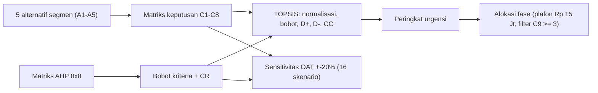

# Penjelasan Halaman Aplikasi dan Paper (Bahan Presentasi Progres)

Tujuan dokumen: bahan presentasi progres ke dosen. Posisi progres yang disampaikan: **tahap perancangan mockup 5 layar**, sebagai kelanjutan dari model proposal SCR yang sudah dikumpulkan. Dokumen pendamping: [`justifikasi-data.md`](justifikasi-data.md).

Sumber kebenaran model dan angka: `dss_revisi_markdown/dss_revisi.md` (lihat `AGENTS.md` §2.1).

---

## 1. Inti proyek dalam satu paragraf

Penempatan CCTV di permukiman mahasiswa Jatinangor masih sporadis karena anggaran terbatas. Kami merancang Sistem Pendukung Keputusan (SPK/DSS) yang menjawab: **segmen gang mana yang paling mendesak dipasangi CCTV, dan dalam urutan fase anggaran seperti apa?** Metodenya AHP (menentukan bobot kriteria) lalu TOPSIS (meranking alternatif), dilanjutkan alokasi anggaran bertahap dengan plafon per fase.

## 2. Alur perhitungan

| Tahap | Rumus / aturan | Hasil kanonik (naskah) |
|---|---|---|
| AHP | bobot = eigenvektor utama; CI = (λmax − n)/(n − 1); CR = CI/RI, RI(n=8) = 1,41 | λmax 8,1031; CI 0,0147; **CR 0,0104 (< 0,10)** |
| Bobot | normalisasi Σw = 1 | C1 23,95%; C2 = C3 14,29%; C5 = C8 12,45%; C7 9,74%; C4 7,70%; C6 5,15% |
| TOPSIS | normalisasi vektor, v = w·r, A⁺/A⁻, CC = D⁻/(D⁺+D⁻) | A3 0,6445 > A1 0,5774 > A4 0,4995 > A2 0,4638 > A5 0,1820 |
| Alokasi | urut CC, jumlah biaya per fase ≤ plafon; C9 ≥ 3 sebagai ambang kelayakan operasional | Fase 1 {A3, A1} Rp 14,0 Jt; Fase 2 {A4, A2} Rp 13,0 Jt; Fase 3 {A5} Rp 5,5 Jt |
| Sensitivitas | OAT: tiap bobot ±20%, sisanya direnormalisasi | 2 dari 16 skenario terjadi pembalikan (A4 dan A2); A3 dan A1 stabil |

Catatan: C9 (kesiapan tiang/listrik/jaringan) dan biaya (RAB) bukan kriteria TOPSIS, melainkan kendala alokasi. Ambang C9 ≥ 3 adalah kebijakan implementasi kami, bukan kutipan verbatim naskah.

## 3. Fungsi tiap halaman (5 layar mockup)

| No | Halaman | Fungsi | Pertanyaan yang dijawab |
|---|---|---|---|
| 1 | Dashboard | Ringkasan keputusan: 4 KPI (jumlah segmen, prioritas tertinggi, CR, anggaran Fase 1), peta prioritas, peringkat TOPSIS, kartu fase 1–3 | Apa kesimpulan akhirnya dalam sekali lihat? |
| 2 | Data Kriteria | Matriks keputusan 5 segmen × C1–C8, plus C9 dan biaya; form edit nilai; panel sumber data | Datanya apa, dari mana, dan bisa diubah? |
| 3 | Pembobotan AHP | Matriks perbandingan berpasangan (skala Saaty 1–9), indikator konsistensi (λmax, CI, RI, CR), bobot global | Kriteria mana yang paling penting, dan apakah penilaian konsisten? |
| 4 | Hasil TOPSIS dan Anggaran | Tabel D⁺, D⁻, CC; alokasi per fase terhadap plafon; parameter plafon dan ambang C9; ekspor CSV | Segmen mana dipasang di fase berapa, dengan biaya berapa? |
| 5 | Uji Sensitivitas | Pilih kriteria dan variasi bobot ±20%; penanda perubahan peringkat; tabel 16 skenario | Seberapa kokoh peringkat bila bobot berubah? |

Alur pengguna: Data Kriteria → Pembobotan AHP → Hasil TOPSIS dan Anggaran → Uji Sensitivitas, dengan Dashboard sebagai ringkasan.

## 4. Isi paper

Judul: *Implementasi dan Pengujian Numerik Sistem Pendukung Keputusan AHP–TOPSIS untuk Prioritisasi Penempatan CCTV di Permukiman Mahasiswa Jatinangor* (`06-paper-hasil/draft-paper-hasil.md`, format IEEE).

| Bagian | Isi |
|---|---|
| I Pendahuluan | Masalah penempatan CCTV sporadis; kerangka CPTED dan Routine Activity Theory; celah: model proposal belum berwujud perangkat lunak |
| II Landasan teori | AHP, TOPSIS, karya terkait (pola GIS-MCDM, coverage, expert-driven) |
| III Metode | 5 alternatif (A1–A5), 9 kriteria, dataset hybrid, matriks AHP 8×8, rumus TOPSIS, alokasi, sensitivitas |
| IV Implementasi | Arsitektur 4 lapis (input, preprocessing, decision engine, output), modul, verifikasi |
| V Hasil | CR 0,0104; bobot; peringkat TOPSIS; alokasi fase; sensitivitas 16 skenario |
| VI Kesimpulan | A3 (Persimpangan Hegarmanah) dan A1 (Gang Kos Sayang) prioritas teratas; peringkat puncak stabil |

Lima alternatif: A1 Gang Kos Sayang, A2 Ruas Jalan Cikeruh, A3 Persimpangan Hegarmanah, A4 Gang Cipacing, A5 Ruas Jalan Cileles.

Keterbatasan yang dinyatakan di paper (sebut sendiri sebelum ditanya): data per-segmen adalah estimasi terdokumentasi, bobot AHP adalah konsensus ilustratif (belum dari kuesioner pemangku kepentingan), korelasi antarkriteria belum dimodelkan.

## 5. Skrip status progres untuk dosen

Pesan inti yang disarankan:

1. Proposal SCR sudah selesai dan dikumpulkan; model (AHP + TOPSIS + alokasi anggaran) sudah terkunci.
2. Pada tahap ini kami menyelesaikan **perancangan antarmuka (mockup) 5 layar** yang memetakan model ke alur kerja pengguna.
3. Model numerik sudah diperiksa secara terprogram terhadap angka naskah (CR 0,0104; A3 0,6445).
4. Data per-segmen masih estimasi karena data CCTV per gang tidak tersedia publik; rencana validasi lapangan ada di `justifikasi-data.md` §6.
5. Yang diminta dari dosen: masukan atas alur layar dan kecukupan kriteria, serta arahan untuk validasi data lapangan.

> Kejujuran: repositori ini sudah memuat aplikasi (`05-aplikasi/` dan `07-webapp/`), dan paper hasil membahas implementasi. Bila dosen bertanya, jangan menyangkal keberadaannya; jelaskan bahwa fokus presentasi kali ini adalah mockup dan alur layar.

## 6. Perkiraan pertanyaan dosen

| Pertanyaan | Jawaban singkat |
|---|---|
| Kenapa AHP dan TOPSIS? | AHP cocok untuk bobot dari penilaian pakar dengan uji konsistensi; TOPSIS meranking alternatif lewat kedekatan ke solusi ideal; kombinasi ini paling langsung diadopsi menurut telaah literatur proposal |
| Kenapa C9 dan biaya tidak masuk TOPSIS? | Keduanya kendala pelaksanaan, bukan tingkat urgensi; dipisah agar peringkat murni mencerminkan kerawanan |
| Apakah bobot dari responden nyata? | Belum; konsensus ilustratif. Rencana: kuesioner perbandingan berpasangan ke polisi, kampus, warga |
| Apakah data riil? | Sebagian saja; rinci di `justifikasi-data.md` |
| Kenapa hasil boleh dipercaya? | CR < 0,10, dan A3/A1 stabil pada 16 skenario sensitivitas; namun validitas empiris bergantung data lapangan |
