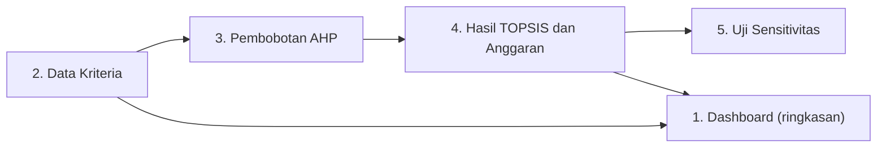

# Skrip Presentasi: Cara Kerja Website SiPrioCCTV (berdasarkan desain 5 layar)

Durasi target: sekitar 10 menit (ditambah tanya jawab). Posisi progres: **perancangan mockup 5 layar** yang diturunkan dari model proposal. Desain ada di Figma: https://www.figma.com/design/KAYBMTvny7wen9CZtxOJFO/Untitled?node-id=0-1

Semua angka di bawah berasal dari paper hasil (`06-paper-hasil/draft-paper-hasil.md`, preset `naskah_uts`) dan sama dengan yang tampil di mockup. Dokumen pendamping: [`penjelasan-halaman-dan-paper.md`](penjelasan-halaman-dan-paper.md), [`justifikasi-data.md`](justifikasi-data.md).

Cara memakai skrip: teks dalam tanda kutip adalah kalimat yang diucapkan. Baris "Tunjuk" adalah bagian layar yang disorot.

---

## 0. Pembuka (1 menit)

"Selamat pagi, Bu/Pak. Kami dari kelompok 5. Topik kami prioritisasi penempatan CCTV di permukiman mahasiswa Jatinangor. Masalahnya, CCTV dipasang secara sporadis karena anggaran terbatas, jadi kami butuh cara yang terukur untuk memutuskan lokasi mana yang dipasang lebih dulu."

"Di proposal kami sudah menetapkan modelnya: AHP untuk bobot kriteria, TOPSIS untuk meranking lokasi, lalu alokasi anggaran bertahap. Progres kami sekarang ada di tahap **perancangan antarmuka**. Hari ini saya jelaskan bagaimana website nanti bekerja, mengikuti lima layar rancangan kami."

Alur yang akan dijelaskan: data, bobot, hasil, uji ketahanan, lalu ringkasan di dashboard.

---

## 1. Layar Data Kriteria (2 menit)

Tunjuk: tabel matriks keputusan, lalu form edit di bawahnya.

"Layar pertama yang dipakai pengguna adalah Data Kriteria. Di sini ada **lima alternatif** yang kami sebut segmen: A1 Gang Kos Sayang, A2 Ruas Jalan Cikeruh, A3 Persimpangan Hegarmanah, A4 Gang Cipacing, dan A5 Ruas Jalan Cileles. Unit keputusannya bukan desa, tetapi segmen gang yang menjadi kandidat satu titik CCTV."

"Setiap segmen dinilai pada **delapan kriteria urgensi**, C1 sampai C8, misalnya riwayat kerawanan, mobilitas malam, defisiensi penerangan, kepadatan kos, dan gap CCTV eksisting. Semuanya bersifat benefit: makin tinggi nilainya, makin mendesak."

"Dua kolom terakhir, **C9 kesiapan tiang dan listrik** serta **biaya**, sengaja dipisah. Keduanya bukan soal seberapa mendesak, tetapi soal bisa tidaknya dipasang dan berapa dananya. Jadi keduanya dipakai sebagai kendala pada tahap alokasi, bukan di perankingan."

"Cara kerjanya: pengguna memilih satu segmen di form bawah, mengubah nilainya, dan website menghitung ulang seluruh hasil. Form ini dirancang menahan input yang salah, misalnya C9 dibatasi skala 1 sampai 5."

"Di panel kanan ada transparansi sumber data. Saya akan jelaskan kejujuran data ini di akhir."

Transisi: "Setelah datanya ada, kita perlu tahu kriteria mana yang paling penting. Itu tugas layar berikutnya."

---

## 2. Layar Pembobotan AHP (2 menit)

Tunjuk: matriks 8×8, empat kartu konsistensi, daftar bobot di kanan.

"Di sini pengguna mengisi **matriks perbandingan berpasangan** 8 kali 8 dengan skala Saaty 1 sampai 9. Misalnya, nilai 2 pada baris C1 kolom C2 berarti riwayat kerawanan dua kali lebih penting daripada mobilitas malam. Sel di bawah diagonal terisi otomatis sebagai kebalikannya."

"Dari matriks ini website menghitung bobot lewat eigenvektor utama. Hasilnya di kanan: **C1 riwayat kerawanan paling besar, 23,95 persen**, lalu C2 dan C3 masing-masing 14,29 persen, C5 dan C8 12,45 persen, C7 9,74 persen, C4 7,70 persen, dan C6 5,15 persen."

"Empat kartu di atas adalah **uji konsistensi**. Lambda maksimum 8,1031, CI 0,0147, RI 1,41 untuk delapan kriteria, sehingga **CR 0,0104**. Batas penerimaannya 0,10, jadi penilaian kami konsisten. Kalau pengguna mengubah matriks sampai tidak konsisten, kartu ini akan menandainya."

"Catatan jujur: matriks ini penilaian konsensus ilustratif dari naskah proposal. Bobot dari responden nyata, yaitu polisi, kampus, dan pengelola kos, adalah langkah berikutnya."

Transisi: "Dengan bobot dan data, kita bisa meranking lokasi."

---

## 3. Layar Hasil TOPSIS dan Anggaran (2 menit)

Tunjuk: tabel TOPSIS, kartu alokasi tiga fase, panel parameter di kanan.

"TOPSIS bekerja dengan membayangkan lokasi ideal terbaik dan terburuk. Untuk setiap segmen, website menghitung jarak ke ideal positif, D plus, dan ke ideal negatif, D minus, lalu **koefisien kedekatan CC** yaitu D minus dibagi jumlah keduanya. Makin dekat ke 1, makin prioritas."

"Hasilnya: **A3 Persimpangan Hegarmanah 0,6445**, A1 Gang Kos Sayang 0,5774, A4 Gang Cipacing 0,4995, A2 Ruas Jalan Cikeruh 0,4638, dan A5 Ruas Jalan Cileles 0,1820. Tabel menampilkan D plus dan D minus supaya perhitungannya bisa diaudit."

"Bagian bawah adalah **alokasi anggaran bertahap**. Dengan plafon Rp 15 juta per fase, website mengambil segmen berurutan dari peringkat tertinggi selama total biaya tidak melewati plafon. **Fase 1: A3 dan A1, Rp 14,0 juta. Fase 2: A4 dan A2, Rp 13,0 juta. Fase 3: A5, Rp 5,5 juta.**"

"Di panel kanan, pengguna dapat mengubah plafon dan ambang kesiapan C9. Aturannya: segmen dengan C9 di bawah ambang tidak dimasukkan ke Fase 1, dan biaya satu titik tidak boleh melebihi plafon. Ada tombol ekspor CSV untuk membawa hasilnya ke laporan."

Transisi: "Pertanyaan wajar berikutnya: apakah urutan ini kokoh kalau bobot berubah sedikit?"

---

## 4. Layar Uji Sensitivitas (1,5 menit)

Tunjuk: chip kriteria, tombol variasi, perbandingan peringkat, tabel 16 skenario.

"Di layar ini pengguna memilih satu kriteria lalu mengubah bobotnya turun atau naik 20 persen, sementara bobot lain disesuaikan proporsional. Website menghitung ulang TOPSIS dan menampilkan peringkat awal berdampingan dengan peringkat simulasi."

"Contoh di layar: C1 turun 20 persen, bobotnya dari 23,95 menjadi 19,16 persen. Hasilnya A3 dan A1 tetap peringkat satu dan dua, tetapi **A2 menyalip A4**, jadi muncul peringatan rank reversal."

"Tabel bawah merangkum **seluruh 16 skenario**, yaitu delapan kriteria kali dua arah. Temuannya: **A3 dan A1 stabil di 16 dari 16 skenario**, dan pembalikan hanya terjadi antara A4 dan A2 pada dua skenario, yaitu C1 turun 20 persen dan C2 naik 20 persen. Wajar, karena selisih CC keduanya kecil, sekitar 0,036, dan keduanya memang berada di fase yang sama."

"Artinya keputusan Fase 1 tahan terhadap ketidakpastian bobot."

---

## 5. Layar Dashboard sebagai ringkasan (1 menit)

Tunjuk: empat KPI, peta, daftar peringkat, kartu tiga fase.

"Dashboard adalah layar pertama saat website dibuka, dan merangkum semua tadi dalam satu halaman. Empat kartu atas menampilkan jumlah segmen, prioritas tertinggi, rasio konsistensi, dan anggaran Fase 1. Peta skematik menandai posisi tiap segmen dengan warna sesuai peringkat. Daftar di kanan menampilkan peringkat TOPSIS, dan tiga kartu bawah menampilkan alokasi per fase. Semua angka di sini otomatis mengikuti perubahan di layar-layar sebelumnya."

---

## 6. Kejujuran data dan penutup (1,5 menit)

"Satu hal yang ingin kami sampaikan terbuka. Kami sudah mencari data riil lebih dulu. Data riil ada di tingkat kecamatan dan desa, misalnya kejahatan di Jatinangor naik dari 11 kasus pada 2022 menjadi 155 kasus pada 2023, dan ada 4.250 kamar kos di Desa Hegarmanah. Tetapi data CCTV dan insiden **per gang** tidak tersedia publik."

"Karena itu nilai per segmen di tabel adalah **estimasi terdokumentasi**, dikalibrasi ke angka riil desa, dan diberi label. Hasil saat ini adalah validasi metode, bukan klaim lokasi terbaik di lapangan. Rencana kami: survei lapangan untuk mobilitas malam, kondisi PJU, titik CCTV, dan biaya, serta kuesioner AHP ke pemangku kepentingan."

"Yang kami harapkan dari Ibu/Bapak: masukan atas alur layar dan kecukupan kriteria, serta arahan untuk validasi data lapangan. Terima kasih."

---

## Ringkasan satu kalimat per layar (untuk catatan kecil)

| Layar | Satu kalimat |
|---|---|
| Data Kriteria | Pengguna memasukkan nilai 5 segmen pada 8 kriteria urgensi, plus C9 dan biaya sebagai kendala. |
| Pembobotan AHP | Matriks 8×8 diubah menjadi bobot, dan CR 0,0104 membuktikan penilaian konsisten. |
| Hasil TOPSIS dan Anggaran | Segmen diranking (A3 teratas) lalu dibagi ke tiga fase di bawah plafon Rp 15 juta. |
| Uji Sensitivitas | Bobot digeser 20 persen; A3 dan A1 stabil di 16 skenario. |
| Dashboard | Ringkasan semua hasil dalam satu halaman. |

## Antisipasi pertanyaan cepat

| Pertanyaan | Jawaban singkat |
|---|---|
| Kenapa C9 dan biaya tidak masuk TOPSIS? | Keduanya kendala pelaksanaan, bukan urgensi; dipisah agar peringkat murni kerawanan. |
| Apakah bobot dari responden nyata? | Belum; konsensus ilustratif. Kuesioner pemangku kepentingan adalah tahap berikutnya. |
| Apakah datanya riil? | Sebagian riil (kecamatan dan desa), nilai per segmen estimasi; lihat `justifikasi-data.md`. |
| Kenapa A4 dan A2 bisa berbalik? | Selisih CC dasarnya kecil (sekitar 0,036), dan keduanya satu paket di Fase 2. |
| Kalau plafon naik, apa yang berubah? | Lebih banyak segmen masuk fase awal; urutan peringkat tidak berubah, hanya pengelompokan fase. |

> Catatan kejujuran: repositori ini sudah memuat aplikasi (`05-aplikasi/`, `07-webapp/`). Bila ditanya apakah sudah ada implementasi, jawab apa adanya: fokus presentasi hari ini adalah rancangan layar dan alur kerja, dan implementasi mengikuti rancangan itu.
