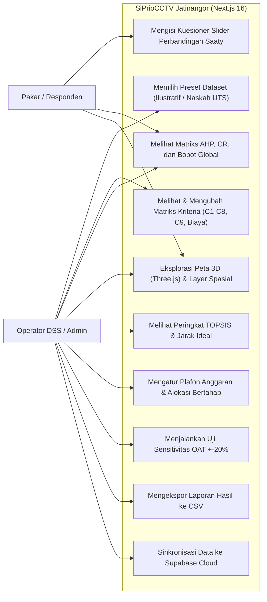
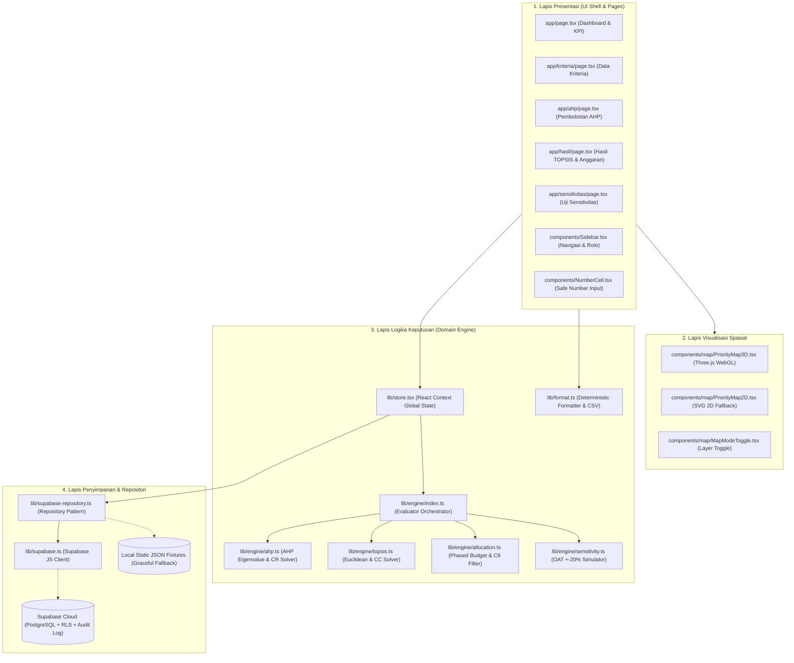
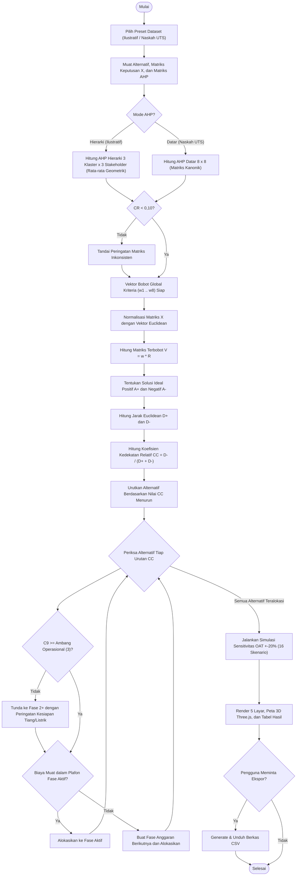
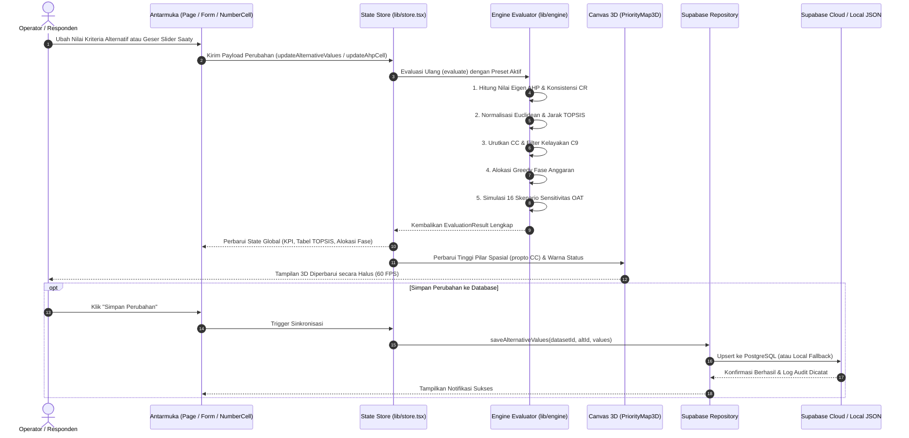

# Diagram UML — Sistem Pendukung Keputusan SiPrioCCTV Jatinangor

Dokumen ini memodelkan arsitektur, use case, alur aktivitas, dan interaksi komponen pada aplikasi **SiPrioCCTV Jatinangor** (berbasis **Next.js 16 + Three.js + Supabase** pada `07-webapp/` serta prototipe mandiri pada `05-aplikasi/`).

---

## 1. Aktor dan Use Case Diagram

Aplikasi memfasilitasi dua peran utama:
1. **Operator DSS / Administrator:** Mengelola matriks kriteria segmen, mengatur plafon anggaran dan ambang $C_9$, mengganti preset dataset, menganalisis sensitivitas bobot, dan mengekspor hasil ke CSV.
2. **Pakar / Responden:** Mengisi kuesioner perbandingan berpasangan Saaty (1–9) terpandu untuk menilai kepentingan relatif antar-kriteria atau antar-klaster urgensi.

---

## 2. Diagram Arsitektur & Komponen (4 Lapis)

Sistem dirancang dengan pemisahan tanggung jawab yang jelas (*Separation of Concerns*):

---

## 3. Activity Diagram — Alur Keputusan Lengkap

Diagram berikut memodelkan seluruh siklus pemrosesan keputusan dari inisialisasi dataset hingga rekomendasi alokasi anggaran dan pengujian sensitivitas:

---

## 4. Sequence Diagram — Interaksi Pengguna & Evaluasi Real-Time

Diagram sekuens ini menggambarkan interaksi dinamis ketika operator mengubah nilai kriteria alternatif atau preferensi AHP:

---

## 5. Ringkasan Keterlacakan Komponen UML ke Kode

| Komponen / Artefak UML | Berkas Sumber Implementasi | Skrip Pengujian Terkait |
|---|---|---|
| AHP Hierarki & Flat Engine | `07-webapp/lib/engine/ahp.ts` | `07-webapp/scripts/parity.mts` |
| TOPSIS Vector Normalization | `07-webapp/lib/engine/topsis.ts` | `07-webapp/scripts/parity.mts` |
| Alokasi Fase & Filter $C_9$ | `07-webapp/lib/engine/allocation.ts` | `07-webapp/scripts/parity.mts` |
| Uji Sensitivitas OAT $\pm 20\%$ | `07-webapp/lib/engine/sensitivity.ts` | `07-webapp/scripts/parity.mts` |
| Peta Spasial 3D WebGL | `07-webapp/components/map/PriorityMap3D.tsx` | `07-webapp/scripts/ui-check.mjs` |
| Fallback Peta 2D SVG | `07-webapp/components/map/PriorityMap2D.tsx` | `07-webapp/scripts/ui-check.mjs` |
| Proteksi Input Angka | `07-webapp/components/NumberCell.tsx` | `07-webapp/scripts/ui-bugs.mjs` |
| Ekspor CSV Deterministiik | `07-webapp/lib/format.ts` | `07-webapp/scripts/ui-export.mjs` |
| Skema Database & RLS | `07-webapp/supabase/migrations/20261116000000_init.sql` | `07-webapp/lib/supabase-repository.ts` |
| Audit Aksesibilitas WCAG AA | Seluruh halaman `07-webapp/app/` | `07-webapp/scripts/ui-a11y.mjs` |
