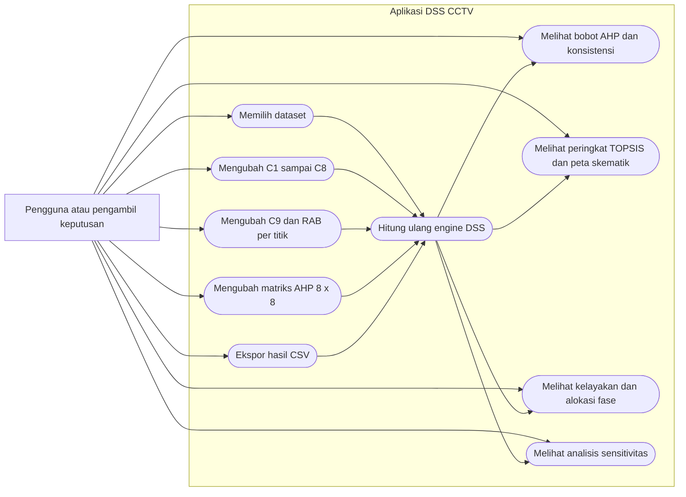
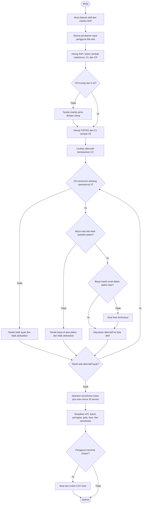
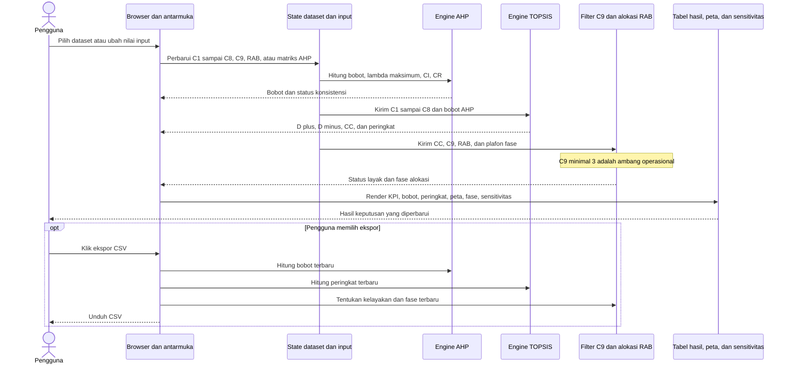

# Diagram UML — Aplikasi DSS Prioritisasi CCTV Jatinangor

## Tujuan dan batasan

Dokumen ini mendeskripsikan perilaku aplikasi web offline pada `05-aplikasi/index.html` untuk prioritisasi penempatan CCTV di permukiman mahasiswa Jatinangor. Diagram memodelkan **alur aplikasi dan keputusan**, bukan klaim bahwa nilai setiap segmen telah berasal dari survei lapangan.

- **C1–C8** adalah kriteria urgensi berorientasi *benefit* dan menjadi masukan pembobotan AHP serta perankingan TOPSIS.
- **C9** adalah kelayakan teknis, sedangkan **RAB/biaya per titik** adalah kendala anggaran. Keduanya tidak masuk perhitungan urgensi TOPSIS.
- Aplikasi menerapkan **C9 ≥ 3** sebagai ambang kelayakan **operasional** pada tahap alokasi fase. Ambang tersebut adalah kebijakan implementasi terdokumentasi, **bukan** aturan numerik yang dinyatakan eksplisit dalam naskah kanonik.
- Dataset resmi lima segmen memakai mode *hybrid*: sebagian data dikalibrasi dari sumber sekunder, sementara nilai per-gang yang belum tersedia tetap merupakan estimasi terdokumentasi. Dataset 12 desa adalah `[SIMULASI]` untuk demonstrasi skalabilitas.

## Aktor dan use case

Aktor utama adalah pengguna/pengambil keputusan yang membuka aplikasi lokal di browser. Pengguna dapat memilih dataset, mengubah nilai matriks, memeriksa hasil keputusan, lalu mengekspor hasil. Mesin DSS menjalankan AHP, TOPSIS, filter kelayakan, alokasi anggaran, serta sensitivitas secara otomatis.

> Mermaid belum menyediakan notasi *use case diagram* UML native. Diagram berikut memakai `flowchart` sebagai representasi use case yang setara dan dapat dirender Mermaid.

**Penjelasan singkat:** perubahan input tidak merender ulang tabel input, tetapi memicu pembaruan hasil agar fokus saat mengetik tetap terjaga. Ekspor CSV memakai hasil perhitungan terbaru, termasuk status kelayakan C9 dan fase jika alternatif memenuhi ambang operasional.

## Activity diagram perhitungan dan alokasi

Diagram berikut membedakan dua jalur keputusan. Jalur pertama menghasilkan urutan urgensi dari C1–C8 melalui AHP dan TOPSIS. Jalur kedua memakai C9 dan RAB setelah peringkat terbentuk untuk menentukan kelayakan teknis dan fase anggaran.

**Penjelasan singkat:** status CR tidak menghentikan aplikasi, tetapi memberi penanda bahwa penilaian AHP perlu ditinjau. TOPSIS tetap hanya memproses C1–C8. C9 dan biaya baru dipakai sesudahnya, sehingga alternatif yang sangat urgen tetap dapat terlihat pada peringkat namun tidak dimasukkan ke fase bila C9 berada di bawah ambang operasional atau biaya satu titik melebihi plafon.

## Sequence diagram pembaruan hasil

Sequence berikut menjelaskan pembaruan otomatis saat pengguna mengedit sel matriks atau memilih dataset. Perhitungan mengalir dari browser ke state data, engine AHP dan TOPSIS, kemudian ke filter kelayakan/alokasi dan komponen hasil.

## Trace sumber dan konsistensi

| Elemen diagram | Dasar penelusuran |
|---|---|
| Alternatif segmen, pemisahan C1–C8 dari C9 dan biaya, AHP lalu TOPSIS, serta alokasi bertahap | `dss_revisi_markdown/dss_revisi.md`, Seksi IV-B sampai IV-D. |
| Implementasi AHP datar 8×8, TOPSIS C1–C8, filter C9, plafon fase, sensitivitas, ekspor CSV, dan pembaruan hasil saat input berubah | `05-aplikasi/index.html`. |
| Penjelasan penggunaan aplikasi, dataset resmi dan simulasi, serta definisi ambang C9 sebagai kebijakan operasional | `05-aplikasi/README.md` dan `PROGRESS.md`, Sesi 8 (14 November 2026). |
| Status data riil, estimasi, dan simulasi per segmen | `08-docs/data-dan-sumber.md`, khususnya pemetaan status C1–C9 dan catatan C9. |

Dokumen ini tidak menetapkan nilai observasi baru. Validasi empiris tetap memerlukan survei per segmen untuk kesiapan tiang, listrik, jaringan, RAB, dan indikator urgensi yang saat ini masih berstatus estimasi atau simulasi.
