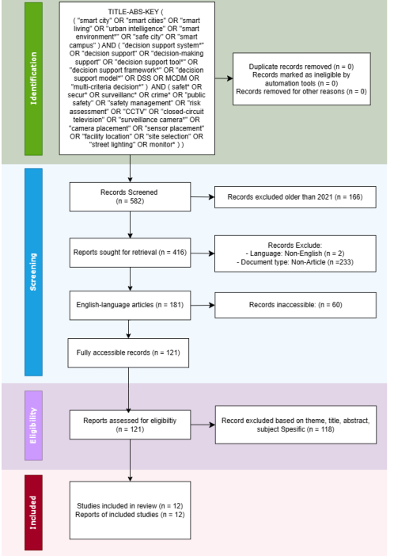
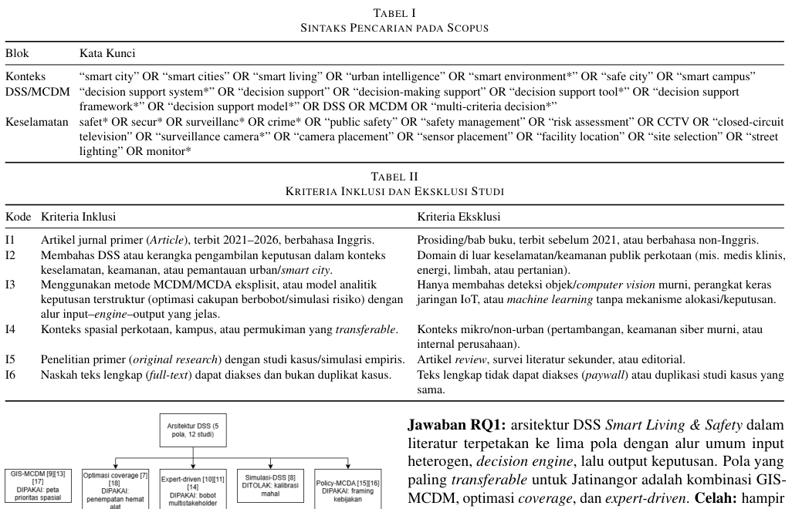
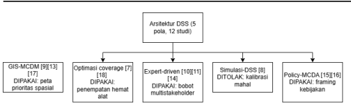
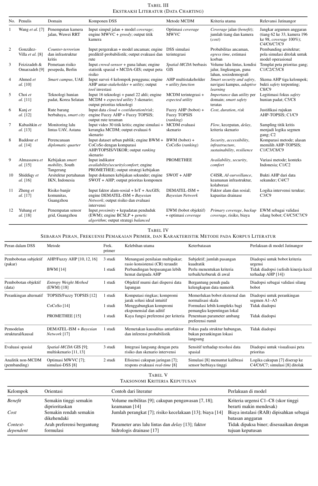
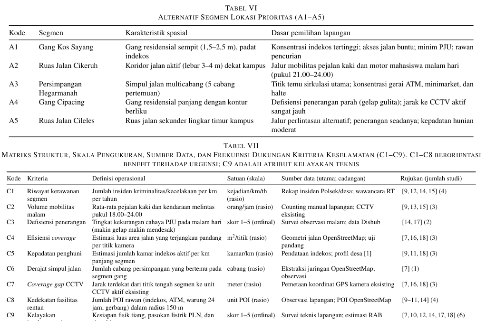
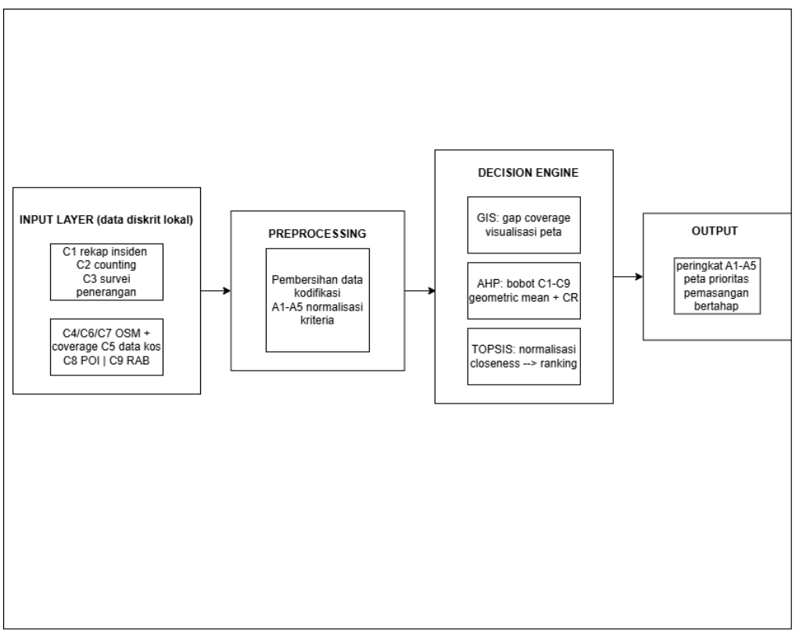

# Decision Support Systems for Urban Surveillance and Public Safety Facility Placement: A Scoping Review and Conceptual Framework for CCTV Prioritization in Jatinangor Student Settlements
**Penulis:** Marvel Evan T.; Kezia Tabhita Smith; Ibnaty Farah Rabbany; Achmad Faruq M.; Gabriella Marie Keira Wibawa  
**Afiliasi:** Program Studi Teknik Informatika, Universitas Padjadjaran, Sumedang, Indonesia  
**Sumber:** `dss revisi.pdf` (8 halaman)
> **Catatan konversi:** Teks mengikuti dokumen sumber. Tabel kompleks dan diagram dipertahankan sebagai gambar PNG agar susunan visual dan nilainya tidak berubah. Rumus PDF yang sulit dibaca pada hasil ekstraksi ditulis ulang dengan notasi LaTeX di bawah.

<!-- Halaman 1 -->

**Abstrak:** Permukiman mahasiswa di Jatinangor memiliki gang sempit, penerangan jalan terbatas, mobilitas malam hari yang tinggi, dan pemasangan CCTV yang masih sporadis akibat keterbatasan anggaran. Kondisi ini menuntut prioritisasi alokasi fasilitas pengawasan yang terukur. Penelitian ini memetakan literatur tentang Decision Support System (DSS) untuk pengawasan perkotaan dan penempatan fasilitas keselamatan publik melalui scoping review berbasis PRISMA-ScR pada basis data Scopus (TITLE-ABSKEY; 2021–2026; tipe artikel; bahasa Inggris). Seleksi menghasilkan 582 rekaman teridentifikasi, 416 laporan yang dicari, 121 laporan yang dinilai kelayakannya, dan 12 studi primer yang disertakan. Sintesis menunjukkan lima pola arsitektur DSS (GIS-MCDM, optimasi cakupan, berbasis pakar, simulasi-DSS, dan kebijakan-MCDA), dominasi kombinasi AHP untuk pembobotan dan TOPSIS untuk perankingan, serta taksonomi kriteria benefit, cost, dan bergantung konteks. Berdasarkan sintesis tersebut, dirumuskan model DSS konseptual untuk Jatinangor yang terdiri atas lima alternatif segmen gang (A1–A5), sembilan kriteria keselamatan (C1–C9), pembobotan AHP oleh tiga kelompok pemangku kepentingan, dan perankingan TOPSIS dengan alokasi CCTV bertahap di bawah batasan anggaran. Model diuji secara numerik dengan data ilustratif, belum dengan data lapangan. Delapan dari sembilan kriteria didukung oleh minimal dua studi primer, sehingga model memiliki landasan konseptual yang transparan untuk menerjemahkan bukti scoping review menjadi model keputusan lokal.

Kata Kunci: Decision Support System, Multi-Criteria Decision Making, Scoping Review, PRISMA-ScR, AHP, TOPSIS, penempatan CCTV, Smart Living and Safety, Jatinangor

## I. PENDAHULUAN

Kecamatan Jatinangor, Kabupaten Sumedang, merupakan kawasan pendidikan tinggi seluas 26,20 km2 yang mencakup 12 desa dengan penduduk lebih dari 98.000 jiwa dan kepadatan rata-rata di atas 3.740 jiwa/km2. Kepadatan tersebut melampaui 9.300 jiwa/km2 di kantong permukiman mahasiswa sekitar empat perguruan tinggi utama (Unpad, ITB, IPDN, dan IKOPIN) [1]. Pertumbuhan hunian padat ini belum diimbangi kapasitas pengawasan lingkungan: gang permukiman sempit (lebar 1,5–3 m), cakupan Penerangan Jalan Umum (PJU) belum merata, dan mobilitas malam hari antara kampus, indekos, dan simpul layanan tinggi. Akibatnya, keselamatan warga, terutama mahasiswa, menjadi persoalan nyata dalam konteks Smart Living and Safety di Jatinangor. Dari sudut pandang kriminologi lingkungan, pengawasan ruang publik bertumpu pada Crime Prevention Through Environmental Design (CPTED) [2] dan Routine Activity Theory [3]. Keduanya menyatakan bahwa kehadiran pengawas yang cakap (capable guardian) dan visibilitas lingkungan dapat mengurangi peluang bertemunya pelaku potensial dengan target yang rentan. Namun, penempatan Closed-Circuit Television (CCTV) di permukiman padat terkendala anggaran publik, ketersediaan tiang, pasokan listrik, dan jaringan internet. Pemasangan yang sporadis atau reaktif

berisiko menimbulkan titik buta (blind zone), investasi perangkat yang tidak efisien, dan pelanggaran privasi warga sebagaimana diatur dalam UU PDP No. 27/2022. Karena itu, alokasi fasilitas pengawasan memerlukan pendekatan kuantitatif yang terukur dan objektif. DSS berbasis Multi-Criteria Decision Making (MCDM) sesuai untuk mengevaluasi trade-off antara faktor keselamatan dan kelayakan fisik secara bersamaan. Analytic Hierarchy Process (AHP) lazim digunakan untuk menurunkan bobot kriteria dari penilaian berpasangan pakar [4], sedangkan Technique for Order Preference by Similarity to Ideal Solution (TOPSIS) memeringkat alternatif berdasarkan jaraknya terhadap solusi ideal [5]. Meski demikian, sebagian besar literatur penempatan fasilitas keamanan dan sensor perkotaan berfokus pada kota metropolitan dengan infrastruktur sensor kontinu dan anggaran besar. Terdapat kesenjangan penelitian (research gap) mengenai perancangan DSS yang realistis untuk permukiman padat berkendala anggaran dengan hanya memanfaatkan data diskrit lokal (data tabular, data spasial statis OpenStreetMap, dan penilaian pemangku kepentingan). Makalah ini mengisi celah tersebut melalui pendekatan hibrida: scoping review berbasis PRISMA-ScR untuk memetakan arsitektur dan metode dalam literatur, kemudian merancang model konseptual DSS penempatan CCTV di Jatinangor. Penelitian dipandu oleh tiga pertanyaan penelitian: 
- RQ1 (Pemetaan Arsitektur DSS): Bagaimana arsitektur DSS Smart Living & Safety dipetakan dari literatur (alur input data heterogen, engine MCDM/analitik, output keputusan), dan pola mana yang paling transferable terhadap keterbatasan data Jatinangor? 
- RQ2 (Sebaran Metode dan Taksonomi Kriteria MCDM): Metode MCDM apa yang digunakan dalam DSS Smart Living & Safety, bagaimana skema pembobotan dan perankingannya diterapkan, dan bagaimana kriteria keputusan diklasifikasikan menurut atribut benefit dan cost? 
- RQ3 (Formulasi Model Konseptual Jatinangor): Model konseptual DSS seperti apa yang paling layak untuk prioritisasi CCTV di permukiman mahasiswa Jatinangor, mencakup representasi segmen gang sebagai alternatif, struktur sembilan kriteria keselamatan, skema pembobotan AHP multistakeholder dan perankingan TOPSIS, serta elemen literatur yang sengaja tidak diadopsi beserta alasannya? Kontribusi kajian ini adalah sebagai berikut. 
- Kontribusi 1 (RQ1): pemetaan lima pola arsitektur DSS keselamatan perkotaan beserta kebutuhan datanya. Pola GIS-

<!-- Halaman 2 -->

MCDM, optimasi coverage, dan berbasis pakar dinilai paling transferable untuk Jatinangor, sedangkan pola simulasi-DSS ditolak karena kebutuhan kalibrasi sensor yang tidak realistis di tingkat lokal. 
- Kontribusi 2 (RQ2): taksonomi peran metode MCDM (pembobotan subjektif dan objektif, perankingan, struktural, dan evaluasi spasial) serta klasifikasi kriteria ke dalam atribut benefit, cost, dan context-dependent sebagai dasar konseptual model Jatinangor. 
- Kontribusi 3 (RQ3): model konseptual prioritisasi CCTV berupa alternatif segmen gang A1–A5, matriks kriteria C1–C9 yang memisahkan urgensi risiko dari kendala kelayakan dan biaya, skema AHP tiga kelompok pemangku kepentingan, perankingan TOPSIS dengan alokasi anggaran bertahap, serta uji numerik ilustratif atas konsistensi AHP dan sensitivitas ±20%.

## II. METODOLOGI REVIU (PROTOKOL SCR)

Kajian ini menggunakan pendekatan scoping review dengan alur seleksi Preferred Reporting Items for Systematic Reviews and Meta-Analyses Extension for Scoping Reviews (PRISMA-ScR) [6]. Protokol ditetapkan sebelum pencarian dan mencakup strategi pencarian, kriteria inklusi-eksklusi, tahapan seleksi, dan ekstraksi data.

### A. Strategi Pencarian Literatur

Pencarian dilakukan pada basis data Scopus dengan advanced search pada bidang TITLE-ABS-KEY. Kata kunci disusun dari tiga blok konsep yang dihubungkan operator AND, sedangkan sinonim dalam tiap blok dihubungkan operator OR (Tabel I), sehingga setiap rekaman memuat minimal satu istilah dari masing-masing blok. Protokol menetapkan dokumen bertipe Article, berbahasa Inggris, terbit 2021–2026, dengan teks lengkap yang dapat diakses; penerapan batasan ini dilaporkan pada Seksi II-C. Pencarian dijalankan pada 28 Maret 2026 dan menghasilkan 582 rekaman awal.

### B. Kriteria Inklusi dan Eksklusi

Enam kriteria inklusi dan eksklusi (I1–I6) dirumuskan sebelum penyaringan untuk meminimalkan bias seleksi. Kriteria tersebut mencakup tipe dokumen, topik, metode, konteks penerapan, jenis publikasi, dan ketersediaan teks lengkap (Tabel II). Menurut protokol, I1, I5, dan I6 diterapkan pada tahap screening, sedangkan I2, I3, dan I4 diverifikasi pada tahap full-text review. Kombinasi ini memastikan bahwa setiap studi yang disertakan membahas DSS atau kerangka keputusan terstruktur dengan metode MCDM eksplisit dalam konteks urban.

### C. Proses Seleksi Studi

 Seleksi mengikuti empat tahap standar PRISMA-ScR (Gambar 1). 1) Identifikasi: pencarian pada Scopus menghasilkan 582 rekaman awal tanpa rekaman duplikat otomatis. 2) Penyaringan metadata: batas tahun terbit 2021–2026 mengeksklusi 166 rekaman yang terbit sebelum 2021, sehingga tersisa 416 laporan yang dicari teks lengkapnya (reports sought for retrieval). 3) Pengambilan teks lengkap: 295 dari 416 laporan dieksklusi karena berbahasa non-Inggris (n = 2), bukan artikel jurnal primer (n = 233), atau teks lengkap tidak dapat

diunduh akibat batasan akses langganan institusi (n = 60). Dengan demikian, 121 laporan masuk penilaian kelayakan (reports assessed for eligibility). 4) Penilaian kelayakan substantif: 121 laporan ditelaah terhadap Tabel II dan 109 dieksklusi karena tidak memuat model keputusan/MCDM atau hanya computer vision/optimasi murni (n = 63), berada di luar domain keselamatan perkotaan atau permukiman (n = 28), berfokus pada indeks komparasi makro antarkota tanpa mekanisme alokasi fasilitas lokal (n = 10), berupa tinjauan pustaka sekunder (n = 5), atau berkonteks spesifik yang tidak dapat ditransfer ke lingkungan permukiman (n = 3). Proses ini menghasilkan 12 studi primer yang memenuhi seluruh kriteria protokol dan disertakan dalam sintesis (studies included).

### D. Ekstraksi dan Analisis Literatur

Studi yang disertakan di-chart ke dalam tabel ekstraksi dengan kolom penulis, domain permasalahan, komponen DSS, metode MCDM, kriteria utama, dan relevansi terhadap studi kasus Jatinangor. Hasil charting menjadi dasar analisis RQ1 (pemetaan arsitektur), RQ2 (sebaran metode dan taksonomi kriteria), dan penyusunan model konseptual RQ3. Sintesis dilakukan secara tematik, yaitu dengan mengelompokkan pola arsitektur, peran metode, dan orientasi kriteria.

<!-- Halaman 3 -->

### Tabel I dan Tabel II — Sintaks pencarian dan kriteria inklusi-eksklusi

Gambar 2. Taksonomi lima pola arsitektur DSS dan status adopsinya pada model Jatinangor.

## III. HASIL DAN PEMBAHASAN

### A. Analisis RQ1: Pemetaan Kerangka dan Arsitektur DSS

Hasil data charting terhadap 12 studi primer [7–18] dirangkum pada Tabel III, yang menjadi rujukan tunggal bagi seluruh analisis pada seksi ini. Komponen DSS dalam tabel tersebut dapat dipetakan ke tiga lapisan umum: lapisan input (data spasial, observasi, survei pakar, data historis, citra/sensor), decision engine (MCDM, machine learning, fuzzy logic, jaringan Bayesian, simulasi, optimasi), dan decision output (peta risiko, skor, perankingan, rute, prioritas intervensi). Keberagaman domain tidak diadopsi sebagai variabel fisik, melainkan diabstraksi menjadi pola arsitektur dan logika keputusan yang domain-agnostic. Berdasarkan kesamaan engine dan output, arsitektur DSS pada Tabel III dikelompokkan menjadi lima pola: (1) GIS-MCDM dan evaluasi skenario spasial [9, 13, 17], (2) optimasi coverage [7, 18], (3) expert-driven [10, 11, 14], (4) simulasi-DSS operasional [8], dan (5) policy-MCDA [15,16] (Gambar 2). Pola hybrid (kombinasi lebih dari satu engine) dominan dalam literatur, tetapi kebutuhan datanya berbeda jauh. Pola yang bergantung pada simulasi realtime, citra berbiaya, atau machine learning memerlukan data berdensitas tinggi, sedangkan GIS-MCDM, optimasi coverage, dan expert-driven dapat berjalan di atas data tabular, data spasial statis, dan penilaian pakar. Berdasarkan kriteria transferability, ketiga pola yang disebut terakhir menjadi baseline yang paling realistis bagi Jatinangor. Empat dari lima pola diadopsi, sedangkan simulasi-DSS operasional ditolak karena membutuhkan data kalibrasi berbiaya tinggi.

### B. Analisis RQ2: Sebaran Metode MCDM dan Taksonomi Kriteria

Metode MCDM dalam 12 studi dikelompokkan menurut perannya dalam alur keputusan (Tabel IV), yaitu pembobotan subjektif, pembobotan objektif, perankingan alternatif, dan pemodelan struktural/spasial, ditambah dua studi analitik nonMCDM sebagai pembanding. Frekuensi dihitung berdasarkan penggunaan sebagai engine utama pada tiap studi, sedangkan komparasi metode pada [14] dicatat terpisah. Sepuluh studi memakai kerangka berbasis MCDM/MCDA, dengan AHP/Fuzzy AHP sebagai metode pembobotan primer terbanyak (3 studi: [10,12,16]) dan Spatial-MCDA/multiskenario pada 3 studi [9,11,13]. Dua studi non-MCDM menggunakan optimasi coverage MWVC [7] dan simulasi operasional terintegrasi [8]. Kombinasi AHP dan TOPSIS digunakan bersama secara eksplisit pada [12] dan didukung uji komparasi empiris pada [14]. Kriteria keputusan dari seluruh studi disintesis menjadi tiga kelompok (Tabel V). Benefit dan cost merupakan sifat kriteria dalam suatu model keputusan, bukan sifat absolut dari nama variabel. Karena itu, klasifikasi dilakukan terhadap tujuan keputusan studi sumber, dan kriteria yang arah preferensinya tidak tercatat eksplisit pada charting dikelompokkan sebagai context-dependent. Seluruh arah kriteria pada model Jatinangor dirumuskan terhadap urgensi, yaitu skor yang lebih tinggi menandakan prioritas pemasangan yang lebih besar. Jawaban RQ2: metode dalam literatur terbagi atas empat

<!-- Halaman 4 -->

### Tabel III — Ekstraksi literatur (data charting)

### Tabel IV — Sebaran peran dan metode

### Tabel V — Taksonomi kriteria keputusan

<!-- Halaman 5 -->

peran, yaitu pembobotan subjektif (AHP, Fuzzy AHP, BWM), pembobotan objektif (EWM), perankingan (TOPSIS, CoCoSo, PROMETHEE), dan pemodelan struktural (DEMATEL-ISM, Bayesian). Pola AHP untuk bobot lalu TOPSIS untuk peringkat adalah yang paling langsung dapat diadopsi. Celah: (a) komparasi bobot objektif berbasis data dengan bobot subjektif berbasis pakar jarang dilakukan dalam satu studi, (b) SAW dan WP tidak ditemukan secara eksplisit pada korpus ini, dan (c) klasifikasi benefit/cost kerap dilakukan hanya dari nama variabel tanpa memeriksa arah preferensi.

### C. Sintesis RQ1 dan RQ2

Temuan RQ1 dan RQ2 diterjemahkan menjadi keputusan perancangan berikut. Untuk arsitektur, dipakai baseline GISMCDM, optimasi coverage, dan expert-driven karena pola hybrid dominan dalam literatur. Untuk input, data diskrit lokal sudah memadai karena literatur memakai data spasial, observasi, survei pakar, dan data historis. Untuk decision engine, MCDM dipilih karena transparan dibandingkan machine learning, fuzzy, simulasi, atau optimasi. Pembobotan menggunakan AHP tiga kelompok pemangku kepentingan karena banyak studi berbasis pakar (AHP, BWM), sedangkan perankingan menggunakan TOPSIS karena ringkas dan sejalan dengan pasangan AHP-TOPSIS pada [12]. Kriteria C1–C8 diorientasikan terhadap urgensi (benefit: cakupan, aktivitas, keamanan, kepadatan), biaya dan kelayakan diperlakukan sebagai kendala (cost: biaya, risiko, jumlah perangkat), dan kriteria context-dependent tidak dipaksa menjadi biner. Output berupa peta prioritas segmen gang dan urutan pemasangan bertahap, dan transferability model diuji pada tiga dimensi (Seksi IV-E). Dengan demikian, setiap elemen model Jatinangor memiliki dasar dari literatur yang dapat ditelusuri pada tabel-tabel di atas.

## IV. PERANCANGAN MODEL KONSEPTUAL DSS JATINANGOR (ANALISIS RQ3)

### A. Profil Lokasi dan Perumusan Alternatif

Profil umum kawasan telah diuraikan pada Seksi I. Puluhan ribu mahasiswa komuter dan penghuni indekos terkonsentrasi di koridor Desa Sayang, Cikeruh, Hegarmanah, Cipacing, dan Cileles [1], dengan kepadatan penduduk di desa-desa penyangga kampus mencapai 6.000 hingga lebih dari 9.300 jiwa/km2 [1]. Kepadatan ini memicu pertumbuhan ratusan bangunan indekos di sepanjang gang sempit berlebar 1,5– 3 m yang minim PJU dan pengawasan kamera. Karena tingkat kerawanan dan kapasitas tiang/jaringan berbeda tajam antargang, unit keputusan yang tepat bukan tingkat desa, melainkan segmen jalan atau gang yang menjadi kandidat penempatan satu titik CCTV. Lima alternatif segmen dirumuskan berdasarkan tipologi kerawanan dan karakteristik spasial di permukiman mahasiswa Jatinangor (Tabel VI). Pemilihan kelima segmen bersumber dari pengamatan lapangan terhadap lima tipologi spasial, sedangkan [7,9] dirujuk hanya sebagai landasan metodologis untuk memodelkan unit keputusan berbasis segmen graf jalan. Model diilustrasikan pada lima segmen representatif agar perhitungan matematisnya transparan. Secara konseptual, kerangka ini dapat diperluas ke puluhan hingga ratusan segmen tanpa mengubah struktur sembilan kriteria, tetapi perluasan tersebut belum diuji dalam kajian ini.

### B. Matriks Kriteria Keselamatan C1–C9

 Untuk memisahkan aspek urgensi dari aspek kelayakan fisik, kriteria dibagi menjadi dua domain fungsi. 1) Kriteria urgensi risiko (C1–C8): seluruhnya diformulasikan searah terhadap urgensi (benefit-oriented toward urgency). Skor yang lebih tinggi menandakan kebutuhan pengawasan yang lebih mendesak, dan kriteria ini diproses langsung dalam mesin perankingan TOPSIS. 2) Kriteria kelayakan teknis (C9) dan biaya finansial: C9 (kesiapan tiang, listrik, dan jaringan) bersama estimasi biaya (Rencana Anggaran Biaya/RAB) dipisahkan dari perankingan urgensi. Keduanya berfungsi sebagai kendala kelayakan dan batas anggaran (budget ceiling constraint) untuk membagi alternatif ke dalam fase pemasangan bertahap. Tabel VII merangkum definisi operasional, skala, sumber data, dan rujukan studi pendukung setiap kriteria. Delapan dari sembilan kriteria didukung oleh minimal dua studi primer: C9 didukung enam studi, C1 dan C8 masing-masing empat, C2, C4, C5, dan C7 masing-masing tiga, serta C3 dua studi. Hanya C6 (derajat simpul jalan) yang bersumber tunggal dari model vertex cover [7], dan hal ini dicatat apa adanya. Frekuensi kemunculan pada korpus lintas domain tidak otomatis mencerminkan urutan kepentingan di lapangan. Sebagai contoh, defisiensi penerangan (C3) hanya muncul pada dua studi [14, 17], tetapi penulis menilainya sebagai faktor krusial pemicu kerawanan di Jatinangor. Oleh karena itu, bobot kriteria sepenuhnya ditentukan melalui penilaian konsensus pemangku kepentingan dengan AHP. Pada uji numerik ilustratif (Seksi IV-C), C3 termasuk tiga bobot teratas bersama riwayat kerawanan (C1) dan mobilitas malam (C2).

### C. Skema Pembobotan AHP dan Perankingan TOPSIS

 Pembobotan AHP multistakeholder mengadopsi skema lintas kelompok pemangku kepentingan [10]. 1) Responden tiga kelompok: (a) pemerintah daerah (Kecamatan Jatinangor, Satpol PP, Dishub Sumedang), (b) pengelola kampus (Direktorat Keamanan/Sarana Prasarana PTN Jatinangor), dan (c) komunitas warga (Ketua RT/RW dan paguyuban pengusaha indekos). 2) Hierarki untuk mitigasi inkonsistensi: untuk menghindari kejenuhan responden akibat 28 perbandingan berpasangan pada matriks 8×8 (yang rawan menghasilkan CR > 0,10), kriteria urgensi dikelompokkan ke dalam tiga kluster: Risiko (C1, C3), Paparan Aktivitas (C2, C5, C8), dan Karakteristik Spasial (C4, C6, C7). Skema ini memangkas perbandingan berpasangan menjadi 10. 3) Agregasi preferensi: matriks tiap responden diuji konsistensinya terlebih dahulu, lalu penilaian antarkelompok diagregasi dengan rata-rata geometrik (Persamaan (1))

ajk = P ∏ p=1 a(p) jk 1/P , (1)

dengan P jumlah responden pemangku kepentingan. 4) Uji konsistensi rasio (Persamaan (2)):

CI = λmax −n

n−1 , CR = CI

RI , (2)

dengan λmax eigenvalue maksimum, n = 8 kriteria urgensi,

<!-- Halaman 6 -->

### Tabel VI — Alternatif segmen lokasi prioritas (A1–A5)

### Tabel VII — Matriks kriteria keselamatan (C1–C9)

dan nilai acak RI = 1,41 [4]. Matriks dinyatakan konsisten apabila CR < 0,10. Perankingan TOPSIS dan alokasi bertahap memproses matriks keputusan urgensi X = [xi j]m×n (m = 5 alternatif, n = 8 kriteria) melalui tahap berikut. 1) Normalisasi vektor Euclidean (Persamaan (3)) mengubah skala campuran (rasio dan ordinal) menjadi matriks takberdimensi R = [ri j]:

rij = xi j q

∑m k=1 x2 k j , i = 1,...,m; j = 1,...,n. (3)

2) Pembobotan matriks (Persamaan (4)) mengalikan kolom ternormalisasi dengan bobot AHP wj:

vij = w j ri j, n ∑ j=1 w j = 1. (4)

3) Solusi ideal (Persamaan (5)): karena seluruh kriteria C1– C8 diarahkan sebagai benefit terhadap urgensi,

A+ = {max i vi j | j = 1,...,n},

A−= {min i vi j | j = 1,...,n}. (5)

4) Jarak Euclidean (Persamaan (6)) tiap alternatif ke solusi ideal positif (D+ i ) dan negatif (D− i ):

s n ∑ j=1 (vij −v+ j )2, D− i =

s n ∑ j=1 (vi j −v− j )2. (6)

D+ i =

5) Koefisien kedekatan relatif (closeness coefficient, Persamaan (7)):

CCi = D− i D+ i +D− i , 0 ≤CCi ≤1. (7)

Alternatif dengan CCi mendekati 1 memiliki urgensi keselamatan tertinggi untuk dipasangi CCTV. 6) Alokasi bertahap di bawah kendala anggaran: urutan peringkat CCi dipadukan dengan kelayakan C9 dan estimasi biaya per titik Costi. Pemasangan dibagi ke dalam fase tahunan di bawah plafon anggaran belanja Bk (Persamaan (8)):

∑ i∈Fase k Costi ≤Bk. (8)

Rasio efisiensi biaya urgensi (CCi/Costi) dipakai sebagai instrumen pendukung jika terdapat alternatif dengan urgensi berdekatan tetapi selisih biaya implementasi yang tajam. 7) Uji sensitivitas ±20%: variasi bobot dilakukan secara One-At-A-Time (OAT) sebesar +20% dan −20% pada setiap kriteria dengan renormalisasi proporsional, untuk memeriksa ketahanan peringkat terhadap fluktuasi preferensi pakar. Uji numerik ilustratif (pilot dummy). Model di atas diuji secara numerik dengan dataset ilustratif untuk Jatinangor. Dataset ini bukan hasil survei lapangan, sehingga uji tersebut belum merupakan validasi empiris. Pembobotan AHP menghasilkan λmax = 8,1031, CI = 0,0147, dan CR = 0,0104 < 0,10, sehingga matriks konsisten pada data ilustratif.

<!-- Halaman 7 -->

Tiga bobot teratas adalah riwayat kerawanan C1 (23,95%), defisiensi penerangan C3 (14,29%), dan mobilitas malam C2 (14,29%). Perankingan TOPSIS menghasilkan urutan urgensi A3 (Persimpangan Hegarmanah, CC = 0,6445) > A1 (Gang Kos Sayang, 0,5774) > A4 (Gang Cipacing, 0,4995) > A2 (Ruas Jalan Cikeruh, 0,4638) > A5 (Ruas Jalan Cileles, 0,1820). Dengan simulasi plafon anggaran Rp15.000.000 per tahun dan estimasi biaya pemasangan Rp5–8 juta per titik, A3 dan A1 didanai penuh pada Fase 1 (segera) dengan total belanja Rp14,0 juta, A4 dan A2 dialokasikan pada Fase 2, dan A5 pada Fase 3. Pada uji sensitivitas ±20%, peringkat teratas (A3) tidak berubah dan tidak terjadi pembalikan peringkat (rank reversal) pada simulasi perturbasi bobot. Hasil ini menunjukkan bahwa alur model dapat dijalankan secara numerik.

### D. Arsitektur Konseptual dan Justifikasi Adopsi

 Arsitektur empat lapisan pada Gambar 3 mengadopsi pola GIS-MCDM dari [9, 13], logika optimasi coverage dari [7,18], dan skema expert-driven dari [10,14]. Setiap lapisan memiliki masukan dan keluaran yang jelas: lapisan input mengumpulkan data sembilan kriteria, lapisan preprocessing membentuk matriks keputusan, lapisan engine menghitung bobot dan peringkat, dan lapisan output menerjemahkan skor menjadi urutan pemasangan bertahap. Justifikasi adopsi dan penolakan elemen literatur dicatat secara eksplisit: 
- Ditolak: simulasi-DSS operasional ala [8], karena membutuhkan data kalibrasi berbiaya tinggi dan infrastruktur yang tidak tersedia di Jatinangor. 
- Ditolak: kombinasi BWM-CoCoSo ala [14], karena selisih kinerjanya terhadap AHP-TOPSIS kecil, sedangkan pakar tersedia untuk AHP dan prosesnya lebih mudah diaudit. 
- Ditunda: metrik response time dan egress ala [8], karena datanya tidak tersedia; hal ini dicatat sebagai keterbatasan dan arah riset lanjutan. 
- Catatan disiplin protokol: templat terkait AHP-GIS-FuzzyTOPSIS yang relevan tetapi terbit 2020 gugur oleh aturan tahun 2021–2026.

### E. Kelayakan Adopsi Model

 Kelayakan model ditinjau pada tiga dimensi. Pertama, kebutuhan data: seluruh input berupa data diskrit nonstreaming (rekap insiden, counting manual, survei, OSM, RAB), sehingga tidak bergantung pada jaringan sensor kontinu maupun langganan citra berbiaya. Kedua, kompleksitas metode: AHP dan TOPSIS transparan, dapat dihitung manual maupun dengan lembar kerja, dan tidak menuntut infrastruktur komputasi berat; CR dan analisis sensitivitas menyediakan uji kualitas yang jelas. Ketiga, keluaran: model menghasilkan peringkat, peta prioritas, dan urutan pemasangan yang dapat dipakai sebagai dasar pengalokasian anggaran bertahap. Berdasarkan tiga dimensi tersebut, model diperkirakan dapat dijalankan oleh pemangku kepentingan lokal dengan data yang tersedia, dengan catatan bahwa hal ini belum diuji pada data lapangan.

## V. KESIMPULAN DAN ROADMAP IMPLEMENTASI

Kajian ini memetakan 12 studi primer melalui protokol PRISMA-ScR dan mengidentifikasi lima pola arsitektur DSS keselamatan perkotaan, sebaran peran metode MCDM dengan pasangan AHP untuk pembobotan dan TOPSIS

untuk perankingan sebagai kombinasi yang paling langsung diadopsi, serta taksonomi kriteria benefit, cost, dan contextdependent. Dari sintesis tersebut dirancang model konseptual DSS prioritisasi CCTV untuk Jatinangor yang mencakup lima alternatif segmen (A1–A5), sembilan kriteria dengan pemisahan urgensi (C1–C8) dari kelayakan teknis dan biaya (C9 dan anggaran), pembobotan AHP tiga kelompok pemangku kepentingan dengan struktur hierarki, serta perankingan TOPSIS dengan alokasi anggaran bertahap. Uji numerik dengan data ilustratif menunjukkan bahwa alur model dapat dijalankan dan peringkat teratas bertahan pada uji sensitivitas ±20%. Model ini masih berstatus konseptual: penerapannya memerlukan data lapangan dan bobot empiris dari pemangku kepentingan. Roadmap menuju implementasi perangkat lunak meliputi empat langkah. 1) Pengumpulan data empiris lapangan: survei geometri gang A1–A5, penghitungan (counting) mobilitas pejalan dan pengendara malam hari, survei defisiensi PJU malam, pemetaan GPS kamera aktif, dan penyusunan RAB tiang/jaringan. 2) Penyusunan prototipe dasbor DSS: implementasi algoritma AHP-TOPSIS pada dasbor spasial ringan berbasis web GIS untuk memvisualisasikan zonasi prioritas dan rute pengawasan. 3) Kalibrasi bobot pemangku kepentingan: kuesioner perbandingan berpasangan kepada perwakilan Pemda Sumedang, pengelola keamanan kampus, dan paguyuban RT/indekos untuk memperoleh vektor bobot empiris konsensus. 4) Pengembangan lanjutan: integrasi kanal pelaporan insiden warga berbasis mobile, pembaruan data berkala, dan evaluasi dampak penurunan angka kriminalitas pascainstalasi. Keterbatasan kajian ini mencakup: (1) pencarian literatur dibatasi pada satu basis data (Scopus) untuk artikel berbahasa Inggris, dan 60 laporan tidak dapat diakses teks lengkapnya karena batasan langganan institusi; (2) penurunan beberapa kriteria keselamatan dan arsitektur penempatan sensor dilakukan melalui abstraksi analogi struktural dari domain terkait (rute transportasi bahan berbahaya [12], risiko banjir [17], dan sensor jaringan listrik [18]); (3) kriteria C6 (derajat simpul jalan) bersumber tunggal dari model vertex cover [7]; serta (4) nilai numerik matriks keputusan dan bobot AHP dalam naskah ini berasal dari simulasi pilot dummy yang dirancang sebagai cetak biru sebelum pengisian data survei lapangan secara komprehensif.

## References
[1] Badan Pusat Statistik Kabupaten Sumedang, Kecamatan Jatinangor Dalam Angka 2024. Sumedang, Indonesia: BPS Kabupaten Sumedang, 2024.

[2] T. D. Crowe, Crime Prevention Through Environmental Design: Applications of Architectural Design and Space Management Concepts, 2nd ed. Boston, MA, USA: Butterworth-Heinemann, 2000.

[3] L. E. Cohen and M. Felson, “Social change and crime rate trends: A routine activity approach,” Am. Sociol. Rev., vol. 44, no. 4, pp. 588–608, 1979.

[4] T. L. Saaty, The Analytic Hierarchy Process: Planning, Priority Setting, Resource Allocation. New York, NY, USA: McGraw-Hill, 1980.

<!-- Halaman 8 -->

[5] C.-L. Hwang and K. Yoon, Multiple Attribute Decision Making: Methods and Applications. Berlin, Germany: Springer-Verlag, 1981.

[6] A. C. Tricco et al., “PRISMA extension for scoping reviews (PRISMA-ScR): Checklist and explanation,” Ann. Intern. Med., vol. 169, no. 7, pp. 467–473, Oct. 2018, doi: 10.7326/M18-0850.

[7] L. Wang, Y. Zhang, T. Feng, and X. Qi, “Monitoring layout and optimisation method based on minimum weighted vertices of roads,” Appl. Sci., vol. 15, no. 21, Art. no. 11622, 2025, doi: 10.3390/app152111622.

[8] J. González-Villa et al., “Decision-support system for safety and security assessment and management in smart cities,” Multimedia Tools Appl., vol. 83, no. 22, pp. 61971–61994, 2024, doi: 10.1007/s11042023-16020-6.

[9] B. Feizizadeh and D. Omarzadeh, “A GIS based spatiotemporal modelling approach for cycling risk mapping using crowd-sourced sensor data,” Ann. GIS, vol. 31, no. 2, pp. 333–351, 2025, doi: 10.1080/19475683.2025.2453550.

[10] V. Ahmed, S. Saboor, N. Ahmad, and M. Ghaly, “A multi-attribute utility decision support tool for a smart campus: UAE as a case study,” Front. Built Environ., vol. 8, Art. no. 1044646, 2022, doi: 10.3389/fbuil.2022.1044646.

[11] J. Choi, J. Ok, and I. Yu, “Smart city technologies for apartment complexes in South Korea: Expert prioritization and expected utility evaluation,” J. Asian Archit. Build. Eng., early access, Dec. 2025, doi: 10.1080/13467581.2025.2605740.

[12] H. Kanj, Y. Kotb, M. Alakkoumi, and S. Kanj, “Dynamic decision making process for dangerous good transportation using a combination

of TOPSIS and AHP methods with fuzzy sets,” IEEE Access, vol. 12, pp. 40450–40479, 2024, doi: 10.1109/ACCESS.2024.3372852.

[13] I. Kabashkin, A. Kulmurzina, B. Nadimov, G. Tlepiyeva, Z. Sansyzbayeva, and T. Sultanov, “Synchronized multi-point UAV-based traffic monitoring for urban infrastructure decision support,” Drones, vol. 9, no. 5, Art. no. 370, 2025, doi: 10.3390/drones9050370.

[14] O. Baddour, A. Bhogayata, and T. Vora, “Intelligent decision support for diplomatic quarter planning through multi-criteria analysis and urban intelligence,” J. Intell. Decis. Mak. Inf. Sci., vol. 3, no. 3S, pp. 1612–1629, 2026, doi: 10.59543/jidmis.v3.958.

[15] S. F. Almassawa, E. Rustiadi, A. Fauzi, and R. Sutriadi, “Policy on the implementation of smart mobility in South Tangerang City, Indonesia based on public transportation using the PROMETHEE method,” Plann. Malaysia, vol. 22, no. 5, pp. 293–306, 2024, doi: 10.21837/pm.v22i34.1590.

[16] M. A. A. Shiddiqy, R. Novarizal, M. S. N. B. Abu Hassan, D. Kurniawansyah, and Alficandra, “An integrated smart defense architecture for the Nusantara capital city of Indonesia,” Int. J. Saf. Secur. Eng., vol. 15, no. 12, pp. 2561–2572, 2025, doi: 10.18280/ijsse.151213.

[17] X. Zheng, K. Wang, and M. Liu, “A Bayesian Network and DEMATELISM approach for smart community flood risk assessment: A case study of Tangxia, China,” J. Cases Inf. Technol., vol. 27, no. 1, pp. 1–22, 2025, doi: 10.4018/JCIT.386165.

[18] E. Yuhang et al., “Sensor placement optimization for power grid condition monitoring based on a backup coverage model: A case study of Guangzhou,” Appl. Sci., vol. 15, no. 23, Art. no. 12570, 2025, doi: 10.3390/app152312570.

## Rumus matematis (ditranskripsi untuk keterbacaan)

**Agregasi rata-rata geometrik AHP (1):**

$$\bar a_{jk}=\left(\prod_{p=1}^{P} a_{jk}^{(p)}\right)^{1/P}$$

**Indeks dan rasio konsistensi (2):**

$$CI=\frac{\lambda_{\max}-n}{n-1},\qquad CR=\frac{CI}{RI}$$

**Normalisasi TOPSIS (3):**

$$r_{ij}=\frac{x_{ij}}{\sqrt{\sum_{k=1}^{m}x_{kj}^{2}}}$$

**Pembobotan (4):**

$$v_{ij}=w_j r_{ij},\qquad \sum_{j=1}^{n}w_j=1$$

**Solusi ideal (5):**

$$A^+=\{\max_i v_{ij}\},\qquad A^-=\{\min_i v_{ij}\}$$

**Jarak solusi ideal (6):**

$$D_i^+=\sqrt{\sum_{j=1}^{n}(v_{ij}-v_j^+)^2},\qquad D_i^-=\sqrt{\sum_{j=1}^{n}(v_{ij}-v_j^-)^2}$$

**Koefisien kedekatan (7):**

$$CC_i=\frac{D_i^-}{D_i^+ + D_i^-},\qquad 0\le CC_i\le 1$$

**Batasan anggaran (8):**

$$\sum_{i\in\mathrm{Fase}\ k} Cost_i\le B_k$$
